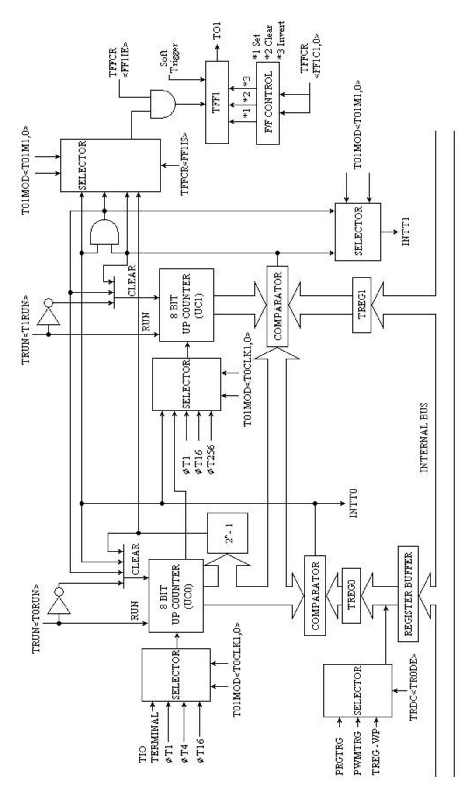
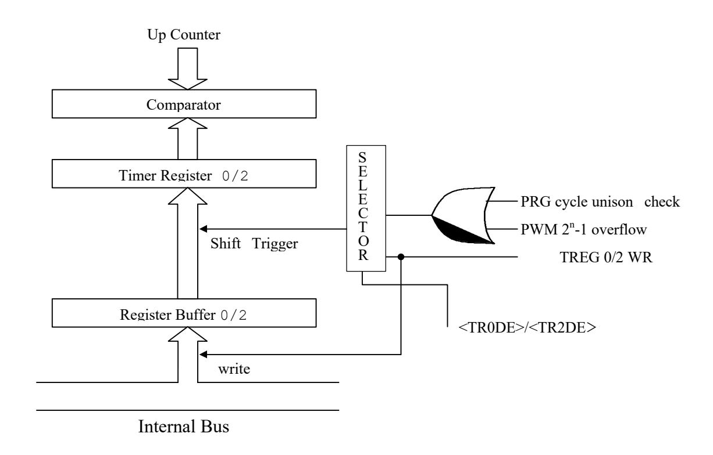
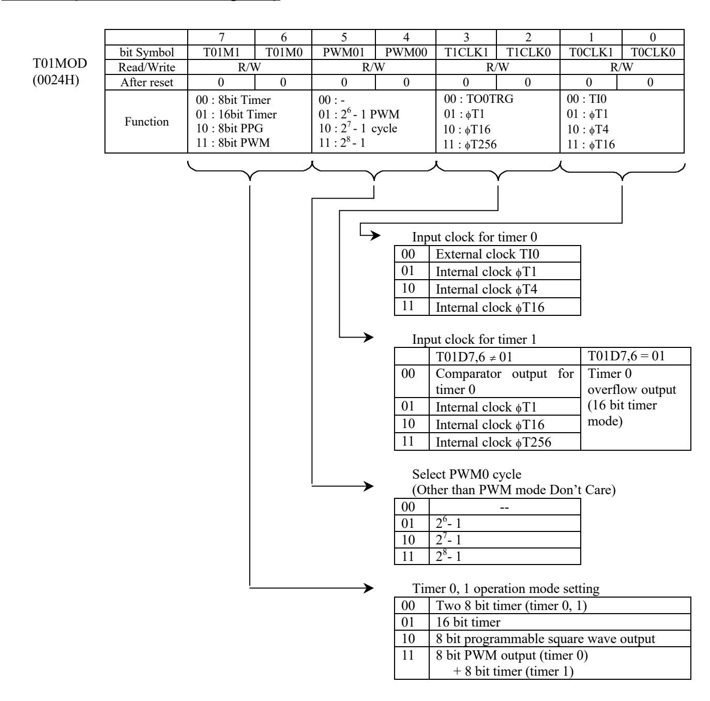
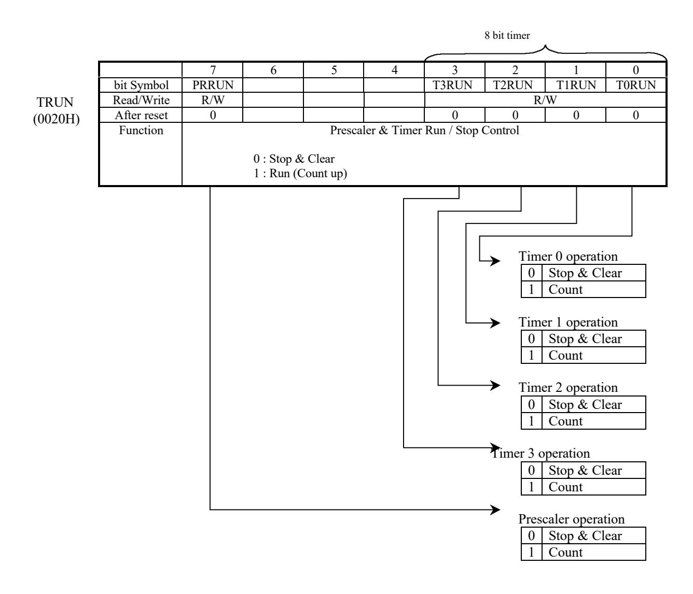

**SNK CORPORATION 1998.10.26 rel. 0.2**

# *TABLE OF CONTENTS*

| 8 BIT TIMER OUTLINE............................................................................................................ | 3  |
|---------------------------------------------------------------------------------------------------------------------------------|----|
| 1. PRESCALER................................................................................................................... | 7  |
| 2. UP COUNTER.................................................................................................................  | 8  |
| 3. TIMER REGISTER                                                                                                               | 8  |
| 4. COMPARATOR..............................................................................................................     | 10 |
| 5. TIMER FLIP FLOP (TIMER F/F)....................................................................................              | 10 |
| T23MOD (Timer 2, 3 Mode Register)..................................................................................             | 12 |
| TFFCFR (8 BIT TIMER FLIP FLOP CONTROL REGISTER...............................................                                   | 13 |
| TRUN (TIMER OPERATION CONTROL REGISTER)........................................................                                 | 14 |
| TRDC (TIMER REGISTER DOUBLE BUFFER CONTROL REGISTER)............................                                                | 15 |
| 8 BIT TIMER SAMPLE SETTING..........................................................................................            | 16 |
| H-int Setting                                                                                                                   | 16 |
| REVISION HISTORY                                                                                                                | 17 |

### *8 BIT TIMER OUTLINE*

The NEOGEO POCKET has four internal 8 bit timers (Timer 0, 1, 2 and 3).

The four 8 bit timers may be used separately, or two can be cascade connected to be used as two 16 bit timers. The 8 bit timer has four different modes which are listed below.

× 8 bit interval timer mode (4 total) may be combined as × 16 bit interval timer mode (2 total) (two 8 bit and one 16 bit) × 8 bit programmable (PRG: variable cycle and duty) square wave output mode (2 total) × 8 bit PWM (pulse wavelength modifier: fixed cycle variable duty) output mode (2 total)

Figure 1 shows a block diagram of 8 bit timers (timer 0 and 1).

 Timer 2 and 3 pair has circuitry similar to timer 0 and 1 pair. The only difference is that timer 0 has an external clock TI0 terminal. Timer 2 does not have an external clock. In the NEOGEO POCKET, the horizontal blanking interrupt generated by the 2D graphic controller is the external clock TIO.

 Each interval timer has an 8 bit up counter, an 8 bit comparator and an 8 bit timer register. Each pair of timers (0, 1 and 2, 3) has one timer flip flop (TFF1and TFF3 respectively).

Of the input clock source for each of the interval timers, the internal clock fT1, fT4, fT16 and fT256 is obtained from the 9 bit prescaler as shown in Figure 2.

 The operation mode and timer flip flop of the 8 bit timer is controlled by the five control register (T01MOD, T23MOD, TFFCR, TRUN and TRDC).

Figure 1. 8 Bit Timer Block Figure (Timer 0,1)

### *1. PRESCALER*

 The 9 bit prescaler takes a quarter of the CPU clock (fc/4, where fc = CPU clock) 1 and scales the signal to be used as input clocks into the 8 bit timer, baud generator, etc.

The 8 bit timer uses 4 input clocks: fT1, fT4, fT16 and fT256.

The prescaler can be put into count or stop mode with the use of the timer run control register TRUN <PRUN>. <PRRUN>=1 starts the count, <PRRUN>=0 zero clears and stops the prescaler.2 When the system resets, <PRRUN> is "0" cleared. In other words, the prescaler is cleared and stopped.

CPU clock (fc) given to the NEOGEO POCKET is fixed at 384 kHz.

Because the serial communication may affected negatively, stopping the prescaler is prohibited.

|   | Cycle fc            |
|---|---------------------|
|   | input clock 384 kHz |
| f | T1 (8/fc)           |
| f | T4 (32/fc)          |
| f | T16 (128/fc)        |
| f | T256 (2048/fc)      |
|   | 20.83 m s           |
|   | 83.33 m s           |
|   | 333.3 m s 5.333 ms  |

Figure 2 Prescaler

fc 0 1 2 3 4 5 6 7 8

9 bit prescaler

Generator

Circuit

1/4

1/2

f2 f1

fT0 fT1

fT2

fT4

fT8

fT16

fT32

fT256

TRUN<PRRUN>

run/stop & clear

CLK

/fc

fT1

fT4

Please refer to Figure 1 and Control Register for the following sections.

#### *2. UP COUNTER*

The up counter is an 8 bit binary counter which counts up with the input clock specified by the mode register T01MOD for timer 0, 1 and mode register T23MOD for timer 2, 3.

The parameter set in T01MOD register determines the input for timer 0 from internal clock fT1, fT4, fT16 or external clock TIO. The parameter set in T23MOD register determines the input for timer 2 from the internal clock fT1, fT4 or fT16.

 Input clock for timer 1 and timer 3 are determined by the operation mode. If the operation mode is set to 16 bit timer mode, the overflow output from timer 0 for timer 1 and overflow output from timer 2 for timer 3 becomes the input clock. If the operation mode is set to other than 16 bit timer mode, the values set in register T01MOD and T23MOD determines the input clock for timer 1 and 3 from the internal clock fT1, fT16, fT256 or output from the comparator (unison check).

Ex: If T01MOD<T01M1,0> = 01 (i.e. if T01M1 and T01M0 in T01MOD as shown in the control register table for T01MOD is set to 0 and 1), then the input clock for timer 1 is the overflow output from the timer 0 (16 bit timer operation mode). If T01MOD7,6 = 00 (i.e. T01MOD<T01M1,0> = 00; or T01M1 = 0 and T01M0 = 0) and T01MOD3,2 = 01 (i.e. T01MOD<T01CLK1,0> = 01; or T1CLK1 = 0 and T1CLK0 = 1); then the input clock for timer 1 is fT1 (8 bit timer).

 Operation mode is set in T01MOD register and T23MOD register. After system reset, the registers are initialized to T01MOD<T01M1,0> = 00 and T23MOD<T23M1,0> = 00, 8 bit timer mode.

 At each interval timer, it is possible to control the count/stop & clear of the up counter with the use of timer control register TRUN. After system reset, all up counters are cleared and the timers are stopped.

### *3. TIMER REGISTER*

This is the 8 bit register to set the interval time. When the values of timer registers TREG0, 1, 2, 3 match the value of the up counter, the comparator unison check becomes active. If the value is set to 00H, unison check becomes active when the up counter is in overflow status.

This timer register TREG0/TREG2 has a double buffer structure, and each is paired with the register buffer.

 <TR0DE,TR2DE> of the timer register double buffer control register TRDC sets the TREG0/TREG2 to be double buffer enabled or disabled. If <TR0DE>/<TR2DE> = 0, it is disabled; and if <TR0DE>/<TR2DE> = 1, it is enabled.

When double buffer is enabled, the data transfer from register buffer to timer register occurs when 2n -1 mode of PWM overflows or cycle unison of PPG mode is detected.

After reset, <TR0DE>/<TR2DE> = 0 and double buffer is disabled. If double buffer is to be used, write data to timer register, next set <TR0DE>/<TR2DE> = 1 and then write the next data to the register buffer.

Figure 3 Timer Register 0/2 Structure

NOTE: Timer register and register buffer has the same memory address block. When <TR0DE>/<TR2DE> = 0, same value is written into register buffer and timer register. When <TR0DE>/<TR2DE> = 1, value is written only into register buffer.

Memory address for each time register is shown below:

TREG0 : 000022H TREG1 : 000023H TREG2 : 000026H TREG3 : 000027H

 Each register is write only and cannot be read. Because it is not possible to initialize values of the registers that are not constants, please write in data before using 8 bit timers.

### *4. COMPARATOR*

The comparator compares the up counter value and timer register value. If it is in unison (the same), the up counter is 0 cleared and an interrupt (INTT0~3) is generated. Also, if timer flip flop reversal is enabled, the timer flip flop value is flipped.

#### *5. TIMER FLIP FLOP (TIMER F/F)*

At each interval timer, flip flop according to the unison (matching comparison) check signal (comparator output). The resulting values may be outputted to timer output terminal T01 and T03\*3 .

This timer F/F is called TFF1 and TFF3, each for the timer pair timer 0,1 and timer 2,3 respectively. TFF1 outputs to T01 terminal and TFF3 outputs to T03 terminal.

\*3 T03 is used as an interrupt to the Z80 CPU.

# *CONTROL REGISTERS*

### *T01MOD (Timer 0, 1 Mode Register)*

#### *T23MOD (Timer 2, 3 Mode Register)*

|             | 7                | 6 | 5 4                | 3           |  | 2      | 1          |  | 0      |
|-------------|------------------|---|--------------------|-------------|--|--------|------------|--|--------|
| bit Symbol  | T23M1 T23M0      |   | PWM21 PWM20        | T3CLK1      |  | T3CLK0 | T2CLK1     |  | T2CLK0 |
| Read/Write  | R/W              |   | R/W                | R/W         |  |        | R/W        |  |        |
| After reset | 0                | 0 | 0 0                | 0           |  | 0      | 0          |  | 0      |
| Function    | 00 : 8bit Timer  |   | 00 : -             | 00 : TO2TRG |  |        | 00 : -     |  |        |
|             | 01 : 16bit Timer |   | 01 : 2 6 - 1 PWM   |             |  |        |            |  |        |
|             |                  |   | 10 : 2 7 - 1 cycle |             |  |        |            |  |        |
|             |                  |   | 11 : 2 8 - 1       |             |  |        |            |  |        |
|             |                  |   |                    | 01 : f T1   |  |        |            |  |        |
|             |                  |   |                    | 10 : f T16  |  |        |            |  |        |
|             |                  |   |                    | 11 : f T256 |  |        |            |  |        |
|             | 10 : 8bit PPG    |   |                    |             |  |        | 01 : f T1  |  |        |
|             | 11 : 8bit PWM    |   |                    |             |  |        | 10 : f T4  |  |        |
|             |                  |   |                    |             |  |        | 11 : f T16 |  |        |

Input clock for timer 2 00 -- 01 Internal clock fT1 10 Internal clock fT4 11 Internal clock fT16

|    | Input clock for timer 3 |        |                                           |
|----|-------------------------|--------|-------------------------------------------|
|    | T23MOD7,6               | ¹ 01   | T23MOD7,6 = 01                            |
| 00 | Comparator for timer 2  | output | Overflow output for timer 2 (16 bit timer |
| 01 | Internal clock          | f      | T1 mode)                                  |
| 10 | Internal clock          | f      | T16                                       |
| 11 | Internal clock          | f      | T256                                      |

Select cycle for PWM2

(Other than PWM mode, Don't Care)

00 --

01 2 6 - 1

10 2 7 - 1

11 2 8 - 1

|    | Timer 2, 3 operation mode setting                  |
|----|----------------------------------------------------|
| 00 | Two 8 bit timer (timer 2, 3)                       |
| 01 | 16 bit timer                                       |
| 10 | 8 bit programmable square wave output              |
| 11 | 8 bit PWM output (timer 2) + 8 bit timer (timer 3) |

T23MOD (0028H)

#### *TFFCFR (8 BIT TIMER FLIP FLOP CONTROL REGISTER*

TFF3 TFF1

7 6 5 4 3 2 1 0

bit Symbol FF3C1 FF3C0 FF3IE FF3IS FF1C1 FF1C0 FF1IE FF1IS Read/Write W R/W W R/W After reset - 0 0 - 0 0

function 00 : Invert TFF3

01 : Set TFF3 10 : Clear TFF3 11 : Don't Care

1 : TFF3 Invert Enable 0 : flipped by 8 bit timer 2 1 : flipped by timer 3

00 : Invert TFF1 01 : Set TFF1 10 : Clear TFF1 11 : Don't Care

1 : TFF1 Invert Enable 0 : flipped by 8 bit timer 0 1 : flipped by timer 1

 Timer flip flop TFF1 flip signal selection (Not 8 bit timer, Don't Care)

0 Flip by timer 0 1 Flip by timer 1

Timer flip flop TFF1 flip

0 Disable 1 Enable

Timer flip flop TFF1 control

00 Flip the value of TFF3. (Software flip)

01 Sets TFF1 to"1". 10 Sets TFF1 to"0".

11 Don't Care (The value will always be

"11" when read)

 Timer flip flop TFF3 flip signal selection (Not 8 bit timer, Don't Care)

0 Flip by timer 2 1 Flip by timer 3

Timer flip flop TFF3 flip

0 Disable 1 Enable

Timer flip flop TFF3 control

00 Flip the value of TFF3. (Software flip)

01 Sets TFF3 to"1". 10 Sets TFF3 to"0".

11 Don't Care (The value will always be

"11" when read)

TFFCR (0025H)

### *TRUN (TIMER OPERATION CONTROL REGISTER)*

**NOTE: To avoid interruption to serial communication, it is PROHIBITED to stop the prescaler.**

### *TRDC (TIMER REGISTER DOUBLE BUFFER CONTROL REGISTER)*

|             | 7 | 6 | 5 | 4 | 3 | 2 | 1 0                                              |
|-------------|---|---|---|---|---|---|--------------------------------------------------|
| bit Symbol  |   |   |   |   |   |   | TR2DE TR0DE                                      |
| Read/Write  |   |   |   |   |   |   | R/W                                              |
| After reset |   |   |   |   |   |   | 0 0                                              |
| Function    |   |   |   |   |   |   | 0: Double Buffer Disable 1: Double Buffer Enable |

 Timer register 0 double buffer control

> 0 Disable 1 Enable

 Timer register 2 double buffer control

> 0 Disable 1 Enable

TRDC (0029H)

# *8 BIT TIMER SAMPLE SETTING*

#### *H-int Setting*

 The 8 bit timer must be utilized in order to use the H-int with the NEOGEO POCKET. An example is shown below. H-int is set by using timer 0 in 8 bit timer mode. The example below generates H-int every line. If it is to be generated every 4 lines, please set the interval time TREG0 to 0x04.

| andb | (                 | TRUN   | ),0y10001110 | ;stop count for timer 0                      |
|------|-------------------|--------|--------------|----------------------------------------------|
| ldb  | (                 | T01MOD | ),0x00       | ;timer 0,1 operation mode <8 bit timer mode> |
| ldb  | (                 | TREG0  | ),0x01       | ;interval tine is 0x01                       |
| ldb  | rw3,VECT_INTLVSET |        |              | ;system call used                            |
| ldb  | rb3,0x03          |        |              | ;(please refer to SYSTEM CALL REF. MAN.)     |
| ldb  | rc3,0x02          |        |              | ;                                            |
| swi  | 1                 |        |              | ;setting 8 bit timer 0 interrupt level       |
| orb  | (                 | TRUN   | ),0y00000001 | ;start count for timer 0                     |

# *REVISION HISTORY*