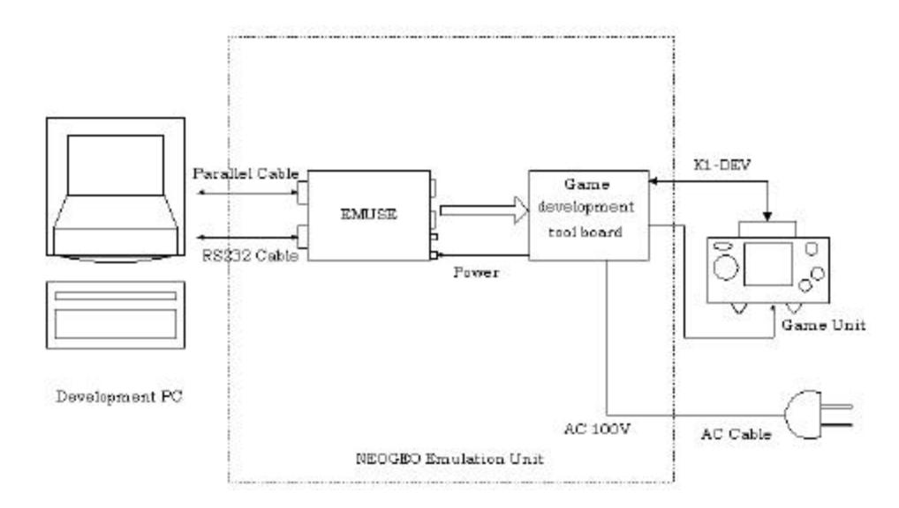
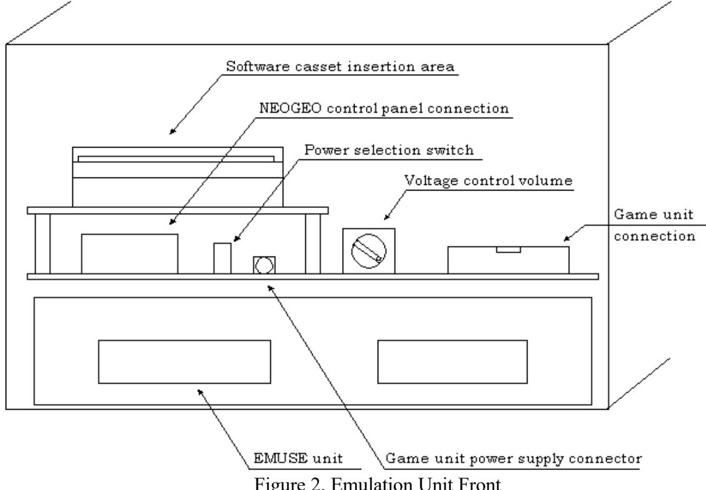
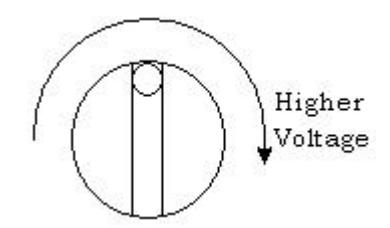
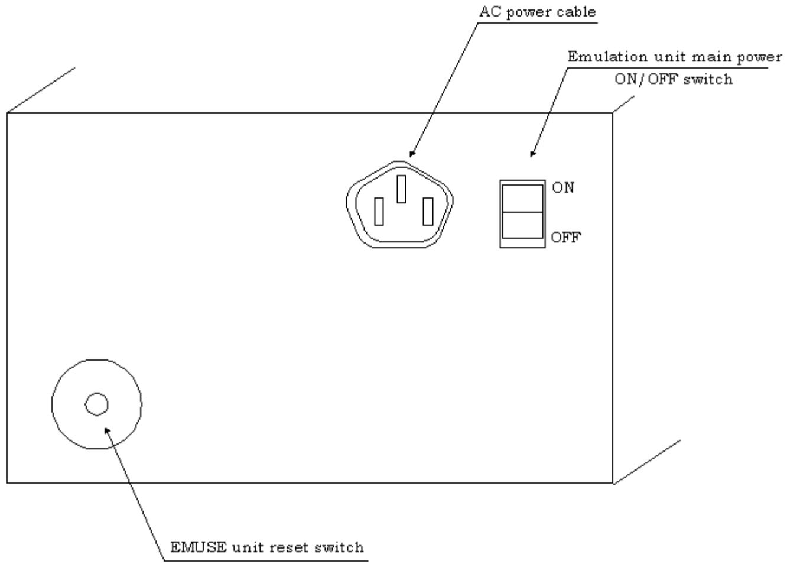
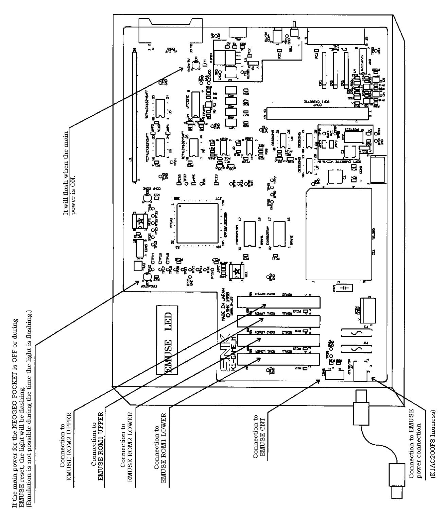
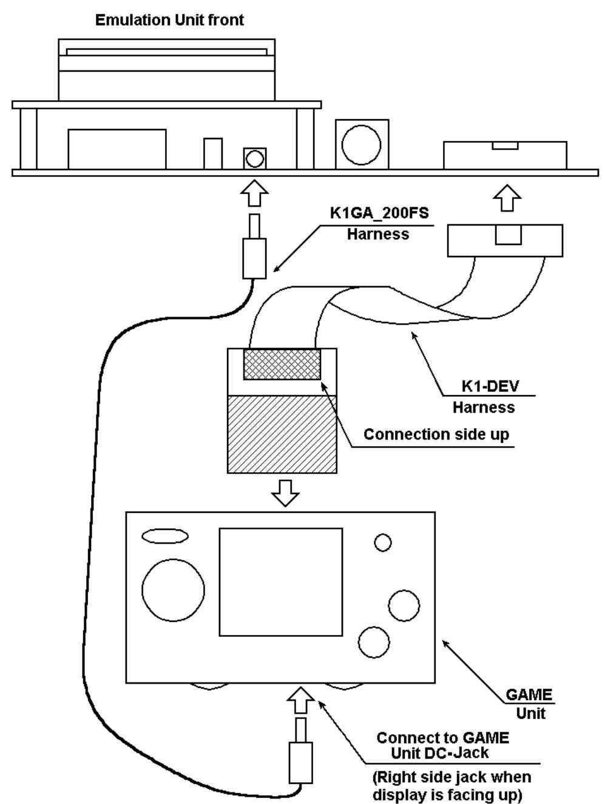
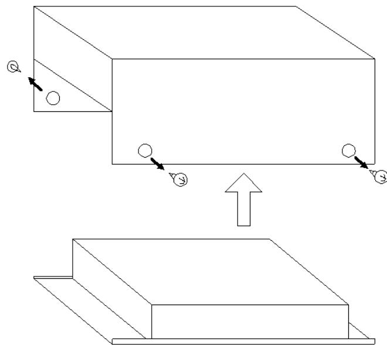
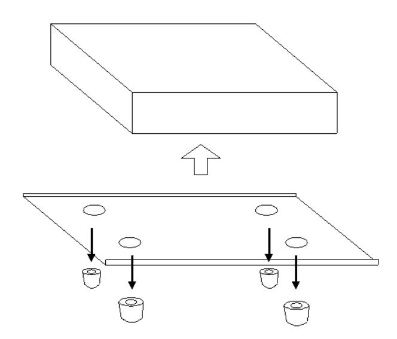

# **NEOGEO POCKET EMULATION UNIT(GAME DEVELOPMENT TOOL) REFERENCE MANUAL**

# REVISION HISTORY

# **TABLE CONTENTS**

# *1 OUTLINE*

The NEOGEO POCKET emulation unit has been created to develop application software for the NEOGEO POCKET. This manual covers the hardware for the emulation unit.

### *2 SYSTEM*

The NEOGEO POCKET emulation unit consists of EMUSE (ROM emulator), game development board (which interfaces EMUSE with the game unit), and the NEOGEO POCKET unit. Power for EMUSE and NEOGEO POCKET are supplied by the game development board. Thus there is no need to connect a power adapter to the EMUSE.

Figure 1. Emulation Unit System

Table 2-1 Emulation Unit Parts

| No. 1 | Part name Emulation Unit | count 1 | Comments Includes EMUSE.                                   |
|-------|--------------------------|---------|------------------------------------------------------------|
| 2     | AC Cable                 | 1       |                                                            |
| 3     | RS232C Cable             | 1       | Used for connection with the PC.                           |
| 4     | Parallel Cable           | 1       | Used for connection with the PC.                           |
| 5     | K1GA_200FS               | 1       | Power cable from emulation unit to the NEOGEO POCKET unit. |
| 6     | K1-DEV                   | 1       | Emulation unit and NEOGEO Pocket connection harness.       |

# *3 DEFINITIONS AND CONNECTIONS*

Figure 2. Emulation Unit Front

#### *3-1 EMULATION UNIT FRONT*

The power switch and the voltage control volume regulates the power to the NEOGEO POCKET unit. (It can be used to emulate the state of the battery used in the NEOGEO POCKET unit.)

Power selection switch…This switch allows selection between a constant 3V or a volume controlled voltage for the game system.

Switch up…Voltage controlled by volume control.

Switch down…Constant 3V.

Voltage control volume…The volume control regulates the voltage supplied to the NEOGEO POCKET. (When the Power selection switch is switched up.) Range: Approximately 1.7 ~ Approximately 3.3 V.

#### *3-2 EMULATION UNIT REAR*

#### Figure 3 Emulation Unit Rear

Turning the emulation power ON provides power for both the EMUSE unit and the NEOGEO POCKET unit.

(There is no need to use the AC adapter packaged in the EMUSE unit.)

#### *3-3 EMULATION UNIT TOP*

Figure 4 Emulation Unit Top

#### *3-4 CONNECTING WITH THE NEOGEO PCKET UNIT*

Figure 5 Connection Figure

\*The only connection remaining is with the EMUSE unit and the PC. Please refer to the EMUSE manual.

#### *3-5 EMUSE UNIT REMOVAL*

Please remove the 4 screws from the side, and disconnect the probe between the EMUSE unit and the GAME unit to remove the EMUSE unit. The game development tool can be lifted up as shown below.

Figure 6 Removal Part 1

Next, remove the 4 rubber legs and screws. This will allow removal of the EMUSE unit.

Figure 7 Removal Part 2