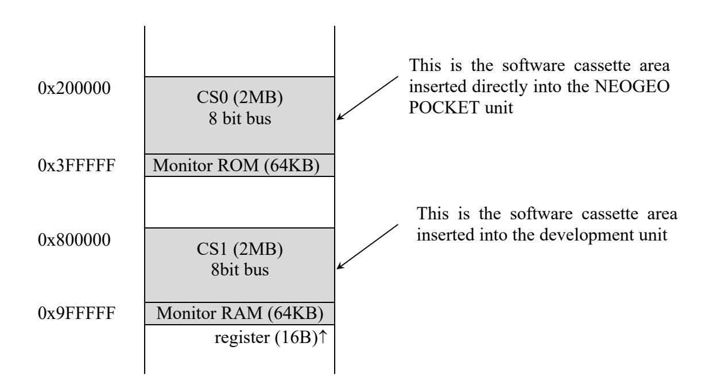

SNK CORPORATION 1998.10.19 rel. 0.9

## *TABLE OF CONTENTS*

| PREFACE                                                                                                    | 3 |
|------------------------------------------------------------------------------------------------------------|---|
| FLASH MEMORY MAP                                                                                           | 4 |
| BLOCK                                                                                                      | 5 |
| 4MBIT FLASH MEMORY CARD                                                                                    | 5 |
| 8MBIT FLASH MEMORY CARD                                                                                    | 5 |
| 16MBIT FLASH MEMORY CARD                                                                                   | 6 |
| RESTRICTIONS ON FLASH MEMORY USE.......................................................................... | 7 |
| NUMBER OF FLASH MEMORY WRITES POSSIBLE............................................................         | 8 |
| REVISION HISTORY                                                                                           | 9 |

## *PREFACE*

Materials covered in this manual are based on the NEOGEO POCKET production version. Please understand that when the system program version changes, the reference manual material will change accordingly.

## *FLASH MEMORY MAP*

In the NEOGEO POCKET, flash memory is mapped to CS0 and CS1. The memory map is shown below.

**CS0**

This is the user program area. In the development environment, during use of the debugger, the area is used for ROM emulation and may not be used as flash memory. CS0 is the area where the program runs, and game data is saved in this area for a production version.

**CS1**

This area is for security confirmation and is used as flash memory during development. The area between 0x9F0000~0x9FFFFF is used as monitor RAM area for the emulator. Thus this area may not be used as a flash memory area. This area CS1 is only valid during development. This area cannot be used to run the program in the production version.

## *BLOCK*

There are 3 different types of flash memory cards (4Mbit, 8Mbit and 16Mbit). They are given block numbers according to their addresses.

This block number is used when flash memory is to be erased. (Please refer to SYSTEM CALL REFERENCE MANUAL.)

There is an EQU definition in the header file "**BLOCK\_NO.INC**" for the block numbers.

## **4Mbit Flash Memory Card**

| Block number | EQU label | Address         | Size          |
|--------------|-----------|-----------------|---------------|
| 0            | F4_B0     | 0x00000~0x0FFFF | 64K (0x10000) |
| 1            | F4_B1     | 0x10000~0x1FFFF | 64K (0x10000) |
| 2            | F4_B2     | 0x20000~0x2FFFF | 64K (0x10000) |
| 3            | F4_B3     | 0x30000~0x3FFFF | 64K (0x10000) |
| 4            | F4_B4     | 0x40000~0x4FFFF | 64K (0x10000) |
| 5            | F4_B5     | 0x50000~0x5FFFF | 64K (0x10000) |
| 6            | F4_B6     | 0x60000~0x6FFFF | 64K (0x10000) |
| 7            | F4_B7     | 0x70000~0x77FFF | 32K (0x8000)  |
| 8            | F4_B8     | 0x78000~0x79FFF | 8K (0x2000)   |
| 9            | F4_B9     | 0x7A000~0x7BFFF | 8K (0x2000)   |
| 10           | F4_B10    | 0x7C000~0x7FFFF | 16K (0x4000)  |

### **8Mbit Flash Memory Card**

| Block number | EQU label | Address         | Size          |
|--------------|-----------|-----------------|---------------|
| 0            | F8_B0     | 0x00000~0x0FFFF | 64K (0x10000) |
| 1            | F8_B1     | 0x10000~0x1FFFF | 64K (0x10000) |
| 2            | F8_B2     | 0x20000~0x2FFFF | 64K (0x10000) |
| 3            | F8_B3     | 0x30000~0x3FFFF | 64K (0x10000) |
| 4            | F8_B4     | 0x40000~0x4FFFF | 64K (0x10000) |
| 5            | F8_B5     | 0x50000~0x5FFFF | 64K (0x10000) |
| 6            | F8_B6     | 0x60000~0x6FFFF | 64K (0x10000) |
| 7            | F8_B7     | 0x70000~0x7FFFF | 64K (0x10000) |
| 8            | F8_B8     | 0x80000~0x8FFFF | 64K (0x10000) |
| 9            | F8_B9     | 0x90000~0x9FFFF | 64K (0x10000) |
| 10           | F8_B10    | 0xA0000~0xAFFFF | 64K (0x10000) |
| 11           | F8_B11    | 0xB0000~0xBFFFF | 64K (0x10000) |
| 12           | F8_B12    | 0xC0000~0xCFFFF | 64K (0x10000) |
| 13           | F8_B13    | 0xD0000~0xDFFFF | 64K (0x10000) |
| 14           | F8_B14    | 0xE0000~0xEFFFF | 64K (0x10000) |
| 15           | F8_B15    | 0xF0000~0xF7FFF | 32K (0x8000)  |
| 16           | F8_B16    | 0xF8000~0xF9FFF | 8K (0x2000)   |
| 17           | F8_B17    | 0xFA000~0xFBFFF | 8K (0x2000)   |
| 18           | F8_B18    | 0xFC000~0xFFFFF | 16K (0x4000)  |

#### **16Mbit Flash Memory Card**

| Block number | EQU label | Address           | Size          |
|--------------|-----------|-------------------|---------------|
| 0            | F16_B0    | 0x00000~0x0FFFF   | 64K (0x10000) |
| 1            | F16_B1    | 0x10000~0x1FFFF   | 64K (0x10000) |
| 2            | F16_B2    | 0x20000~0x2FFFF   | 64K (0x10000) |
| 3            | F16_B3    | 0x30000~0x3FFFF   | 64K (0x10000) |
| 4            | F16_B4    | 0x40000~0x4FFFF   | 64K (0x10000) |
| 5            | F16_B5    | 0x50000~0x5FFFF   | 64K (0x10000) |
| 6            | F16_B6    | 0x60000~0x6FFFF   | 64K (0x10000) |
| 7            | F16_B7    | 0x70000~0x7FFFF   | 64K (0x10000) |
| 8            | F16_B8    | 0x80000~0x8FFFF   | 64K (0x10000) |
| 9            | F16_B9    | 0x90000~0x9FFFF   | 64K (0x10000) |
| 10           | F16_B10   | 0xA0000~0xAFFFF   | 64K (0x10000) |
| 11           | F16_B11   | 0xB0000~0xBFFFF   | 64K (0x10000) |
| 12           | F16_B12   | 0xC0000~0xCFFFF   | 64K (0x10000) |
| 13           | F16_B13   | 0xD0000~0xDFFFF   | 64K (0x10000) |
| 14           | F16_B14   | 0xE0000~0xEFFFF   | 64K (0x10000) |
| 15           | F16_B15   | 0xF0000~0xFFFFF   | 64K (0x10000) |
| 16           | F16_B16   | 0x100000~0x10FFFF | 64K (0x10000) |
| 17           | F16_B17   | 0x110000~0x11FFFF | 64K (0x10000) |
| 18           | F16_B18   | 0x120000~0x12FFFF | 64K (0x10000) |
| 19           | F16_B19   | 0x130000~0x13FFFF | 64K (0x10000) |
| 20           | F16_B20   | 0x140000~0x14FFFF | 64K (0x10000) |
| 21           | F16_B21   | 0x150000~0x15FFFF | 64K (0x10000) |
| 22           | F16_B22   | 0x160000~0x16FFFF | 64K (0x10000) |
| 23           | F16_B23   | 0x170000~0x17FFFF | 64K (0x10000) |
| 24           | F16_B24   | 0x180000~0x18FFFF | 64K (0x10000) |
| 25           | F16_B25   | 0x190000~0x19FFFF | 64K (0x10000) |
| 26           | F16_B26   | 0x1A0000~0x1AFFFF | 64K (0x10000) |
| 27           | F16_B27   | 0x1B0000~0x1BFFFF | 64K (0x10000) |
| 28           | F16_B28   | 0x1C0000~0x1CFFFF | 64K (0x10000) |
| 29           | F16_B29   | 0x1D0000~0x1DFFFF | 64K (0x10000) |
| 30           | F16_B30   | 0x1E0000~0x1EFFFF | 64K (0x10000) |
| 31           | F16_B31   | 0x1F0000~0x1F7FFF | 32K (0x8000)  |
| 32           | F16_B32   | 0x1F8000~0x1F9FFF | 8K (0x2000)   |
| 33           | F16_B33   | 0x1FA000~0x1FBFFF | 8K (0x2000)   |
| 34           | F16_B34   | 0x1FC000~0x1FFFFF | 16K (0x4000)  |

# *RESTRICTIONS ON FLASH MEMORY USE*

The last block of the flash memory (4 Mbit: block 10, 8 Mbit: block 18, and 16 Mbit: block 34) is reserved for use by the system program. Please do not use these blocks for program code, data, or back up area.

# *NUMBER OF FLASH MEMORY WRITES POSSIBLE*

The maximum number of rewrites possible in the same memory cell of the flash memory card is approximately 100,000 times.

## *REVISION HISTORY*

| rel 0.1 | Initial release                     | 1998/07/15 |
|---------|-------------------------------------|------------|
| rel 0.8 | Preface modified                    |            |
| rel 0.9 | Number Of Flash Memory Writes added | 1998.10.19 |