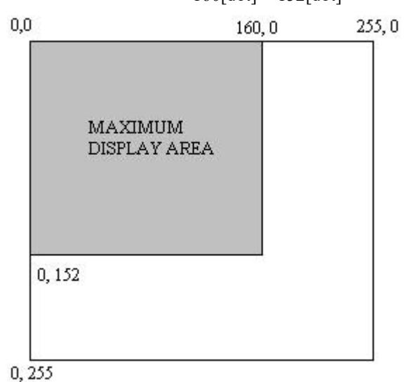
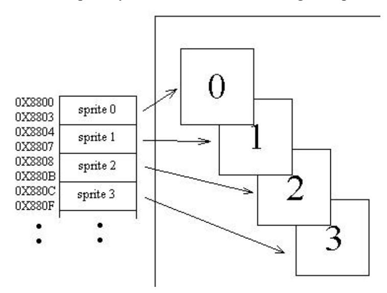
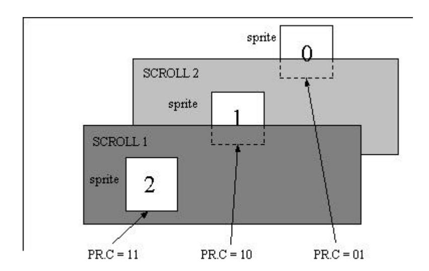
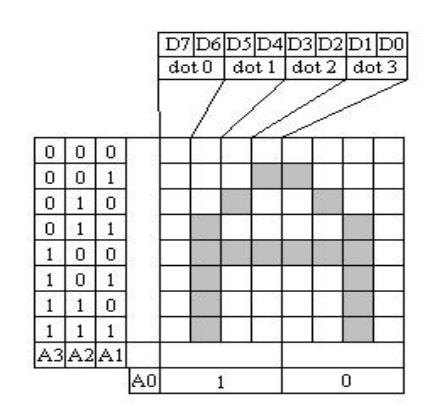
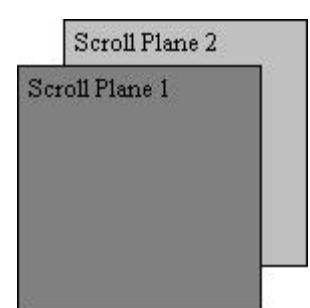
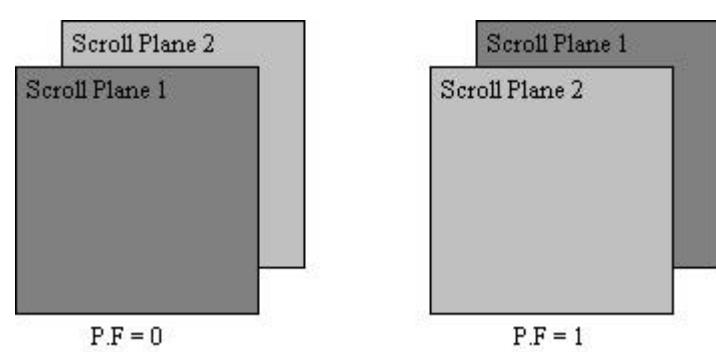
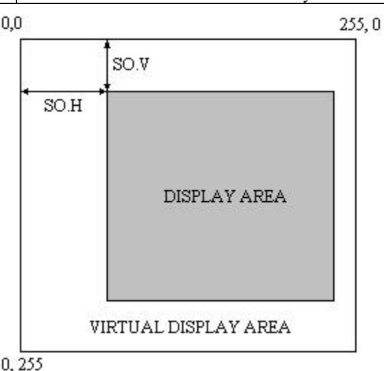
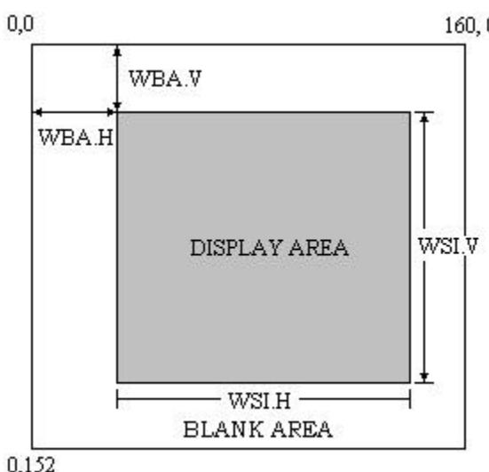
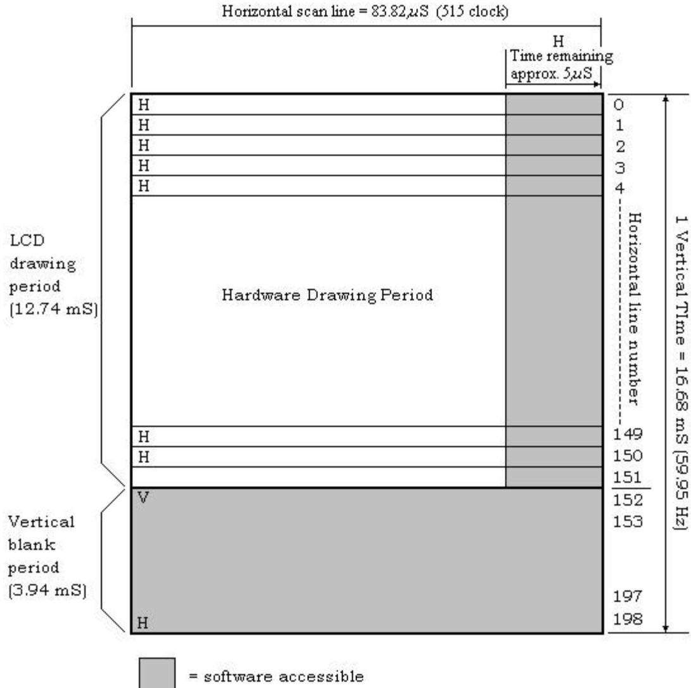

# *K1GE Technical Reference*

CONFIDENTIAL: DEVELOPERS ONLY **FOR GENERAL DEVELOPMENT**

## Revision History

# Table of Contents

| 1. FEATURES                                                                   | 4  |
|-------------------------------------------------------------------------------|----|
| 2. DISPLAY SPECIFICATION                                                      | 4  |
| 2-1. COORDINATES AND DISPLAY AREA                                             | 4  |
| 3. GRAPHIC ENGINE                                                             | 5  |
| 3-1. MEMORY LAYOUT_________________________________________________           | 5  |
| 3-2. MEMORY MAP____________________________________________________           | 5  |
| 3-3. SPRITE CONTROL                                                           | 6  |
| 3-3-1. Specification for Sprite Control_____________________________________  | 6  |
| 3-3-2. Display Function for Sprite Control                                    | 6  |
| 3-3-3. Data Format for Sprite VRAM                                            | 6  |
| 3-3-4. Sprite Position Offset Function                                        | 9  |
| 3-3-5. Data Format for Sprite Characters                                      | 9  |
| 3-4. SCROLL CONTROL                                                           | 11 |
| 3-4-1. Specification for Scroll Control                                       | 11 |
| 3-4-2. Display Function for Scroll Control                                    | 11 |
| 3-4-3. Relationship of VRAM Address and Scroll Plane                          | 11 |
| 3-4-4. Interrupt Control Register                                             | 11 |
| 3-4-5. Data Format for Scroll Plane VRAM                                      | 13 |
| 3-4-6. VRAM Address and the Relationship to the Position on Screen___________ | 13 |
| 3-4-7. Priority Levels of Scroll Planes____________________________________   | 14 |
| 3-4-8. Register to Change Priority Level of Scroll Planes                     | 14 |
| 3-4-9. Scroll Offset Register                                                 | 15 |
| 3-4-10. Window Register                                                       | 15 |
| 3-4-11. Relationship of Vint and Screen Setup                                 | 17 |
| 3-4-12. Relationship of Hint and Screen Setup                                 | 17 |
| 3-4-13. Raster Position Register                                              | 17 |
| 3-4-14. Scroll Character Data Format                                          | 17 |
| 3-5. 2D STATUS REGISTER                                                       | 18 |
| 3-6. 2D CONTROL                                                               | 19 |
| 3-7. PALETTE LUT FOR SPRITES                                                  | 20 |
| 3-7-1. Color Change and Bit Weight                                            | 21 |
| 3-7-1. Palette LUT for Scroll Plane 1_____________________________________    | 21 |
| 3-7-3. Palette LUT for Scroll Plane 2_____________________________________    | 22 |
| 3-8. LED CONTROL REGISTER                                                     | 22 |
| 3-9. REGISTERT O SET LED FLASH CYCLE_______________________________           | 23 |
| 3-10. 2D CIRCUIT RESET REGISTER                                               | 23 |
| 3-11. INPUT PORT REGISTER (RESERVED)_______________________________           | 24 |
| 4. OPERATION TIMING FIGURE                                                    | 25 |
| 5. REGISTER LAYOUT TABLE                                                      | 26 |

#### *1. FEATURES*

- 1. DOUBLE LINE BUFFER METHOD
- 2. CHARACTER RAM METHOD
- 3. SCROLL AND SPRITE USE COMMON CIRCUIT
- 4. SCROLL VRAM, SPRITE VRAM, CHARACTER RAM COMMON
- 5. ALL RAM INTERNAL
- 6. LUT INTERNAL, COLOR LEVEL CHANGE BY USE OF PALETTE LUT
- 7. LCD INTERFACE INTERNAL

## *2. DISPLAY SPECIFICATION*

| SCREEN SIZE       | 160[dot] × 152[dot] 1                               |
|-------------------|-----------------------------------------------------|
| COLOR LEVEL       | 8 LEVELS                                            |
| FRAME RATE        | 60[F/S] 2                                           |
| INTERFACE         | LCD INTERFACE                                       |
| SPRITE CONTROLLER | CAPABLE OF DISPLAYING 64 8[dot] ´ 8[dot] CHARACTERS |
| SCROLL CONTROLLER | CAPABLE OF DISPLAYING 2 SCROLLABLE BACKGROUND       |

#### *2-1. COORDINATES AND DISPLAY AREA*

FIGURE 1. WORLD COORDINATES AND DISPLAY AREA

## **3. GRAPHIC ENGINE**

GRAPHIC ENGINE**3** is similar to other systems. In order to decrease the necessary circuitry, sprite display and scroll display use a common circuitry. There are no special cautions that need to be followed when programming.

#### **3-1. MEMORY LAYOUT**

All three memory types of K1GE (character RAM, VRAM, and line buffer) are included in the ASIC. Of these, the character RAM and VRAM are under CPU control and are common with the scroll control. The layout and amount of memory is as follows.

*Character RAM*

Size : 8KB

Layout : 512 x {(8 x 8) x 2} =65.536Kb = 8.192 KB

characters x {(dots vertically x dots horizontally) x levels}

*VRAM*

Size : 4.25KB

Layout : 1024 x 16 x 2 = 32.768Kb = 4.096KB (scroll control only) maximum characters(1 screen) definable in RAM x parameters necessary to describe 1 character

x scrollable plane numbers

64 x 32 = 2.048Kb = 256Bytes (sprite control only)

maximum characters(1 screen) definable in RAM x parameters necessary to describe 1 character

*Line Buffer*

Size : 256B

Layout : {(4 x 16) x 16} x 2 = 2.048Kb = 256Bytes

(to transfer 8 dots simultaneously) x double buffer

#### **3-2. MEMORY MAP**

Figure 2. K1GE Memory Map

 **3** Graphics Engine will be designated as K1GE from this point onward

#### *3-3. SPRITE CONTROL*

#### *3-3-1. Specification for Sprite Control*

| # of sprites displayable in one frame | 64                    |
|---------------------------------------|-----------------------|
| # of sprites displayable in one line  | 64 4                  |
| maximum characters definable in VRAM  | 64                    |
| maximum character definable           | 512 characters 5      |
| levels available                      | 8 levels 6            |
| character size                        | 8[dot] ´ 8[dot] fixed |

#### *3-3-2. Display Function for Sprite Control*

#### *3-3-3. Data Format for Sprite VRAM*

VRAM data format is as follows.

| ADDRESS | D7  | D6  | D5  | D4 D3       | D2   | D1   | D0  |
|---------|-----|-----|-----|-------------|------|------|-----|
| 0X8800  |     |     |     | C.C(8+1Bit) |      |      |     |
| 0X8801  | H.F | V.F | P.C | PR.C        | H.ch | V.ch | C.C |
| 0X8802  |     |     |     | H.P(8Bit)   |      |      |     |
| 0X8803  |     |     |     | V.P(8Bit)   |      |      |     |

\*Start address for VRAM is 0X8800. The above example shows the first set of parameters, 4 bytes each. Since there are memory space for 64 sprites, there are 256 bytes available.

#### **Table 1. Parameters and Definitions**

| V.P                |                                                   |                       |
|--------------------|---------------------------------------------------|-----------------------|
| V position H.P     | Y coordinate for the character.                   |                       |
| H position C.C     | X coordinate for the character.                   |                       |
| Character code H.F | Setting character code. Character display status. |                       |
| H Flip             | H.F Logic                                         | Display status        |
|                    | 0                                                 | Normal                |
|                    | 1                                                 | Horizontally mirrored |

(Continued)

 **4** Except, there is a possibility of "character over." Explanation on page 18.

**5** Common with scroll character.

**6** 8 levels of gray excluding clear. Only 4 levels maybe used in one character (clear would be counted as well).

(Continuation)

| V.F Character display status.                  |                     |
|------------------------------------------------|---------------------|
| V.F Logic                                      | Display status      |
| 0                                              | Normal              |
| 1                                              | Vertically Mirrored |
| Palette Code Specifies palette code.           |                     |
| Value of PR.C                                  | Priority            |
| 00                                             | Character not shown |
| 01                                             | Furthest            |
| 10                                             | Middle              |
| 11                                             | Front               |
| H.ch Logic                                     | Display status      |
| 0                                              | Normal Coordinates  |
| 1                                              | Offset Coordinates  |
| V.ch Logic                                     | Display status      |
| 0                                              | Normal Coordinates  |
| 1                                              | Offset Coordinates  |
| Do not care This register value has no effect. |                     |

| V.F Character display status.                  |                     |
|------------------------------------------------|---------------------|
| V.F Logic                                      | Display status      |
| 0                                              | Normal              |
| 1                                              | Vertically Mirrored |
| Palette Code Specifies palette code.           |                     |
| Value of PR.C                                  | Priority            |
| 00                                             | Character not shown |
| 01                                             | Furthest            |
| 10                                             | Middle              |
| 11                                             | Front               |
| H.ch Logic                                     | Display status      |
| 0                                              | Normal Coordinates  |
| 1                                              | Offset Coordinates  |
| V.ch Logic                                     | Display status      |
| 0                                              | Normal Coordinates  |
| 1                                              | Offset Coordinates  |
| Do not care This register value has no effect. |                     |

#### *3-3-3-1. VRAM Address and Character Sprite Priority*

Priority for sprites on screen is dependent on the VRAM address. The hardware reads the values from the VRAM 0 address and writes to the line buffer. During the write to the line buffer, the hardware checks the priority as follows to avoid writing over previously written data.

Figure 3. Scroll Screen and Sprite Priority Relation

#### **3-3-3-2. Scroll Screen and Sprite Priority**

Figure 4 shows the PR.C value and the priority.

Figure 4. Scroll Screen and Sprite Priority Relationship

#### *3-3-4. Sprite Position Offset Function*

The value inside this register is added as an offset to the sprite position. The relationship between sprite position and offset is as follows:

*H' =H. P+PO. H V' =V. P+PO. V* (over flow ignored)

Because a value over 256 is ignored, overflow values are ignored and the value is set to 256. Since this value is always added to the sprite position, please initialize with 0X00 if offset is not required.

| ADDRESS | D7 | D6 | D5 | D4 D3      | D2 | D1 | D0 |
|---------|----|----|----|------------|----|----|----|
| 0X8020  |    |    |    | PO.H(8Bit) |    |    |    |
| 0X8021  |    |    |    | PO.V(8Bit) |    |    |    |

\*Caution: When the value in this register is set, it is reflected in the following line.

**Table 2. Parameters and Definitions**

#### *3-3-5. Data Format for Sprite Characters*

Each dot in a sprite character has 4 levels. For CPU connection reasons, 1 byte is 1 address and thus 1 address has data for 4 dots**7** . Bits are positioned as in Figure 5. Address bus above A4 corresponds with the character code. The CPU data bus is 16 bit, but the format is in this fashion due to it being a "little-endian."

Figure 5. Sprite Character ROM Data Format

 **7** For each dot, there are 2 bits information which determines the color (4 total including clear). Character color information is given in 3-7 palette LUT for sprites.

#### *3-3-5-1. Relationship Between Sprite Character Data and Address*

The relationship between character dot data and its address is as follows. The table below shows data and address for one character. 1 row of data represents 1 line on screen.

| ADDRESS | D7 D6 | D5 D4 | D3 D2 | D1 D0 |
|---------|-------|-------|-------|-------|
| 0XA000  | Dot 4 | Dot 5 | Dot 6 | Dot 7 |
| 0XA001  | Dot 0 | Dot 1 | Dot 2 | Dot 3 |
| 0XA002  | Dot 4 | Dot 5 | Dot 6 | Dot 7 |
| 0XA003  | Dot 0 | Dot 1 | Dot 2 | Dot 3 |
| 0XBFFC  | Dot 4 | Dot 5 | Dot 6 | Dot 7 |
| 0XBFFD  | Dot 0 | Dot 1 | Dot 2 | Dot 3 |
| 0XBFFE  | Dot 4 | Dot 5 | Dot 6 | Dot 7 |
| 0XBFFF  | Dot 0 | Dot 1 | Dot 2 | Dot 3 |

#### *3-4. SCROLL CONTROL*

#### *3-4-1. Specification for Scroll Control*

| Scrollable planes Virtual screen size | 2 planes 256[dot] x 256[dot] |
|---------------------------------------|------------------------------|
| Maximum VRAM definable characters     | 2048 8 characters            |
| Maximum definable characters          | 512 9 characters             |
| Usable color levels                   | 8 levels                     |
| Character size                        | 8[dot] x 8[dot]fixed         |

#### *3-4-2. Display Function for Scroll Control*

| Function applicable to screen         | Changing priority of scroll planes |
|---------------------------------------|------------------------------------|
|                                       | Window function 10                 |
| Function applicable to each character | Flip(mirroring) function           |
| Other functions                       | Scan line interrupt(Hint)          |

#### *3-4-3. Relationship of VRAM Address and Scroll Plane*

Figure 6 shows VRAM address and scroll plane relationship.

Figure 6. VRAM Address and Scroll Plane Relationship

#### *3-4-4. Interrupt Control Register*

K1GE produces interrupts after drawing the screen**11** and before the line is drawn(beginning of a line) **12**. ON/OFF of interrupts are set in the interrupt control register. The format is as follows.

\* Caution: Register setting affects the system with no time delay (at once).

 **8** 32character×32character×2planes.

**9** Common with sprite characters.

**10** Display area function.

**11** Called Vint.

**12** Called Hint.

#### **Table 3. Parameters and Definitions**

#### *3-4-5. Data Format for Scroll Plane VRAM*

VRAM data format is as follows.

| ADDRESS | D7  | D6  | D5  | D4 D3       |     | D2 | D1 | D0  |
|---------|-----|-----|-----|-------------|-----|----|----|-----|
| 0X9000  |     |     |     | C.C(8+1Bit) |     |    |    |     |
| 0X9001  | H.F | V.F | P.C |             | D.C |    |    | C.C |

\* Start address of VRAM for scroll plane is 0X9000. Only one parameter group is shown above. Address increases 2 bytes when used.

#### **Table 4. Parameters and Definitions**

| C.C                                                                                                          |                       |
|--------------------------------------------------------------------------------------------------------------|-----------------------|
| Character Code Sets character code. Character code is common with the sprites. H.F Character display status. |                       |
| H.F Logic H Flip                                                                                             | Display status        |
| 0                                                                                                            | Normal                |
| 1 V.F Character display status.                                                                              | Horizontally mirrored |
| V.F Logic V Flip                                                                                             | Display status        |
| 0                                                                                                            | Normal                |
| 1 P.C                                                                                                        | Vertically mirrored   |
| Palette Code Setting palette code. D.C                                                                       |                       |
| Do not care. This register value has no effect.                                                              |                       |

#### *3-4-6. VRAM Address and the Relationship to the Position on Screen*

VRAM address and the positioning on screen with respect to each other are as follows:

| 0X9000 | 0X9002 | 0X9004 | 0X903E |
|--------|--------|--------|--------|
| 0X9040 | 0X9042 | 0X9044 | 0X907E |
| 0X97C0 | 0X97C2 | 0X97C4 | 0X97FE |

Figure 7. VRAM Address and Screen Position Relationship

As can be seen, increasing the address moves the position horizontally. The second scroll plane address is from 0X9800 to 0X9FFE.

#### *3-4-7. Priority Levels of Scroll Planes*

Priority of scroll planes with respect to each other is as follows. Changing the value in the register switches the priority level.

Figure 8. Scroll Plane Priority

#### *3-4-8. Register to Change Priority Level of Scroll Planes*

Changes the scroll plane priority level. Register value and priority is shown in Figure 9.

\*Caution:

This register setting affects takes effect from the next line being drawn.

#### **Table 5. Parameters and Definitions**

Figure 9. P.F Logic Value and Priority

#### *3-4-9. Scroll Offset Register*

Sets the scroll plane offset value. The relationship of the offset and display is shown in Figure 10.

| ADDRESS D7 | D6 D5 D4 D3 D2 D1 D0 |
|------------|----------------------|
| 0X8032     | S1SO.H(8Bit)         |
| 0X8033     | S1SO.V(8Bit)         |
| 0X8034     | S2SO.H(8Bit)         |
| 0X8035     | S2SO.V(8Bit)         |

\*Caution:

Register value affects the display from the line drawn after setting.

#### **Table 6. Parameters and Definitions**

| S1SO.H                                |                                                                          |
|---------------------------------------|--------------------------------------------------------------------------|
| Scroll Plane 1 H Scroll Offset S1SO.V | Scroll Plane 1 X scroll offset. After system reset, 0x00(initial value). |
| Scroll Plane 1 V Scroll Offset S2SO.H | Scroll Plane 1 Y scroll offset. After system reset, 0x00(initial value). |
| Scroll Plane 2 H Scroll Offset S2SO.V | Scroll Plane 2 X scroll offset. After system reset, 0x00(initial value). |
| Scroll Plane 2 V Scroll Offset        | Scroll Plane 2 Y scroll offset. After system reset, 0x00(initial value). |

Figure 10. Scroll Offset and Display Area

#### *3-4-10. Window Register*

Determines the window display area. WBA.n is the windows origin, and WSI.n determines the window size. Non-display area is blank**13**. Figure 11 shows the register and screen relationship.

 **13** Blank is set in 3 – 6 2D control 00WC.

| ADDRESS D7 | D6 D5 D4 D3 D2 D1 D0 |
|------------|----------------------|
| 0X8002     | WBA.H(8Bit)          |
| 0X8003     | WBA.V(8Bit)          |
| 0X8004     | WSI.H(8Bit)          |
| 0X8005     | WSI.V(8Bit)          |

#### \*Caution:

Since WBA.n and WSI.n determines the window position and size, the lower right corner of the widow may exceed the display area. When this occurs, the following operation is performed by the hardware. The register value takes effect from the next frame.

| WBA.n and the Sum (WBA.n + WSI.n)                  | Operation                                  |
|----------------------------------------------------|--------------------------------------------|
| WBA.n value is outside the display area            | Screen is blank                            |
| Sum of WBA.n and WSI.n is outside the display area | Only area inside the display area is valid |

#### **Table 7. Parameters and Definitions**

| WBA.H                 |                                                                        |
|-----------------------|------------------------------------------------------------------------|
| Window H origin WBA.V | Sets the window origin X value. After system reset 0x00(initial value) |
| Window V origin WSI.H | Sets the window origin Y value. After system reset 0x00(initial value) |
| Window H size WSI.V   | Sets the X size of window. After system reset 0xFF(initial value)      |
| Window V size         | Sets the Y size of window. After system reset 0xFF(initial value)      |

Figure 11. Display Area and Window Function Relationship

#### *3-4-11. Relationship of Vint and Screen Setup*

Care must be taken concerning interrupts which occur after the screen is drawn by the K1GE CPU, because the timing at which the interrupt occurs is dependent on the value in the Window Register. The end of drawing is dependent on the displayed area, and Vint occurs when the line WBA.V + WSI.V is drawn. The exception is when WSI.V = 0. Then Vint occurs when the line is at WBA.V.

#### *3-4-12. Relationship of Hint and Screen Setup*

Hint is different from Vint and is not dependent on the value set in the Window Register. It is constant and 152 Hint occur every time.

#### *3-4-13. Raster Position Register*

Reading the value in this register allows access to the current raster position.

| ADDRESS | D7 | D6 | D5 | D4 D3       | D2 | D1 | D0 |
|---------|----|----|----|-------------|----|----|----|
| 0X8008  |    |    |    | RAS.H(8Bit) |    |    |    |
| 0X8009  |    |    |    | RAS.V(8Bit) |    |    |    |

\*Caution: LCD and Scan Line

Unlike a CRT, LCD does not have a scan line. In this case, the signal inside of the ASIC is used as the raster position.

Upper 8 bits of the 10 bit internal subtraction counter of the horizontal drawing operation time (internally 515 clock) is read in to RAS.H. (The value decreases as the horizontal drawing operation period progresses, and this value is accessible during V blank.)

RAS.V obtains the current line number during horizontal drawing operation. (Accessible during V blank.)

**Table 8. Parameters and Definitions**

#### *3-4-14. Scroll Character Data Format*

*The format is common with the sprites.*

#### *3-5. 2D STATUS REGISTER*

This register is used to determine the internal status of K1GE.

#### **Table 9. Parameter and Definitions**

| C.OVR Determines the character over status. C.OVER |                                                                                                        |
|----------------------------------------------------|--------------------------------------------------------------------------------------------------------|
| Logic                                              | Operation                                                                                              |
| 0                                                  | Character Over has not occurred Character Over has occurred: With the end of V blanking, it is cleared |
| BLNK Logic                                         | Operation                                                                                              |
| 0                                                  | Displaying                                                                                             |
| 1                                                  | V Blanking                                                                                             |

#### \* Character Over is:

K1GE sprites**14** uses the line buffer method. Character Over is a phenomenon associated with a line buffer method sprite system. This phenomenon results from the system determining visibility of the sprite after reading in from the VRAM and then updating the line buffer. Due to an operation which results in this process not being completed in one scan line period, the character disappears partially or completely. This phenomenon is called Character Over, or Sprite Line Over**15**. Because the K1GE writes two scroll planes and sprites to the line buffer, processing time is limited. Normally Character Over will not occur, but if a program is written that accesses the VRAM frequently, Character Over may occur.

 **14** Internally K1GE does not differentiate between sprites and scroll planes.

**15** As can be seen from previous comments, this phenomenon is referred to as Character Over in this documentation.

#### *3-6. 2D CONTROL*

This register sets the display setting and color setting for outside the window related to the LCD display.

\* Caution:

Setting in this register is reflected in the next line being drawn on screen.

#### **Table 10. Parameters and Definitions**

| NEG                                      | Negative and positive of the screen display is switched.                   |
|------------------------------------------|----------------------------------------------------------------------------|
| NEG Logic Negative and Positive Switched | Operation Normal display: After system reset, this is the value (initial). |
| 1 OOWC                                   | Switched display                                                           |
| Outside window color                     | Color setting outside the window. After reset 0X0 (initial).               |

#### *3-7. PALETTE LUT*16 *FOR SPRITES*

Palette code (P.C) defined in the sprite VRAM is changed to the value set in this register. Register format is as follows.

| ADDRESS | D7 D6 D5 D4         | D3 D2 D1 D0 |
|---------|---------------------|-------------|
| 0X8100  | Access not allowed. |             |
| 0X8101  | D.C                 | SPPLT.01    |
| 0X8102  | D.C                 | SPPLT.02    |
| 0X8103  | D.C                 | SPPLT.03    |
| 0X8104  | Access not allowed. |             |
| 0X8105  | D.C                 | SPPLT.11    |
| 0X8106  | D.C                 | SPPLT.12    |
| 0X8107  | D.C                 | SPPLT.13    |

#### \* Caution 1: *Clear code*

Character color 0X0 is treated differently inside the ASIC. The ASIC does not change the line memory if the code read in from the character RAM is 0x0 (treated as clear color). Thus no character code can be assigned to character color 0X0. Character color and character code relationship is shown in Table 11.

#### \* Caution 2:

The value set in this register takes affect immediately.

#### **Table 11. Color Code and Character Color Relation**

| Character Color | Color Code |
|-----------------|------------|
| 0X1             | SPPLT.01   |
| 0X2             | SPPLT.02   |
| 0X3             | SPPLT.03   |
| 0X1             | SPPLT.11   |
| 0X2             | SPPLT.12   |
| 0X3             | SPPLT.13   |

#### **Table 12. Parameters and Definitions**

| SPPLT.0n                              |                                    |
|---------------------------------------|------------------------------------|
| Palette code 0, Color code n SPPLT.1n | Color code set for palette 0.      |
| Palette code 1, Color code n D.C      | Color code set for palette 1.      |
| Do not care                           | This register value has no effect. |

#### *3-7-1. Color Change and Bit Weight*

LSB of the data will always be in D0 and its bit weight is the lowest. Screen output is similar with the smallest contrast change being the LSB and the largest the MSB. (Rear most screen has the lightest color.

#### **Table 13. MSB and LSB Definition**

#### *3-7-1. Palette LUT for Scroll Plane 1*

Palette code (P.C) defined in the scroll plane 1 VRAM (0X9000 0X97FF) is changed to the value set in this register. Register format is as follows.

| ADDRESS | D7 D6 D5 D4         | D3 D2 D1 D0 |
|---------|---------------------|-------------|
| 0X8108  | Access not allowed. |             |
| 0X8109  | D.C                 | SC1PLT.01   |
| 0X810A  | D.C                 | SC1PLT.02   |
| 0X810B  | D.C                 | SC1PLT.03   |
| 0X810C  | Access not allowed. |             |
| 0X810D  | D.C                 | SC1PLT.11   |
| 0X810E  | D.C                 | SC1PLT.12   |
| 0X810F  | D.C                 | SC1PLT.13   |

\* Caution:

The value set in this register takes effect immediately.

#### **Table 14. Parameters and Definitions**

| SC1PLT.0n                              |                                    |
|----------------------------------------|------------------------------------|
| Palette code 0, Color code n SC1PLT.1n | Color code set for palette 0.      |
| Palette code 1, Color code n D.C       | Color code set for palette 1.      |
| Do not care                            | This register value has no effect. |

#### *3-7-3. Palette LUT for Scroll Plane 2*

Palette code (P.C) defined in the scroll plane 2 VRAM (0X9800 0X9FFF) is changed to the value set in this register. Register format is as follows.

| ADDRESS | D7 D6 D5 D4         | D3 D2 D1 D0 |
|---------|---------------------|-------------|
| 0X8110  | Access not allowed. |             |
| 0X8111  | D.C                 | SC2PLT.01   |
| 0X8112  | D.C                 | SC2PLT.02   |
| 0X8113  | D.C                 | SC2PLT.03   |
| 0X8114  | Access not allowed. |             |
| 0X8115  | D.C                 | SC2PLT.11   |
| 0X8116  | D.C                 | SC2PLT.12   |
| 0X8117  | D.C                 | SC2PLT.13   |

\* Caution:

The value set in this register takes effect immediately.

#### **Table 15. Parameters and Definitions**

| SC2PLT.0n                              |                                    |
|----------------------------------------|------------------------------------|
| Palette code 0, Color code n SC2PLT.1n | Color code set for palette 0.      |
| Palette code 1, Color code n D.C       | Color code set for palette 1.      |
| Do not care                            | This register value has no effect. |

#### **3-8. LED CONTROL REGISTER**

Register format is as follows.

#### \* Caution:

The value set in this register takes effect immediately.

#### **Table 16. Parameters and Definitions**

| LEDON Sets the flashing property of the indicator LED. |                                                                                                               |
|--------------------------------------------------------|---------------------------------------------------------------------------------------------------------------|
| Value of LEDON LED control                             | Operation LED Flash:                                                                                          |
| 0X07 ~ 0XFE                                            | LED flashes with (register value x 10.6 [mS] ) apart. Flash cycle is set in 3-9. register to set flash cycle. |
| 0XFF                                                   | LED On: After system reset this is the initial value.                                                         |

#### *3-9. REGISTERT O SET LED FLASH CYCLE*

Register format is shown below.

#### \* Caution:

The value set in this register takes effect immediately.

#### **Table 17. Parameters and Definition**

## **3-10. 2D CIRCUIT RESET REGISTER**

This register can be used to reset K1GE. The register format is shown below.

#### \* Caution 1:

The value set in this register takes effect immediately.

#### **Table 18. Parameters and Definition**

#### \* Caution 2:

All register settings are set to the initialization values when this register is used.

#### *3-11. INPUT PORT REGISTER (RESERVED)*

Register to read input port (reserved).

#### **Table 19. Parameters and Definitions**

### *4. OPERATION TIMING FIGURE*

#### K1GE operation timing is shown below.

\*Access to each RAM area is possible during the Hardware Drawing Period. Please be aware of the adjustment circuitry delaying the Hardware Drawing Period if software accesses the RAM during this period. If the total time surpasses "H Time Remaining (approx. 5 mS)," Character Over occurs. (Accessing the registers does not have an effect. Sprite VRAM, scroll VRAM, and character RAM read/write access invokes the adjustment circuitry.

#### H = H\_INT generation timing

\*The signal generation begins 1 H before the Hardware Drawing Period starts. (Please be aware H\_INT signal is not generated at line 151 and signal generation for the 0th line occurs at the beginning of line 198.)

## **5. REGISTER LAYOUT TABLE**

K1GE register layout is shown in the following table.