*K 2 GE TECHNICAL REFERENCE MANUAL*

CONFIDENTIAL: DEVELOPERS ONLY

**FOR GENERAL DEVELOPMENT**

## Revision History

| Ver  | Date       | Revision         | In Charge | Requested |
|------|------------|------------------|-----------|-----------|
| 0.02 |            | Initial Release  | Takeda    |           |
| 1.00 | 1998.11.18 | Official Release | Takeda    |           |

# **Table of Contents**

| 1 . OUTLINE......................................................................................................................... |                                                                                                                   | 5    |
|--------------------------------------------------------------------------------------------------------------------------------------|-------------------------------------------------------------------------------------------------------------------|------|
| 2. FEATURES......................................................................................................................    |                                                                                                                   | 5    |
| 3. DISPLAY SPECIFICATION.........................................................................................                    |                                                                                                                   | 5    |
| 3-1. COORDINATES AND DISPLAY AREA                                                                                                    |                                                                                                                   | 5    |
| 4. GRAPHIC ENGINE                                                                                                                    |                                                                                                                   | 6    |
| 4-1. MEMORY LAYOUT.....................................................................................................              |                                                                                                                   | 6    |
| 4-2. MEMORY MAP.............................................................................................................         |                                                                                                                   | 7    |
| 4-3.                                                                                                                                 | SPRITE CONTROL                                                                                                    | 8    |
| 4-3-1.                                                                                                                               | Specification for Sprite Control............................................................................      | 8    |
| 4-3-2.                                                                                                                               | Display Function for Sprite Control.....................................................................          | 8    |
| 4-3-3.                                                                                                                               | Data Format for Sprite VRAM                                                                                       | 8    |
| 4-3-4.                                                                                                                               | Sprite Position Offset Function                                                                                   | 12   |
| 4-3-5. Data Format for Sprite Characters.....................................................................                        |                                                                                                                   | 13   |
| 4-4.                                                                                                                                 | SCROLL CONTROL.................................................................................................   | 14   |
| 4-4-1.                                                                                                                               | Specification for Scroll Control                                                                                  | 14   |
| 4-4-2.                                                                                                                               | Display Function for Scroll Control...................................................................            | 14   |
| 4-4-3.                                                                                                                               | Relationship of VRAM Address and Scroll Plane                                                                     | 14   |
| 4-4-4.                                                                                                                               | Data Format for Scroll Plane VRAM                                                                                 | 15   |
| 4-4-5.                                                                                                                               | VRAM Address and the Relationship to the Position on Screen.......................                                | 16   |
| 4-4-6.                                                                                                                               | Priority Levels of Scroll Planes...........................................................................       | 16   |
| 4-4-7.                                                                                                                               | Register to Change Priority Level of Scroll Planes                                                                | 17   |
| 4-4-8.                                                                                                                               | Scroll Offset Register........................................................................................... | 18   |
| 4-4-9.                                                                                                                               | Scroll Character Data Format............................................................................          | 19   |
| 4-5.                                                                                                                                 | WINDOW REGISTER                                                                                                   | 20   |
| 4-5-1.                                                                                                                               | Relationship of Vint and Screen Setup                                                                             | 21   |
| 4-5-2.                                                                                                                               | Relationship of Hint and Screen Setup..............................................................               | 21   |
| 4-6.                                                                                                                                 | BACKGROUND COLOR REGISTER......................................................................                   | 21   |
| 4-7.                                                                                                                                 | FRAME RATE REGISTER.......................................................................................        | 21   |
| 4-8.                                                                                                                                 | RASTER POSITION REGISTER.............................................................................             | 22   |
| 4-9. MODE SELECTION REGISTER                                                                                                         | §                                                                                                                 | 22   |
| 4-10. 2D STATUS REGISTER..........................................................................................                   |                                                                                                                   | 23   |
| 4-11.                                                                                                                                | 2D CONTROL REGISTER                                                                                               | 24   |
| 4-12.                                                                                                                                | PALETTE LUT FOR SPRITES                                                                                           | 25   |
| 4-12-1.                                                                                                                              | Color Change and Bit Weight..........................................................................             | 26   |
| 4-13.                                                                                                                                | PALETTE LUT FOR SCROLL PLANE 1                                                                                    | 27   |
| 4-14.                                                                                                                                | PALETTE LUT FOR SCROLL PLANE 2                                                                                    | 28   |
| 4-15. COLOR PALETTE RAM                                                                                                              | §                                                                                                                 | 29   |
| 5. K1GE                                                                                                                              | ® K2GE EXPANDED FUNCTION SUMMARY                                                                                  | § 31 |

| 5-1. SUMMARY................................................................................................................ | 31 |
|------------------------------------------------------------------------------------------------------------------------------|----|
| 5-2. K2GE MODE COLOR PALETTE RAM ADDRESS CALCULATION                                                                         | 32 |
| 5-3. K1GE UPPER PALETTE COMPATIBLE MODE COLOR PALETTE RAM                                                                    |    |
| ADDRESS CALCULATION                                                                                                          | 33 |
| 5-4. BACKGROUND COLOR PALETTE RAM ADRESS CALCULATION                                                                         | 34 |
| 5-5. WINDOW COLOR PALETTE RAM ADDRESS CALCULATION..........................                                                  | 34 |
| 6. OPERATION TIMING FIGURE................................................................................                   | 35 |
| 7. COLOR PALETTE TABLE.........................................................................................              | 36 |
| 8. REGISTER TABLE......................................................................................................      | 37 |

### **1. OUTLINE**

This manual is for the "K2 Graphics Engine" (noted as K2GE from this point on), a modified K1 Graphic Engine with color capability. (Functions enhanced or added is noted with §.)

### **2. FEATURES**

- 1. Double line buffer method
- 2. Character RAM method
- 3. § K1GE upper palette compatible mode
- 4. § Color LCD compatible
- 5. § Maximum output color In K1GE upper palette compatible mode = 20 out of 4096 colors simultaneous output (18 colors + 1 background color + 1 window color) In K2GE mode = 146 out of 4096 colors simultaneous output (144 colors + 1 background color + 1 window color)

#### **3. DISPLAY SPECIFICATION**

| SCREEN SIZE       | 160[dot]x152[dot] 1                     |
|-------------------|-----------------------------------------|
| COLOR LEVEL       | § K1GE upper palette compatible mode:   |
|                   | § K2GE mode:                            |
| FRAME RATE        | 60[F/S]                                 |
| INTERFACE         | § Color LCD interface                   |
| SPRITE CONTROLLER | 64 8[dot]x8[dot] character displayable  |
| SCROLL CONTROLLER | 2 dot scrollable background displayable |

#### *3-1. COORDINATES AND DISPLAY AREA*

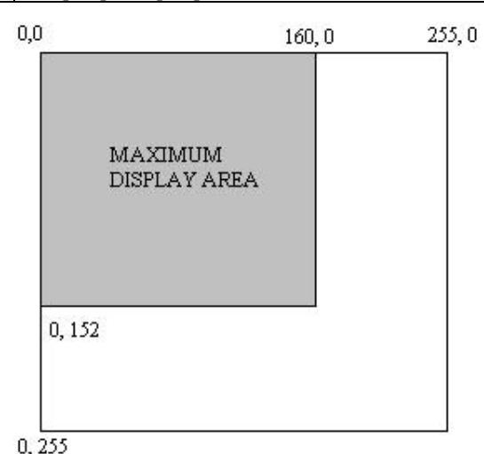

FIGURE 1. WORLD COORDINATES AND DISPLAY AREA

#### **4. GRAPHIC ENGINE**

#### *4-1***.****MEMORY LAYOUT**

The memory of K2GE is divided into character RAM, VRAM, color palette RAM, and line buffer. They are included in the K2GE block. Character RAM, VRAM and color palette RAM are unified memory all accessible from the 900/H CPU. The layout and amount of memory is as follows:

| Character RAM       |                                                                                   |
|---------------------|-----------------------------------------------------------------------------------|
| Size                | : 8KB (actual on board memory [2048x8]x4 sets)                                    |
| Layout VRAM         | : 512x{(8x8)x2} = 65.536Kb = 8.192KB                                              |
| Size                | : § 4384 Bytes (actual on board memory = {[1024x8]x4sets}+{[64x8]x4sets}          |
| Layout              | : 1024x16x2 = 32.768Kb = 4.096KB (scroll control only) x scrollable plane numbers |
|                     | § 64x32 = 2.304Kb = 288Bytes (sprite control only)                                |
| § Color Palette RAM |                                                                                   |
| Size                | : 312 Bytes (actual on board memory = [256x12]x1 set)                             |
| Layout Line Buffer  | : (144+48+8+8)x(4+4+4) = 2496b = 312Bytes                                         |
| Size                | : § 360Bytes (actual on board memory = {[16x24]x6}x2 sets)                        |
| Layout              | : § {20x(9x8)}x2 = 360Bytes                                                       |

#### *4-2. MEMORY MAP*

| 0X8000 0X81FF 0X8200                             | There areas are not used currently, but PLEASE DO NOT ACCESS these Control Registers areas. (Future expansion)                                                                                                                                                          |
|--------------------------------------------------|-------------------------------------------------------------------------------------------------------------------------------------------------------------------------------------------------------------------------------------------------------------------------|
| § 0X83FF 0X8400 0X87FF 0X8800 0X88FF 0X8900      | Color Palette RAM There areas are not used currently, but Control Registers PLEASE DO NOT ACCESS these areas. (Future expansion) There areas are not used currently, but Sprite VRAM PLEASE DO NOT ACCESS these areas. (Future expansion) PLEASE DO NOT ACCESS. (Future |
| 0X8BFF 0X8C00                                    | Vacant expansion).                                                                                                                                                                                                                                                      |
| 0X8C3F 0X8C40 0X8FFF 0X9000 0X9FFF 0XA000 0XBFFF | § Sprite VRAM (color palette code) PLEASE DO NOT ACCESS. (Future Vacant expansion). Scroll VRAM Character RAM                                                                                                                                                           |

FIGURE 2. K2GE MEMORY MAP

### *4-3. SPRITE CONTROL*

#### *4-3-1. Specification for Sprite Control*

| # of sprites displayable in one frame | 64                                                                                                                                                                                                                                |
|---------------------------------------|-----------------------------------------------------------------------------------------------------------------------------------------------------------------------------------------------------------------------------------|
| # of sprites displayable in one line  | 64 2                                                                                                                                                                                                                              |
| maximum characters definable in VRAM  | 64                                                                                                                                                                                                                                |
| maximum character definable           | 512 characters 3                                                                                                                                                                                                                  |
| # of color usable                     | K1 upper palette compatible mode: 6 colors out of 4096 + clear color Each character contains 4 colors of which one is clear K2GE mode: 48 colors out of 4096 + clear color Each character contains 4 colors of which one is clear |
| character size                        | 8[dot] × 8[dot] fixed                                                                                                                                                                                                             |

### *4-3-2. Display Function for Sprite Control*

### *4-3-3. Data Format for Sprite VRAM*

#### VRAM data format is as follows.

| ADDRESS | D7  | D6  | D5  | D4 D3       | D2   | D1   | D0  |
|---------|-----|-----|-----|-------------|------|------|-----|
| 0X8800  |     |     |     | C.C(8+1Bit) |      |      |     |
| 0X8801  | H.F | V.F | P.C | PR.C        | H.ch | V.ch | C.C |
| 0X8802  |     |     |     | H.P(8Bit)   |      |      |     |
| 0X8803  |     |     |     | V.P(8Bit)   |      |      |     |

|         |    |    |            | +  |        |    |    |    |
|---------|----|----|------------|----|--------|----|----|----|
| ADDRESS | D7 | D6 | D5         | D4 | D3     | D2 | D1 | D0 |
| 0x8C00  |    |    | D.C        |    |        |    |    |    |
|         |    |    | K2GE mode) |    | § CP.C |    |    |    |

\*Start address for VRAM is 0X8800. The above example shows the first set of parameters, 4 bytes each. Since there are memory space for 64 sprites, there are 256 bytes available.

The K2GE has an additional byte per character starting from 0X8C00 for the color palette code. This color palette is only valid in K2GE mode and does not exist in K1GE upper palette compatible mode.

(Example: First sprite = 0X8800 ~ 0X8803 + 0X8C00, Second sprite = 0X8804 ~ 0X8807 + 0X8C01)

 **2** Except, there is a possibility of "character over." Explanation on page 23. **3** Common with scroll character.

#### **Table 1. Parameters and Definitions**

| V.P                                        |                                                 |
|--------------------------------------------|-------------------------------------------------|
| V position Y coordinate for the character. |                                                 |
| H position X coordinate for the character. |                                                 |
| Character code Setting character code.     |                                                 |
| H.F Logic                                  | Display status                                  |
| 0                                          | Normal                                          |
| 1                                          | Horizontally mirrored                           |
| V.F Logic                                  | Display status                                  |
| 0                                          | Normal                                          |
| 1                                          | Vertically Mirrored                             |
| Palette Code Specifies palette code. §     | (Valid for K1GE upper palette compatible mode.) |
| Value of PR.C                              | Priority                                        |
| 00                                         | Character not shown                             |
| 01                                         | Furthest                                        |
| 10                                         | Middle                                          |
| 11                                         | Front                                           |
| H.ch Logic                                 | Display status                                  |
| 0                                          | Normal Coordinates                              |
| 1                                          | Offset Coordinates                              |
| V.ch Logic                                 | Display status                                  |
| 0                                          | Normal Coordinates                              |
| 1                                          | Offset Coordinates                              |

| V.P                                        |                                                 |
|--------------------------------------------|-------------------------------------------------|
| V position Y coordinate for the character. |                                                 |
| H position X coordinate for the character. |                                                 |
| Character code Setting character code.     |                                                 |
| H.F Logic                                  | Display status                                  |
| 0                                          | Normal                                          |
| 1                                          | Horizontally mirrored                           |
| V.F Logic                                  | Display status                                  |
| 0                                          | Normal                                          |
| 1                                          | Vertically Mirrored                             |
| Palette Code Specifies palette code. §     | (Valid for K1GE upper palette compatible mode.) |
| Value of PR.C                              | Priority                                        |
| 00                                         | Character not shown                             |
| 01                                         | Furthest                                        |
| 10                                         | Middle                                          |
| 11                                         | Front                                           |
| H.ch Logic                                 | Display status                                  |
| 0                                          | Normal Coordinates                              |
| 1                                          | Offset Coordinates                              |
| V.ch Logic                                 | Display status                                  |
| 0                                          | Normal Coordinates                              |
| 1                                          | Offset Coordinates                              |

(Continued)

#### (Continued)

| CP.C (exists only in K2GE mode) | Value defined becomes the color palette code for the sprite |
|---------------------------------|-------------------------------------------------------------|
|                                 | Value of CP.C Color Palette Code                            |
|                                 | 0 ~ 15 Selection of Sprite Palette 0 ~                      |
| § Color Palette Code D.C        |                                                             |
| Do not care                     | This register value has no effect.                          |

#### **4-3-3-1. VRAM Address and Character Sprite Priority**

Priority for sprites on screen is dependent on the VRAM address. The hardware reads the values from the VRAM 0 address and writes to the line buffer. During the write to the line buffer, the hardware checks the priority as follows to avoid writing over previously written data.

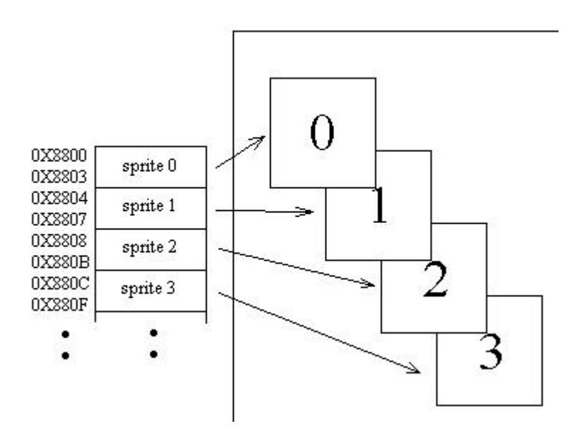

FIGURE 3. VRAM ADDRESS AND PRIORITY RELATION

#### **4-3-3-2. Scroll Screen and Sprite Priority**

Figure 4 shows the PR.C value and the priority.

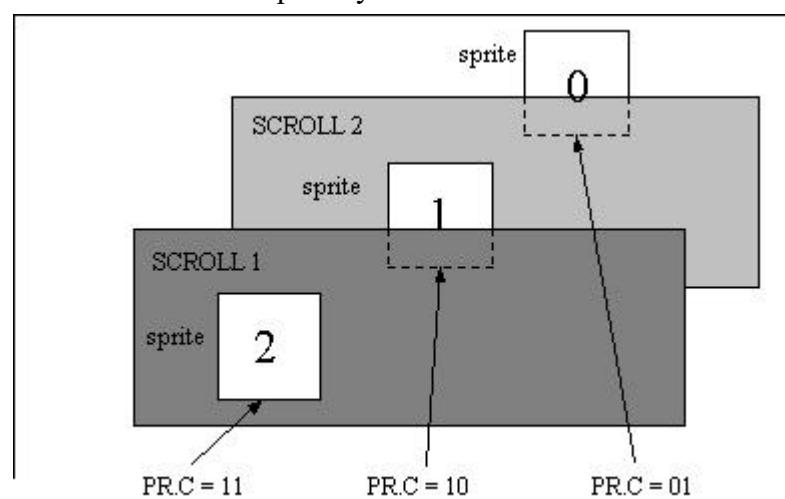

FIGURE 4. SCROLL SCREEN AND SPRITE RELATIONSHIP

#### **4-3-4. Sprite Position Offset Function**

The value inside this register is added as an offset to the sprite position. The relationship between sprite position and offset is as follows:

#### *H' =H. P+PO. H*

#### *V' =V. P+PO. V* (over flow ignored)

Because a value over 256 is ignored, over flow values are ignored and a value is set to 256. Since this value is always added to the sprite position, please initialize with 0X00 if offset is not required.

| ADDRESS | D7 | D6 | D5 | D4 D3      | D2 | D1 | D0 |
|---------|----|----|----|------------|----|----|----|
| 0X8020  |    |    |    | PO.H(8Bit) |    |    |    |
| 0X8021  |    |    |    | PO.V(8Bit) |    |    |    |

Caution: When the value in this register is set, it is reflected in the following line drawn on screen.

#### **Table 2. Parameters and Definitions**

#### **4-3-5. Data Format for Sprite Characters**

Each dot of the sprite character has 4 color codes available (2Bits). Bits are positioned as in Figure 5. Address bus above A4 corresponds with the character code.

FIGURE 5. SPRITE CHARACTER RAM DATA FORMAT

#### **4-3-5-1. Relationship Between Sprite Character Data and Address**

The relationship between character dot data and its address is as follows. The table below shows data and address for one character. 1 row of data represents 1 line on screen.

| ADDRESS | D7 D6 | D5 D4 | D3 D2 | D1 D0 |
|---------|-------|-------|-------|-------|
| 0XA000  | Dot 4 | Dot 5 | Dot 6 | Dot 7 |
| 0XA001  | Dot 0 | Dot 1 | Dot 2 | Dot 3 |
| 0XA002  | Dot 4 | Dot 5 | Dot 6 | Dot 7 |
| 0XA003  | Dot 0 | Dot 1 | Dot 2 | Dot 3 |
| 0XBFFC  | Dot 4 | Dot 5 | Dot 6 | Dot 7 |
| 0XBFFD  | Dot 0 | Dot 1 | Dot 2 | Dot 3 |
| 0XBFFE  | Dot 4 | Dot 5 | Dot 6 | Dot 7 |
| 0XBFFF  | Dot 0 | Dot 1 | Dot 2 | Dot 3 |

#### *4-4. SCROLL CONTROL*

### **4-4-1. Specification for Scroll Control**

| Scrollable planes Virtual screen size | 2 planes 256[dot]x256[dot]                                                                                                                                                                                                                                  |
|---------------------------------------|-------------------------------------------------------------------------------------------------------------------------------------------------------------------------------------------------------------------------------------------------------------|
| Maximum VRAM definable characters     | 2048 4 characters                                                                                                                                                                                                                                           |
| Maximum definable characters          | 512 5 characters                                                                                                                                                                                                                                            |
| Usable colors                         | K1 upper palette compatible mode: (6 colors out of 4096 + clear color) x 2 planes Each character contains 4 colors of which one is clear K2GE mode: (48 colors out of 4096 + clear color) x 2 planes Each character contains 4 colors of which one is clear |
| Character size                        | 8[dot]x8[dot]fixed                                                                                                                                                                                                                                          |

### **4-4-2. Display Function for Scroll Control**

| Function applicable to screen         | Changing priority of scroll planes |
|---------------------------------------|------------------------------------|
| Function applicable to each character | Flip(mirroring) function           |
| Other functions                       | Scan line interrupt(Hint)          |

### **4-4-3. Relationship of VRAM Address and Scroll Plane**

Figure 6 shows VRAM address and scroll plane relationship.

FIGURE 6. VRAM ADDRESS AND SCROLL PLANE RELATIONSHIP

 **4** 32character×32character×2planes.

**5** Common with sprite characters.

### **4-4-4. Data Format for Scroll Plane VRAM**

VRAM data format is as follows.

| ADDRESS | D7  | D6  | D5  | D4 D3 D2    | D1 | D0 |
|---------|-----|-----|-----|-------------|----|----|
| 0X9000  |     |     |     | C.C(8+1Bit) |    |    |
| 0X9001  | H.F | V.F | P.C |             |    |    |
|         |     |     |     | § CP.C      |    |    |

\* Start address of VRAM for scroll plane is 0X9000. Only one parameter group is shown above. Address increases by 2 bytes.

#### **Table 3. Parameters and Definitions**

| C.C                                                                                                          |                                                     |
|--------------------------------------------------------------------------------------------------------------|-----------------------------------------------------|
| Character Code Sets character code. Character code is common with the sprites. H.F Character display status. |                                                     |
| H.F Logic H Flip                                                                                             | Display status                                      |
| 0                                                                                                            | Normal                                              |
| 1 V.F Character display status.                                                                              | Horizontally mirrored                               |
| V.F Logic V Flip                                                                                             | Display status                                      |
| 0                                                                                                            | Normal                                              |
| 1 P.C                                                                                                        | Vertically mirrored                                 |
| Palette Code Setting palette code. § CP.C Sets color palette code for scroll planes.                         | (Only valid in K1GE upper palette compatible mode.) |
| Value of CP.C                                                                                                | Color Palette Code                                  |
| 0 ~ 15                                                                                                       | Selection of scroll palette 0 ~ 15                  |
| § Color Palette Code                                                                                         |                                                     |

#### **4-4-5. VRAM Address and the Relationship to the Position on Screen**

VRAM address and the positioning on screen with respect to each other are listed below. Increase in address results in horizontal progression of characters. The second scroll screen address starts from 0X9800 to 0X9FFE in a similar fashion.

| 0X9000 | 0X9002 | 0X9004 | 0X903E |
|--------|--------|--------|--------|
| 0X9040 | 0X9042 | 0X9044 | 0X907E |
| 0X97C0 | 0X97C2 | 0X97C4 | 0X97FE |

FIGURE 7. VRAM ADDRESS AND SCREEN POSITION RELATIONSHIP

#### **4-4-6. Priority Levels of Scroll Planes**

Priority of the scroll plane with respect to each other is as follows. Changing the value in the register switches the priority level.

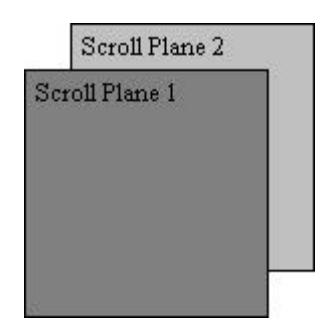

FIGURE 8. SCROLL PLANE PRIORITY

#### **4-4-7. Register to Change Priority Level of Scroll Planes**

This register sets the scroll plane priority level. The relationship of register value and priority is shown in Figure 9.

#### Caution:

The result of the value set in this register is displayed from the next line being drawn.

#### **Table 5. Parameters and Definitions**

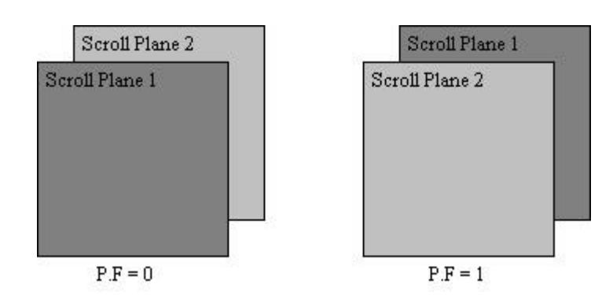

FIGURE 9. P.F LOGIC VALUE AND PRIORITY RELATIONSHIP

#### **4-4-8. Scroll Offset Register**

Sets the scroll plane offset value. The relation of offset and display is shown in Figure 10.

| ADDRESS | D7 D6 D5 D4 D3 D2 D1 D0 |
|---------|-------------------------|
| 0X8032  | S1SO.H(8Bit)            |
| 0X8033  | S1SO.V(8Bit)            |
| 0X8034  | S2SO.H(8Bit)            |
| 0X8035  | S2SO.V(8Bit)            |

Caution:

The result of the value set in this register is displayed from the next line being drawn.

#### **Table 6. Parameters and Definitions**

| S1SO.H                                |                                                                          |
|---------------------------------------|--------------------------------------------------------------------------|
| Scroll Plane 1 H Scroll Offset S1SO.V | Scroll Plane 1 X scroll offset. After system reset, 0x00(initial value). |
| Scroll Plane 1 V Scroll Offset S2SO.H | Scroll Plane 1 Y scroll offset. After system reset, 0x00(initial value). |
| Scroll Plane 2 H Scroll Offset S2SO.V | Scroll Plane 2 X scroll offset. After system reset, 0x00(initial value). |
| Scroll Plane 2 V Scroll Offset        | Scroll Plane 2 Y scroll offset. After system reset, 0x00(initial value). |

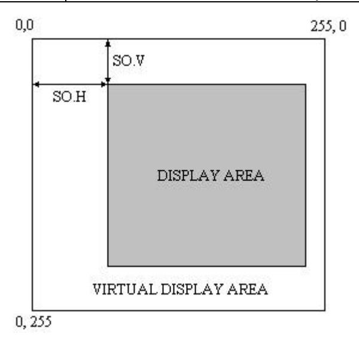

FIGURE 10. SCROLL OFFSET AND DISPLAY AREA

### **4-4-9. Scroll Character Data Format**

The data format is exactly the same as it is for the sprites. The explanation will be omitted.

### *4-5. WINDOW REGISTER*

Determines the window display area. WBA.n is the window origin, and WSI.n determines the window size. Non-display area is blank**6** . Figure 11 shows the register, window, and screen relationship.

| ADDRESS | D7 D6 D5 D4 D3 D2 D1 D0 |
|---------|-------------------------|
| 0X8002  | WBA.H(8Bit)             |
| 0X8003  | WBA.V(8Bit)             |
| 0X8004  | WSI.H(8Bit)             |
| 0X8005  | WSI.V(8Bit)             |

#### Caution:

The window is defined by the origin and the size, and thus the maximum value is determined by the sum of WBA.n and WSI.n. When the sum exceeds the hardware upper limit of 256, display and Vint/Hint generations are disrupted.

To avoid this disruption, please use and follow the condition given below.

#### **Table 6. Parameters and Definitions**

| WBA.H                 |                                                                        |
|-----------------------|------------------------------------------------------------------------|
| Window H origin WBA.V | Sets the window origin X value. After system reset 0x00(initial value) |
| Window V origin WSI.H | Sets the window origin Y value. After system reset 0x00(initial value) |
| Window H size WSI.V   | Sets the X size of window. After system reset 0xFF(initial value)      |
| Window V size         | Sets the Y size of window. After system reset 0xFF(initial value)      |

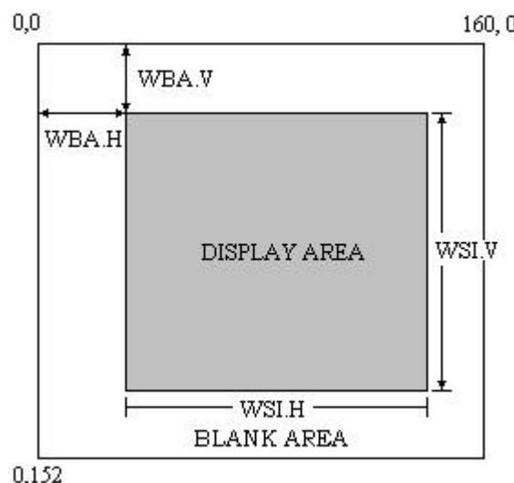

FIGURE 11. DISPLAY AREA AND WINDOW RELATIONSHIP

 **6** Blank area is set in 4-11. 2D control register 00WC.

#### **4-5-1. Relationship of Vint and Screen Setup**

After the screen is drawn by the K1GE, an interrupt is generated and sent to the CPU. The timing of the interrupt generation is determined by the value set in the window register and care must be taken. This value is evaluated after the end of drawing in the display area, and Vint is generated after WBA.V + WSI.V line is drawn. If the WSI.V is "0", Vint is produced after WBA.V line.

### **4-5-2. Relationship of Hint and Screen Setup**

Hint is different from Vint and is not dependent on the value set in the Window Register. It is constant and 152 Hint occur every time.

#### *4-6. BACKGROUND COLOR REGISTER*

The value defines the background color.

#### **Table 7. Parameters and Definitions**

| BGON              |                                                                                                                                                                              |
|-------------------|------------------------------------------------------------------------------------------------------------------------------------------------------------------------------|
| Background ON BGC | “D7=1, D6=0” sets the BGC valid. Other values set the BGC to be not valid, and the background                                                                                |
| Background Color  | Sets the background color (color code). The value set determines the BGC color palette. After reset, the initial values are “D2=0, D1=0, D0=0”. D.C (Exists as reserved RAM) |
| Do not Care       | The values in this register has no effect                                                                                                                                    |

Caution:

The value set in this register is reflected from the next line on screen.

### *4-7. FRAME RATE REGISTER*

This register is locked and only a priority user may be allowed to change the values. Please do not change the initial value set.

#### **Table 8. Parameters and Definitions**

### *4-8. RASTER POSITION REGISTER*

Reading the value in this register allows access to the current raster position.

| ADDRESS | D7 | D6 | D5 | D4 D3       | D2 | D1 | D0 |
|---------|----|----|----|-------------|----|----|----|
| 0X8008  |    |    |    | RAS.H(8Bit) |    |    |    |
| 0X8009  |    |    |    | RAS.V(8Bit) |    |    |    |

Caution: LCD and Scan Line Unlike a CRT, LCD does not have a scan line. In this case, the signal inside of the ASIC is used as the raster position.

Upper 8 bits of the 10 bit internal subtraction counter of the horizontal drawing operation time (internally 515 clock) is read in to RAS.H. (The value decreases as the horizontal drawing operation period progresses, and this value is accessible during V blank.)

RAS.V obtains the current line number during horizontal drawing operation. (Accessible during V blank.)

#### **Table 9. Parameters and Definitions**

#### *4-9. MODE SELECTION REGISTER*§

§This register defines the operation mode of the K2GE.

This register is locked and only a priority user may be allowed to change the values. Please do not change the initial value set.

#### **Table 10. Parameters and Definitions**

| MODE Sets the operation mode of K2GE.  |                                                                                  |
|----------------------------------------|----------------------------------------------------------------------------------|
| MODE Logic Selection of operation mode | Display Status K2GE Color mode. (After system reset, this is the initial value.) |
| 1 D.C (Does not exist as RAM)          | K1GE upper palette compatible mode.                                              |
| Do not Care                            | This register value has no effect on the circuit operation.                      |

#### *4-10. 2D STATUS REGISTER*

This register is used to determine the internal status of K2GE.

**Table 11. Parameter and Definitions**

| C.OVR Determines the character over status. |                                                                                                        |
|---------------------------------------------|--------------------------------------------------------------------------------------------------------|
| C.OVER Logic Character Over                 | Operation                                                                                              |
| 0 BLNK Determines if blanking or not        | Character Over has not occurred Character Over has occurred: With the end of V blanking, it is cleared |
| BLNK Logic Blanking                         | Operation                                                                                              |
| 0                                           | Displaying                                                                                             |
| 1 D.C (Exists as reserved RAM)              | V Blanking                                                                                             |
| Do not Care                                 | The value set in this register has no effect on circuit operation.                                     |

#### Character Over is:

K2GE sprites use the line buffer method. Character Over is a phenomenon associated with a line buffer method sprite system. This phenomenon results from the system determining visibility of the sprite after reading in from the VRAM and then updating the line buffer. Due to an operation which results in this process not being completed in one scan line period, the character disappears partially or completely. This phenomenon is called Character Over, or Sprite Line Over. Because the K2GE writes two scroll plane and sprites to the line buffer, processing time is limited. Even so, the system has been designed to complete the task, and normally Character Over will not occur. But if a program is written that accesses the VRAM frequently, Character Over may occur and care must be taken.

#### *4-11. 2D CONTROL REGISTER*

This register sets the display setting and color setting for outside the window related to the LCD display.

Caution:

Setting in this register is reflected in the next line being drawn on screen.

#### **Table 12. Parameters and Definitions**

| NEG                                                                                | Negative and positive of the screen display is switched.                                                                 |
|------------------------------------------------------------------------------------|--------------------------------------------------------------------------------------------------------------------------|
| Negative and Positive Switched                                                     | NEG Logic Operation Normal display: After system reset, this is the value (initial).                                     |
|                                                                                    | 1 Switched display                                                                                                       |
| § OOWC                                                                             | This function affects the RGB signal outputted by the K2GE. Color setting outside the window. After reset 0X0 (initial). |
| § Outside window color D.C (Exists as reserved RAM)                                | This setting colors through the use of the background color palette.                                                     |
| Do not Care Value set in this register has no effect on the operation of circuits. |                                                                                                                          |

#### *4-12. PALETTE LUT*7 *FOR SPRITES*

Palette code (P.C) defined in the sprite VRAM is changed to the value set in this register. Register format is as follows:

§The value set is only valid in K1GE upper palette compatible mode.

| ADDRESS | D7 D6 D5                                    | D4 D3 D2 D1 D0 |
|---------|---------------------------------------------|----------------|
| 0X8100  | Access not allowed.                         |                |
| 0X8101  | D.C (Does not exist as RAM. “0” when read.) | SPPLT.01       |
| 0X8102  | D.C (Does not exist as RAM. “0” when read.) | SPPLT.02       |
| 0X8103  | D.C (Does not exist as RAM. “0” when read.) | SPPLT.03       |
| 0X8104  | Access not allowed.                         |                |
| 0X8105  | D.C (Does not exist as RAM. “0” when read.) | SPPLT.11       |
| 0X8106  | D.C (Does not exist as RAM. “0” when read.) | SPPLT.12       |
| 0X8107  | D.C (Does not exist as RAM. “0” when read.) | SPPLT.13       |

#### Caution 1: **Clear code**

Character color 0X0 is treated differently inside the ASIC. The ASIC does not change the line memory if the code read in from the character RAM is 0x0 (treated as clear color). Thus no character code can be assigned to character color 0X0. Character color and character code relationship is shown below.

#### Caution 2:

The value set in this register takes effect immediately.

**Table 13. Color Code and Character Color Relation**

| Character Color | Color Code |
|-----------------|------------|
| 0X1             | SPPLT.01   |
| 0X2             | SPPLT.02   |
| 0X3             | SPPLT.03   |
| 0X1             | SPPLT.11   |
| 0X2             | SPPLT.12   |
| 0X3             | SPPLT.13   |

**Table 14. Parameters and Definitions**

| Palette code 0, Color code n                             | Color code set for palette 0.      |
|----------------------------------------------------------|------------------------------------|
| Palette code 1, Color code n D.C (Does not exist as RAM) | Color code set for palette 1.      |
| Do not care                                              | This register value has no effect. |

§The value set in this sprite palette associated with the "K1GE upper palette compatible mode sprite color palette" is the actual colors displayed.

#### **4-12-1. Color Change and Bit Weight**

LSB of the data will always be in D0 and its bit weight is the lowest. Screen output is similar, with the smallest contrast change being the LSB and the largest the MSB.

§The value set in this sprite palette associated with the "K1GE upper palette compatible mode sprite color palette" is the actual colors displayed.

**Table 15. MSB and LSB Definition**

#### *4-13. PALETTE LUT FOR SCROLL PLANE 1*

Palette code (P.C) defined in the scroll plane 1 VRAM (0X9000 0X97FF) is changed to the value set in this register. Register format is as follows.

| ADDRESS | D7 D6 D5                                    | D4 D3 D2 D1 D0 |
|---------|---------------------------------------------|----------------|
| 0X8108  | Access not allowed.                         |                |
| 0X8109  | D.C (Does not exist as RAM. “0” when read.) | SPPLT.01       |
| 0X810A  | D.C (Does not exist as RAM. “0” when read.) | SPPLT.02       |
| 0X810B  | D.C (Does not exist as RAM. “0” when read.) | SPPLT.03       |
| 0X810C  | Access not allowed.                         |                |
| 0X810D  | D.C (Does not exist as RAM. “0” when read.) | SPPLT.11       |
| 0X810E  | D.C (Does not exist as RAM. “0” when read.) | SPPLT.12       |
| 0X810F  | D.C (Does not exist as RAM. “0” when read.) | SPPLT.13       |

#### Caution:

The value set in this register takes effect immediately.

#### **Table 16. Parameters and Definitions**

| Palette code 0, Color code n                             | Color code set for palette 0.      |
|----------------------------------------------------------|------------------------------------|
| Palette code 1, Color code n D.C (Does not exist as RAM) | Color code set for palette 1.      |
| Do not care                                              | This register value has no effect. |

§The value set in this scroll palette associated with the "K1GE upper palette compatible mode scroll 1 color palette" is the actual colors displayed.

#### *4-14. PALETTE LUT FOR SCROLL PLANE 2*

Palette code (P.C) defined in the scroll plane 2 VRAM (0X9800 0X9FFF) is changed to the value set in this register. Register format is as follows.

| ADDRESS | D7 D6 D5                                    | D4 D3 D2 D1 D0 |
|---------|---------------------------------------------|----------------|
| 0X8110  | Access not allowed.                         |                |
| 0X8111  | D.C (Does not exist as RAM. “0” when read.) | SPPLT.01       |
| 0X8112  | D.C (Does not exist as RAM. “0” when read.) | SPPLT.02       |
| 0X8113  | D.C (Does not exist as RAM. “0” when read.) | SPPLT.03       |
| 0X8114  | Access not allowed.                         |                |
| 0X8115  | D.C (Does not exist as RAM. “0” when read.) | SPPLT.11       |
| 0X8116  | D.C (Does not exist as RAM. “0” when read.) | SPPLT.12       |
| 0X8117  | D.C (Does not exist as RAM. “0” when read.) | SPPLT.13       |

Caution:

The value set in this register takes effect immediately.

#### **Table 17. Parameters and Definitions**

| Palette code 0, Color code n                             | Color code set for palette 0.      |
|----------------------------------------------------------|------------------------------------|
| Palette code 1, Color code n D.C (Does not exist as RAM) | Color code set for palette 1.      |
| Do not care                                              | This register value has no effect. |

§The value set in this scroll palette associated with the "K1GE upper palette compatible mode scroll 2 color palette" is the actual colors displayed.

### *4-15. COLOR PALETTE RAM*§

Color palette RAM is composed of "1 palette = 16 Bits (4 of which are D.C), and each of the color palette RAM addresses are separated by 16 Bits for functionality.

Color palette RAM data format is listed below.

Caution 1:

This RAM area is 16 bit access only. Using 8 bit access will produce unreliable values.

Caution 2:

Values set are immediately reflected.

Caution 3:

The clear color palette code address in "0X8200 ~ 0X837E" (i.e. 0X8200, 0X8208, 0X8210, etc.) is treated as D.C for "D15 ~ D0", but in actuality, "D11 ~ D0" is treated as reserved RAM.

Caution 4:

The values inside the color palette RAM after reset are all undefined. It is necessary to initialize these values appropriately.

Caution 5:

Access to color palettes are always 0 WAIT operation possible. (Even during hardware display write it is 0 WAIT operation possible.)

#### **Table 18. Parameters and Definitions**

| R_PLT                                    |                                                           |
|------------------------------------------|-----------------------------------------------------------|
| RED palette G_PLT                        | Defines 4Bit red palette code. (D3 = MSB, D0 = LSB)       |
| GREEN palette B_PLT                      | Defines 4Bit red palette code. (D7 = MSB, D4 = LSB)       |
| BLUE palette D.C (Does not exist as RAM) | Defines 4Bit red palette code. (D11 = MSB, D8 = LSB)      |
| Do not Care                              | Values set does not have any effect on circuit operation. |

Color palette RAM functions are listed below in address groups.

Table 19. Color Palette RAM Functions in Address Groups

| No.       | Address  | Valid Mode |            | Affected Display | Function                         |
|-----------|----------|------------|------------|------------------|----------------------------------|
| 0 ~63     | 0X8200 ~ |            |            |                  |                                  |
|           |          | K2GE mode  |            | Sprite           | K2GE mode sprite color palette   |
| 64 ~ 127  | 0X8280 ~ |            |            |                  |                                  |
|           |          | K2GE mode  |            | Scroll 1         | K2GE mode scroll 1 color palette |
| 128 ~ 191 | 0X8300 ~ |            |            |                  |                                  |
|           |          | K2GE mode  |            | Scroll 2         | K2GE mode scroll 2 color palette |
| 192 ~ 207 | 0X8380 ~ |            |            |                  |                                  |
|           |          | K1GE upper | palette    |                  |                                  |
|           |          |            |            | Sprite           | K1GE upper palette compatible    |
| 208 ~ 223 | 0X83A0 ~ |            |            |                  |                                  |
|           |          | K1GE upper | palette    |                  |                                  |
|           |          |            |            | Scroll 1         | K1GE upper palette compatible    |
| 224 ~ 239 | 0X83C0 ~ |            |            |                  |                                  |
|           |          | K1GE upper | palette    |                  |                                  |
|           |          |            |            | Scroll 2         | K1GE upper palette compatible    |
| 240 ~ 247 | 0X83E0 ~ |            |            |                  |                                  |
|           |          | K2GE/K1GE  | upper      |                  |                                  |
|           |          | palette    | compatible |                  |                                  |
|           |          |            |            | Background       | Background color palette         |
| 248 ~255  | 0X83F0 ~ |            |            |                  |                                  |
|           |          | K2GE/K1GE  | upper      |                  |                                  |
|           |          | palette    | compatible |                  |                                  |
|           |          |            |            | Window           | Window color palette             |

For further information, please refer to "K2GE Color Palette Table".

#### **5. K1GE**®**K2GE EXPANDED FUNCTION SUMMARY**§

The similarities and differences between K1GE and K2GE are summarized in the following sections.

#### *5-1. SUMMARY*

K2GE inherits the functionality of K1GE with the adoption of color. The following functions have been expanded or changed.

- 1. K2GE mode color palette code (4Bits) added to sprite VRAM. (X8C00 ~ 0X8C3F added.)
- 2. K2GE mode color palette code (4Bits) added to scroll VRAM. (D4 ~ D1 of odd address which were formally specified as D.C added.)
- 3. Addition of color palette RAM. (0X8200 ~ 0X83FF added.)
- 4. For operation mode, "K1GE upper palette compatible mode" for K1GE compatibility and "K2GE mode" for maximum color output on board. (Mode selection register added.)

K2 system software sets the operation mode from the header information of the game cassette.

The following functions have not been changed to maintain compatibility.

- 1. Character RAM data format. ("00 b" is always treated as clear color.)
- 2. Sprite display function. (Excluding color palette addition.)
- 3. Scroll display function. (Excluding color palette addition.)
- 4. Background display function. (Excluding color palette addition.)
- 5. Window display function. (Excluding color palette addition.)
- 6. Vint, Hint generation timing.
- 7. All operation timing. (H time left, V blank time, etc.)

#### *5-2. K2GE MODE COLOR PALETTE RAM ADDRESS CALCULATION*

In K2GE mode, the final display color (color palette RAM address) is determined as follows:

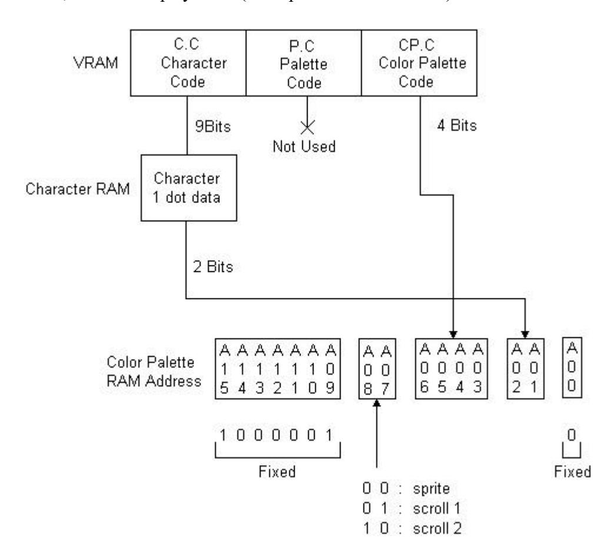

#### *5-3. K1GE UPPER PALETTE COMPATIBLE MODE COLOR PALETTE RAM ADDRESS CALCULATION*

In K1GE upper palette compatible mode, the final display color (color palette RAM address) is determined as follows:

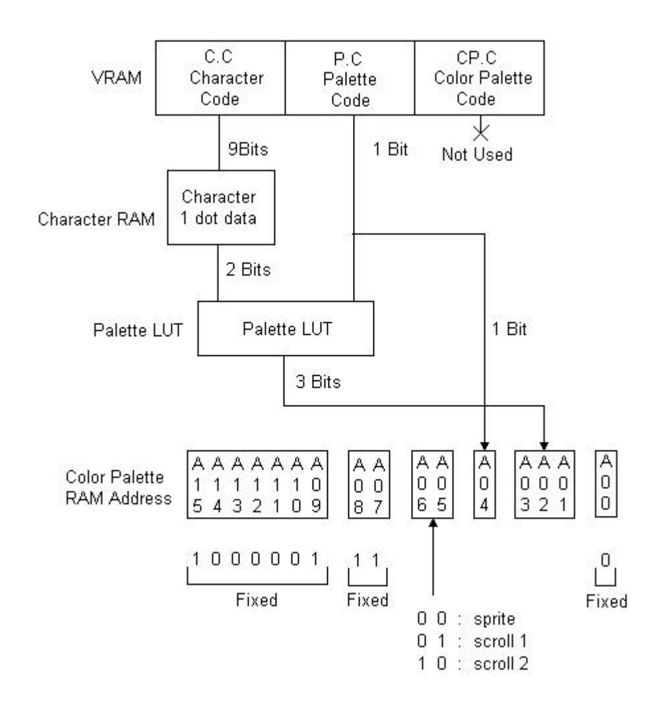

### *5-4. BACKGROUND COLOR PALETTE RAM ADRESS CALCULATION*

The background final display color (color palette RAM address) is determined as follows:

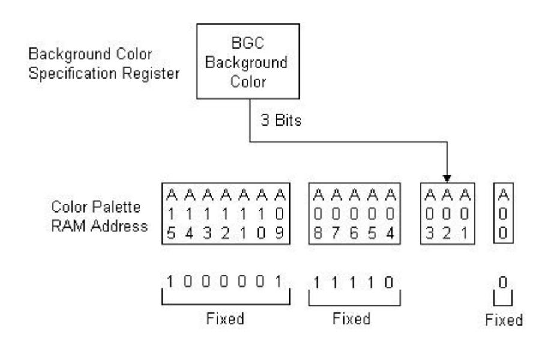

#### *5-5. WINDOW COLOR PALETTE RAM ADDRESS CALCULATION*

The Window boarder final display color (color palette RAM address) is determined as follows:

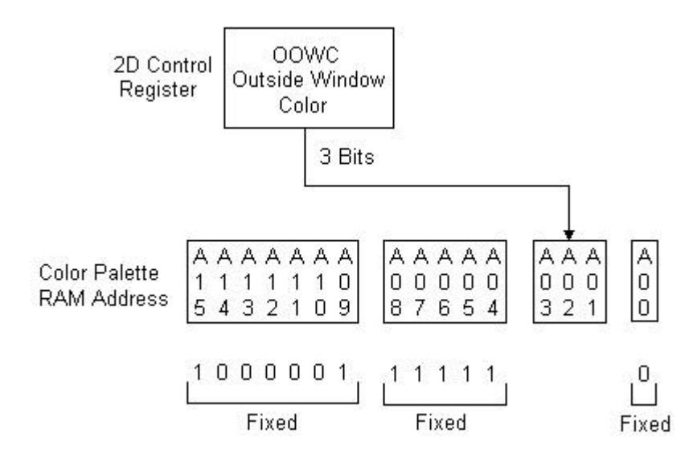

#### **6. OPERATION TIMING FIGURE**

K2GE operation timing is shown below. (§ It is the same as K1GE.)

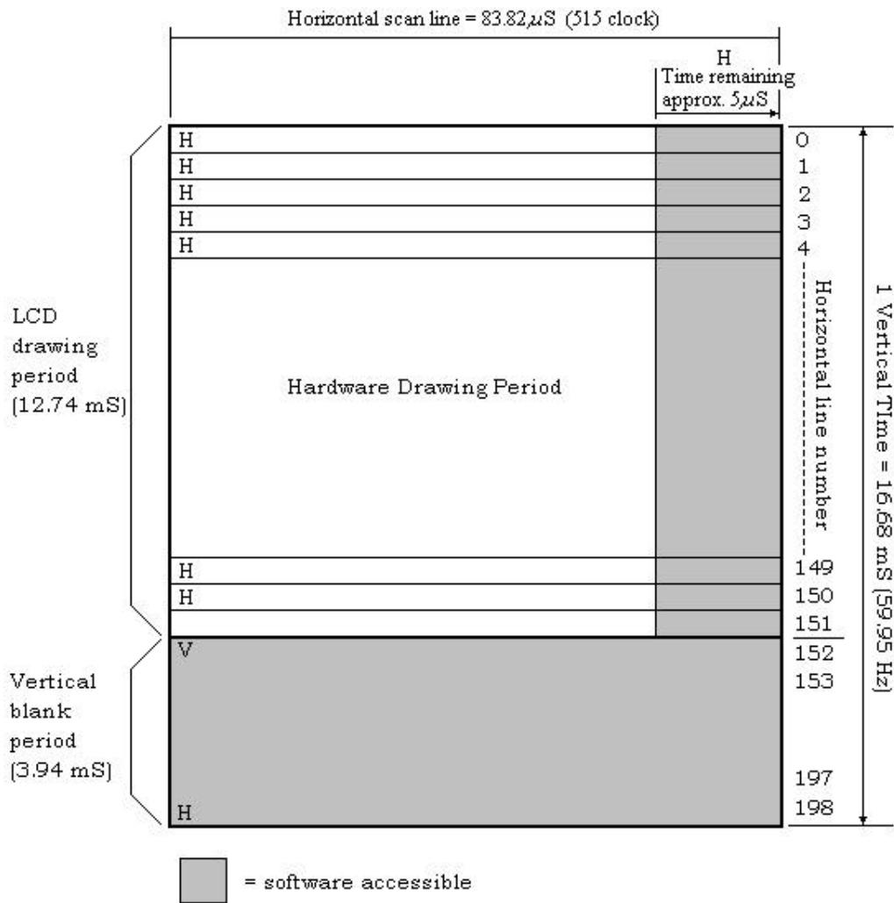

\*Access to each RAM area is possible during the Hardware Drawing Period. Please be aware of the adjustment circuitry delaying the Hardware Drawing Period if software accesses the RAM during this period. If the total time surpasses "H Time Remaining (approx. 5 mS)," Character Over occurs. (Accessing the registers does not have an effect. Sprite VRAM, scroll VRAM, and character RAM read/write access invokes the adjustment circuitry.)

#### H = H\_INT generation timing

\*The signal generation begins 1 H before the Hardware Drawing Period starts. (Please be aware H\_INT signal is not generated at line 151 and signal generation for the 0th line occurs at the beginning of line 198.)

### **7. COLOR PALETTE TABLE**

K2GE color palette table is listed in a separate file.

## **8. REGISTER TABLE**

K2GE register table is listed in a separate file.