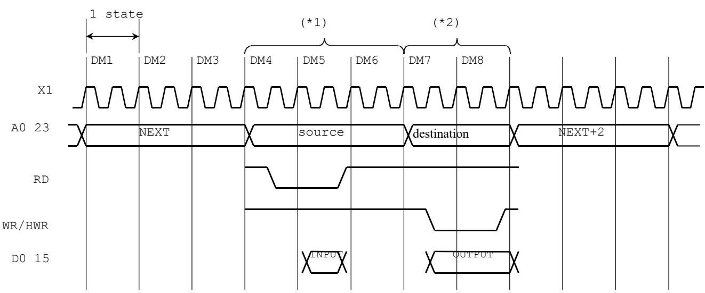
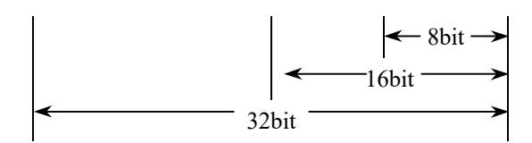

SNK CORPORATION 1998.8.28 rel 0.2

#### *× Micro DMA*

The CPU, along with the common interrupt operations, has micro DMA function. Interrupt requests set in the micro DMA, without any restrictions from the interrupt level set, operates even during a mask-able interrupt at the highest interrupt level (level 6).

#### **(1) Micro DMA Operation**

The micro DMA, which commences operation according to values set in the micro DMA operation vector register (without any restrictions from the interrupt level set and even during mask-able interrupt set), requests the micro DMA (at interrupt level 6) to the CPU and executes the operation instructed. There are 4 channels prepared for the micro DMA, and 4 different instructions may be set at the same time.

The interrupt request F/F corresponding to the given channel is cleared after the micro DMA is received and the DMA operation is allowed. The data in the designated "from" and "to" address stored in the control register is automatically transferred and the transfer count is decremented. If the decremented result is not 0, the micro DMA operation ends and starts again via the CPU's internal logic (in effect continually transferring data while the result is not 0). If the decremented value is 0, the interrupt controller is informed of the transfer end state from CPU to micro DMA (INTTCn). Subsequently, the micro DMA operation start vector register value is 0 cleared, the next DMA start is prohibited, and the micro DMA operation is ended.

During the period when the micro DMA start operation vector is cleared and respecified, if a situation arises in which the interrupt occurs, the normal interrupt operation is performed according to the interrupt level set earlier. Thus, in a situation where the micro DMA operation is started (not used as an interrupt), the interrupt level should be set to 0.

Also, if the micro DMA and the regular interrupts are both used, it is necessary to set the interrupt level of the micro DMA to be lower than that of the regular interrupts.

Ex: If timer 0~3 is used to start micro DMA 0~3, Please set the interrupt levels as follows:

Timer 0~3 interrupt level … 1 Other interrupt level … 2~5

 The priority level of micro DMA end transfer interrupt is dependent on the interrupt level and the default priority of other mask-able interrupts.

Also, if multiple channels of micro DMA requests are generated simultaneously, the channel with the lowest numerical value has the highest priority. This is determined independent of the interrupt level. (CH0 (highest) CH3 (lowest)) The size of the register which specifies the transfer "from" and "to" address is a 32 bit control register. Because only 24 addresses may be outputted, the micro DMA can only access a 16 MB memory space.

There are three transfer modes: 1 byte, 1 word (2 bytes), and 4 bytes transfer. Each transfer mode requires increment, decrement or fixed specification for the transfer from/to addresses after data transfer. With these modes, it is possible to transfer data from I/O to memory, memory to I/O, and I/O to I/O with little effort. Please refer to "Transfer Mode Register Definition" for details.

Because the transfer counter is 16 bits, it is possible to do a maximum of 65536 (when the transfer counter is initialized with a value 0000H) micro DMA operations.

Interrupt sources which can do micro DMA operations are the 9 types of interrupts which have the micro DMA start vector. (Please refer to SYSTEM PROGRAM REFERNECE MANUAL)

Figure 1 below shows a micro DMA cycle with transfer address INC mode and 2 bytes transfer. (All address area 16 bit bus, 0 wait, source destination address both are even.)

State 1~3: Command fetch cycle (obtains next command code)

If the command queue buffer contains a command code that is larger than 3 bytes,

this cycle becomes a dummy cycle. State 4~5: Micro DMA read cycle

State 6: Dummy cycle (the address bus is in the same state as state 5)

State 7~8: Micro DMA write cycle

(\*1) If the source address area is an 8 bit bus, +2 states. Also, if source address area is 16 bit

bus and if the address starts from an odd address, +2 states.

(\*2) If the destination address area is an 8 bit bus, +2 states. Also if destination address is 16 bit bus and the address starts from an odd address, +2 states.

Figure 1. Micro DMA Cycle

## (2) Register Structure (CPU Control Register)

Channel 2 DMAS2 DMAD2

DMAC2

DMAM2

Channel 3 DMAS3 DMAD3

DMAC3

DMAM3

Setting data in these control register is only possible through the use of the LDC cr,c command.

transfer from address register 0 transfer to address register 0 transfer count register 0 (1 65536) transfer mode register 0

(lower 24 bits used)

transfer from address register 1 transfer to address register 1 transfer count register 1 transfer mode register 1

transfer from address register 2 transfer to address register 2 transfer count register 2 transfer mode register 2

transfer from address register 3 transfer to address register 3 transfer count register 3 transfer mode register 3

## (3) Transfer Mode Register Definition

#### DMAM0 3

Run Time (Minimum. @ 25 MHz)

|        | ZZ: 0 = byte, 1 = word, 2 = 4 bytes, 3 = reserved 8 states (640ns)                           |
|--------|----------------------------------------------------------------------------------------------|
| Error! | Transfer to address INC mode…for I/O to memory @ byte/word                                   |
|        | (DMADn+) (DMASn)                                                                             |
|        | DMACn DMACn 1 12 states (960ns) if DMACn = 0 then INTTC generated @ 4 bytes 8 states (640ns) |
| Error! | Transfer to address DEC mode…for I/O to memory (DMADn ) @ byte/word (DMASn)                  |
|        | DMACn DMACn 1 12 states (960ns) if DMACn = 0 then INTTC generated @ 4 bytes 8 states (640ns) |
| Error! | Transfer to address INC mode…for memory to I/O @ byte/word                                   |
|        | (DMADn) (DMASn+)                                                                             |
|        | DMACn DMACn 1 12 states (960ns) if DMACn = 0 then INTTC generated @ 4 bytes 8 states (640ns) |
| Error! | Transfer to address DEC mode…for memory to I/O @ byte/word                                   |
|        | (DMADn) (DMASn )                                                                             |
|        | DMACn DMACn 1 12 states (960ns) if DMACn = 0 then INTTC generated @ 4 bytes                  |
| Error! | Fixed address mode…I/O to I/O 8 states (640ns) @ byte/word                                   |
|        | (DMADn) (DMASn)                                                                              |
|        | DMACn DMACn 1 12 states (960ns) if DMACn = 0 then INTTC generated @ 4 bytes 5 states         |
| Error! | Counter Mode…counts number of interrupts generated                                           |
|        | DMASn DMASn+1 (400ns)                                                                        |
|        | DMACn DMACn 1 if DMACn = 0 then INTTC generated                                              |

1 state = 80ns @25MHz

Note:

n: corresponding micro DNA channel 0~3

DMADn+/DMASn+: post increment (register value incremented after transfer)

DMADn /DMASn-: post decrement (register value decremented after transfer)

I/O in the table above signifies a fixed address and memory designates to addresses that will be INC or DEC.

Please DO NOT use the transfer mode code that is reserved.

Attn: Please input 0 for the upper 3 bits when setting values in this register.

## (4) Micro DMA Start Vector

This register defines what situation results in the micro DMA operation. The vector values set in this register determines the "set vector value" to "micro DMA start vector" interrupt situation.

When the micro DMA transfer counter is 0, the interrupt controller is notified of the micro DMA end transfer interrupt corresponding to that channel. Also, this micro DMA start vector register is cleared and the micro DMA start situation for this channel is also cleared. If continued operation of this micro DMA is necessary, please re-set the values in this micro DMA start vector register after micro DMA end transfer interrupt is generated.

If multiple channels of micro DMA start vector is set, the channel with the lowest numerical value has the highest priority. Thus if the same vector value is registered in the 2 different channels of micro DMA start vector register, until the channel with the lowest numerical value ends transfer, the operation continues. If the value in the register is not re-set, the micro DMA starts with the channel with the higher numerical value. (Micro DMA chain)

#### Micro DMA0 start vector (read modify write is not possible)

|                          | 7 | 6 | 5 4 3 2                                     | 1      | 0      |
|--------------------------|---|---|---------------------------------------------|--------|--------|
| bit Symbol DMA0V (007CH) |   |   | DMA0V4 DMA0V3 DMA0V2                        | DMA0V1 | DMA0V0 |
| Read/Write               |   |   | W                                           |        |        |
| After reset              |   |   | 0 0 0                                       | 0      | 0      |
| Function                 |   |   | Interrupt situation for micro DMA channel 0 |        |        |

#### Micro DMA1 start vector (read modify write is not possible)

|             | 7 | 6 | 5 4 3 2                                     | 1      | 0      |
|-------------|---|---|---------------------------------------------|--------|--------|
| bit Symbol  |   |   | DMA1V4 DMA1V3 DMA1V2                        | DMA1V1 | DMA1V0 |
| Read/Write  |   |   | W                                           |        |        |
| After reset |   |   | 0 0 0                                       | 0      | 0      |
| Function    |   |   | Interrupt situation for micro DMA channel 1 |        |        |

#### Micro DMA2 start vector (read modify write is not possible)

|                          | 7 | 6 | 5 4 3 2                                     | 1      | 0      |
|--------------------------|---|---|---------------------------------------------|--------|--------|
| bit Symbol DMA2V (007EH) |   |   | DMA2V4 DMA2V3 DMA2V2                        | DMA2V1 | DMA2V0 |
| Read/Write               |   |   | W                                           |        |        |
| After reset              |   |   | 0 0 0                                       | 0      | 0      |
| Function                 |   |   | Interrupt situation for micro DMA channel 2 |        |        |

#### Micro DMA3 start vector (read modify write is not possible)

|                          | 7 | 6 | 5 4 3 2                                     | 1      | 0      |
|--------------------------|---|---|---------------------------------------------|--------|--------|
| bit Symbol DMA3V (007FH) |   |   | DMA3V4 DMA3V3 DMA3V2                        | DMA3V1 | DMA3V0 |
| Read/Write               |   |   | W                                           |        |        |
| After reset              |   |   | 0 0 0                                       | 0      | 0      |
| Function                 |   |   | Interrupt situation for micro DMA channel 3 |        |        |

# *Sample Setting for Micro DMA*

# *Setting H-int*

This example is to start micro DMA channel 0 with H-int.

In this example, every time an H-int is generated, 1 byte date is transferred from databuffer to the scroll offset register 0x8034.

DMA1V (007DH)

|             | ;------------Main Routine---------------- |                                               |
|-------------|-------------------------------------------|-----------------------------------------------|
| andb        | (TRUN),0y10001110                         | ;stop the count of timer 0                    |
| ldb         | (T01MOD),0x00                             | ;timer 0, 1 are in <8 bit timer mode>         |
| ldb         | (TREG0),0x01                              | ;interval time is 0x01                        |
| orb         | (TRUN),0y00000001                         | ;start count of timer 0                       |
| ldl         | xwa,0x8034                                | ;transfer to address (scroll offset register) |
| ldc         | dmad0,xwa                                 | ;                                             |
| ldb         | a,0x08                                    | ;memory to I/O byte transfer mode             |
| ldc         | dmam0,a                                   | ;                                             |
| ldl         | xwa,data_buffer                           | ;data transfer from address                   |
| ldc         | dmas0,xwa                                 |                                               |
| ldw         | wa,152                                    | ;raster count                                 |
| ldc         | dmac0,wa                                  |                                               |
| ld          | (DMA0V),0x10                              | ;micro DMA start vector setting (*)           |
| data_buffer | db                                        | 0x00,0x01,0x02,0x03,0x04,0x05,………             |

(\*) Please refer to the "Cautions When Developing User Programs" section in "PROVISIONAL SYSTEM PROGRAM REFERENCE MANUAL" for which interrupt number corresponds to the Micro DMA start vector (number).

# *REVISION HISTORY*