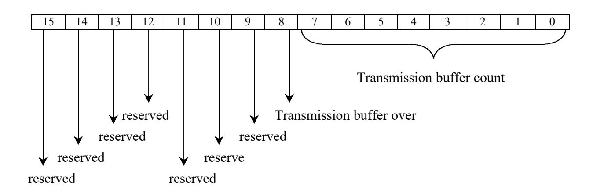
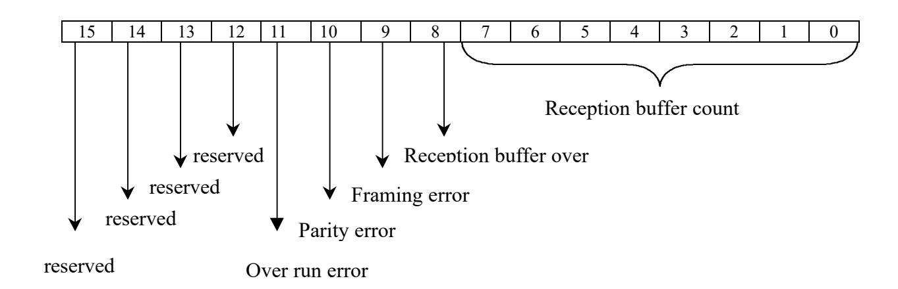

**(Rel. 1.0)**

# *REVISION HISTORY*

| rel 0.1 | Initial release                                                 | 1998/05/19 |
|---------|-----------------------------------------------------------------|------------|
| rel 0.2 | Change of variables and addition of sample program              | 1998/05/21 |
| rel 0.3 | Addition of caution notes, fixed variables, of subroutines, and |            |
| rel 0.8 | Manual and sample program corrections                           | 1998/08/21 |
| rel 1.0 | Official release                                                | 1998/12/09 |

# *TABLE OF CONTENTS*

| SERIAL COMMUNICATION REFERENCE MANUAL.............................................................                          | 1  |
|-----------------------------------------------------------------------------------------------------------------------------|----|
| REVISION HISTORY                                                                                                            | 2  |
| PREFACE                                                                                                                     | 4  |
| SERIAL COMMUNICATION OUTLINE                                                                                                | 5  |
| Serial Communication Specification......................................................................................    | 5  |
| Serial Communication BIOS                                                                                                   | 5  |
| SERIAL COMMUNICATION BIOS VECTOR TABLE..............................................................                        | 6  |
| CAUTION NOTES REGARDING SERIAL COMMUNICATION BIOS USE...........................                                            | 6  |
| VECT_COMINIT Serial Communication Initialization                                                                            | 7  |
| VECT_COMSENDSTART Commence Transmission                                                                                     | 8  |
| VECT_COMRECIVESTART Commence Reception.............................................................                         | 9  |
| VECT_COMCREATEDATA Creating Communication Data                                                                              | 10 |
| VECT_COMONRTS RTS Signal Transmission Permission..............................................                              | 12 |
| VECT_COMOFFRTS RTS Signal Transmission Prohibition                                                                          | 13 |
| VECT_COMSENDSTATUS Obtain Transmission Status                                                                               | 14 |
| VECT_COMRECIVESTATUS Obtain Reception Status.....................................................                           | 15 |
| VECT_COMCREATEBUFDATA Transmission Data Buffer Create...................................                                    | 16 |
| VECT_COMGETBUFDATA Reception Data Buffer Write..................................................                            | 17 |
| SAMPLE PROGRAM............................................................................................................. | 18 |

# *PREFACE*

This reference is written with the understanding that the developer will use assembly level language. If C language is to be used for development, please refer to the manual for the Toshiba development language software package.

# *SERIAL COMMUNICATION OUTLINE*

Listed below are the BIOS subroutines which support serial communication for the NEOGEO POCKET. Vector numbers are set in the header file "COM.INC."

## **Serial Communication Specification**

| Communication speed | : 19200bps                        |
|---------------------|-----------------------------------|
| Bits                | : 8 bit                           |
| Parity              | : None                            |
| Stop bit            | : 1 bit                           |
| Handshake flow      | : handshake with CTS, RTS signals |

# **Serial Communication BIOS**

Serial communication BIOS calls are made with the same method as system calls. Please refer to "SYSTEM CALL REFERENCE MANUAL."

# *SERIAL COMMUNICATION BIOS VECTOR TABLE*

| VECT_COMINIT          | : Serial Communication Initialization BIOS |
|-----------------------|--------------------------------------------|
| VECT_COMSENDSTART     | : Commence Transmission BIOS               |
| VECT_COMRECIVESTART   | : Commence Reception BIOS                  |
| VECT_COMCREATEDATA    | : Create Communication Data BIOS           |
| VECT_COMGETDATA       | : Obtain Communication Data BIOS           |
| VECT_COMONRTS         | : RTS Signal Transmission Permission BIOS  |
| VECT_COMOFFRTS        | : RTS Signal Transmission Prohibition BIOS |
| VECT_COMSENDSTATUS    | : Obtain Transmission Status BIOS          |
| VECT_COMRECIVESTATUS  | : Obtain Reception Status BIOS             |
| VECT_COMCREATEBUFDATA | : Transmission Data Buffer Create BIOS     |
| VECT_COMGETBUFDATA    | : Reception Data Buffer Write BIOS         |

\*Detailed information of each BIOS is stated in the following pages.

# **CAUTION NOTES REGARDING SERIAL COMMUNICATION BIOS USE**

\*Serial data communication transmission and reception are done as interrupts. Any operation which requires a long operation period and suffers from multiple interrupts such as V-BLANK should have VECT\_COMOFFRTS before the operation and VECT\_COMONRTS before reti command. Other operations which require minimal time (ex. H-BLANK) should have similar coding as above.

\*During VECT\_COMGETDATA and VECT\_COMGETBUFDATA operations, transmission and reception interrupts are not allowed. Thus if long operation interrupts (ex. V-BLANK) occur during these operational BIOS calls, there is a possibility of a buffer overrun error and care must be taken to prevent such situations from arising. There is no restriction concerning where these commands must be placed, but it is recommended that these commands be placed after V-BLANK or at the beginning of the MAIN. If these commands are used during interrupts, please push the value in register bank 3 to stack.

\*When using the serial communication BIOS (all BIOS vector calls), please do not use any vector call with software interrupt 1 (swi 1). Please use the system library SYSTEM\_CALL subroutine.

\*The serial communication speed is dependent on the clock gear.

# *VECT\_COMINIT Serial Communication Initialization*

### **DEFINITION:**

Defines ports necessary for serial communication. Please use this call when serial communication is needed.

# **INPUT VARIABLES:**

None

#### **OUTPUT VARIABLES:**

None

### **RETURN VALUES:**

None

### **CONSTANTS:**

# *VECT\_COMSENDSTART Commence Transmission*

### **DEFINITION:**

This is the BIOS to commence transmission of data created in the internal buffer. Please use this call once after the data is created in the buffer.

# **INPUT VARIABLES:**

None

#### **OUTPUT VARIABLES:**

None

### **RETURN VALUES:**

None

### **CONSTANTS:**

# *VECT\_COMRECIVESTART Commence Reception*

### **DEFINITION:**

This is the BIOS to obtain permission to commence reception. Please use this call once to allow reception.

# **INPUT VARIABLES:**

None

#### **OUTPUT VARIABLES:**

None

### **RETURN VALUES:**

None

### **CONTSTANTS:**

# *VECT\_COMCREATEDATA Creating Communication Data*

#### **DEFINITION:**

Creates transmission data in the internal (system) buffer. The buffer is a 64 byte loop buffer. Please use this BIOS before VECT\_COMSENDSTART is called.

## **INPUT VARIABLES:**

register rb3 : 1 byte transmission data

#### **OUTPUT VARIABLES:**

None

## **RETURN VALUES:**

register ra3 : Transmission buffer status flag

### **CONSTANTS:**

COM\_BUF\_OVER : Transmission buffer over COM\_BUF\_OK : Transmission buffer normal

# *VECT\_COMGETDATA Obtain Data Recieved*

#### **DEFINITION:**

1 byte of data received in the internal (system) buffer is obtained.

#### **INPUT VARIABLES:**

**None**

### **OUTPUT VARIABLES:**

register rb3 : 1 byte data received

# **RETURN VALUES:**

register ra3 : Reception buffer status flag

## **CONSTANTS:**

COM\_BUF\_ EMPTY : Reception buffer empty COM\_BUF\_OK : Reception buffer normal

# *VECT\_COMONRTS RTS Signal Transmission Permission*

#### **DEFINITION:**

RTS signal is set to low to allow transmission from others units.

### **INPUT VARIABLES:**

None

## **OUTPUT VARIABLES:**

None

#### **RETURN VALUES:**

None

#### **CONSTANTS:**

# *VECT\_COMOFFRTS RTS Signal Transmission Prohibition*

#### **DEFINITION:**

RTS signal is set to high to prohibit transmission from other units.

### **INPUT VARIABLES:**

None

## **OUTPUT VARIABLES:**

None

#### **RETURN VALUES:**

None

### **CONSTANTS:**

# *VECT\_COMSENDSTATUS Obtain Transmission Status*

#### **DEFINITION:**

Buffer over flag and data count in the internal buffer is obtained. Reserved ERROR status bits do not have set values.

## **INPUT VARIABLES:**

None

#### **OUTPUT VARIABLES:**

None

#### **RETURN VALUES:**

register rwa3 : ERROR status bits & transmission buffer count

### **CONSTANTS:**

COM\_BUFOVERERROR : Buffer over flag

# *VECT\_COMRECIVESTATUS Obtain Reception Status*

#### **DEFINITION:**

Transmission errors which have occurred up till now and the data count in the buffer is obtained. After this BIOS is called, communication error flag is cleared. Reserved area ERROR status bits are 0.

### **INPUT VARIABLES:**

None

### **OUTPUT VARIABLES:**

None

### **RETURN VALUES:**

register rwa3 : ERROR status bits & reception buffer count

## **CONSTANTS:**

COM\_BUFOVERERROR : Buffer over flag COM\_FLAMEERROR : Framing error flag COM\_PARITYERROR : Parity error flag COM\_OVERRUNERROR : Over run error flag

# *VECT\_COMCREATEBUFDATA Transmission Data Buffer Create*

#### **DEFINITION:**

Address and size of the transmission data stored in user buffer is defined and stored in the system buffer. This is a "block transfer" version of VECT\_COMCREATEDATA. It is quicker than using a loop with VECT\_COMCREATEDATA.

### **INPUT VARIABLES:**

register xhl3 : Transmission data buffer address register rb3 : Transmission data buffer size

#### **OUTPUT VARIABLES:**

register xhl3 : : When the buffer works normally, points to the next data address. If data has been left from previous transmission, points to the data. register rb3 : Number of data left

### **RETURN VALUES:**

None

## **CONSTANTS:**

COM\_BUF\_OK : Buffer transfer normal (no transfer left over)

# *VECT\_COMGETBUFDATA Reception Data Buffer Write*

### **DEFINITION:**

Address and size of the reception data wanted in the user buffer is defined and obtained from the system buffer. This is a "block transfer" version of VECT\_COMGETDATA. It is quicker than using a loop with VECT\_COMGETDATA.

# **INPUT VARIABLES:**

register xhl3 : Reception data buffer address register rb3 : Reception data buffer size

## **OUTPUT VARIABLES:**

register xhl3 : Points to the address where the next data will be stored. register rb3 : Number of data left

### **RETURN VALUES:**

None

#### **CONSTANTS:**

COM\_BUF\_OK : Buffer obtained normally (no reception left over)

# *SAMPLE PROGRAM*

;\*\*\*\*\*\*\*\*\*\*\*\*\*\*\*\*\*\*\*\*\*\*\*\*\*\*\*\*\*\*\*\*\*\*\*\*\*\*\*\*\*\*\*\*\*\*\*\*\*\*\*\*\*\*\*\*\*\*\*\*\*\*\*\*\*\*\*\*\*\*\*\*\* ;\* \* ;\* SERIAL COMMUNICATION SAMPLE PROGRAM \* ;\* \* ;\* com\_sample.asm \* ;\* \* ;\* First Edition 1998/05/21 NEOGEO POCKET PROJECTS \* ;\* Second Edition 1998/06/11 NEOGEO POCKET PROJECTS \* ;\* Sample program and vector calls modified \* ;\* Third Edition 1998/08/21 NEOGEO POCKET PROJECTS \* ;\* Bug fixes \* ;\* \* ;\*\*\*\*\*\*\*\*\*\*\*\*\*\*\*\*\*\*\*\*\*\*\*\*\*\*\*\*\*\*\*\*\*\*\*\*\*\*\*\*\*\*\*\*\*\*\*\*\*\*\*\*\*\*\*\*\*\*\*\*\*\*\*\*\*\*\*\*\*\*\*\*\*

;\*\*\*\*\*\*\*\*\*\*\*\*\*\*\*\*\*\*\*\*\*\*\*\*\*\*\*\*\*\*\*\*\*\*\*\*\*\*\*\* \$MAXIMUM ;

module COM\_SAMPLE ;

;\*\*\*\*\*\*\*\*\*\*\*\*\*\*\*\*\*\*\*\*\*\*\*\*\*\*\*\*\*\*\*\*\*\*\*\*\*\*\*\*

; --------------------------------- \$include "sub\_ext.inc" \$include "data\_equ.inc" \$include "k1head.inc" \$include "glbwork.inc" \$include "com.inc" PROG section code large ; public SYSTEM\_CALL

;\*\*\*\*\*\*\*\*\*\*\*\*\*\*\*\*\*\*\*\*\*\*\*\*\*\*\*\*\*\*\*\*\*\*\*\*\*\*\*\*\*\*\*\*\*\*\*\*\*\*\*\*\*\*\*\*\*\*\*\*\*\*\*\*\*\*\*\*\*\*\*\*\* ;\* \* ;\* MAIN\_Init \* ;\* \* ;\* [FUNCTION] INITIALIZATION PROGRAM \* ;\* \* ;\* First Edition 1998/05/21 NEOGEO POCKET PROJECTS \* ;\* Second Edition 1998/06/11 NEOGEO POCKET PROJECTS \* ;\* Vector calls modified \* ;\*\*\*\*\*\*\*\*\*\*\*\*\*\*\*\*\*\*\*\*\*\*\*\*\*\*\*\*\*\*\*\*\*\*\*\*\*\*\*\*\*\*\*\*\*\*\*\*\*\*\*\*\*\*\*\*\*\*\*\*\*\*\*\*\*\*\*\*\*\*\*\*\*

#### MAIN\_Init:

; OTHER INITIALIZATION

ldb rw3,VECT\_COMINIT ;serial communication initialization

calr SYSTEM\_CALL ;vector call

; OTHER INITIALIZATION

;\*\*\*\*\*\*\*\*\*\*\*\*\*\*\*\*\*\*\*\*\*\*\*\*\*\*\*\*\*\*\*\*\*\*\*\*\*\*\*\*\*\*\*\*\*\*\*\*\*\*\*\*\*\*\*\*\*\*\*\*\*\*\*\*\*\*\*\*\*\*\*\*\* ;\* \* ;\* MAIN\_main \* ;\* \* ;\* [FUNCTION] MAIN PROGRAM \* ;\* \* ;\* First Edition 1998/05/21 NEOGEO POCKET PROJECTS \* ;\* Second Edition 1998/06/11 NEOGEO POCKET PROJECTS \* ;\* Vector calls modified \* ;\* \* ;\*\*\*\*\*\*\*\*\*\*\*\*\*\*\*\*\*\*\*\*\*\*\*\*\*\*\*\*\*\*\*\*\*\*\*\*\*\*\*\*\*\*\*\*\*\*\*\*\*\*\*\*\*\*\*\*\*\*\*\*\*\*\*\*\*\*\*\*\*\*\*\*\*

MAIN\_main:

#### ; OTHER MAIN OPERATIONS

ldb rw3,VECT\_COMRECIVESTART ;set reception BIOS permission calr SYSTEM\_CALL ;vector call

;\*\*\*\*\*\*\*\*\*\*\*\*\*\*\*\*\*\*\*\*\*\*\*\*\*\*\*\*\*\*\*\*\*\*\*\*\*\*\*\*\*\*\*\*\*\*\*\*\*\*\*\*\*\*\*\*\*\*\*\*\*\*\*\*\* ;\* CAUTION \* ;\* Please make sure both units status for "power on" may be assessable. \* ;\* If permission is given with one unit off, garbage data will be received \* ;\* and undesired multiple interrupts will result. \* ;\* THIS MAY BE CHANGED AT A LATER DATE. \* ;\*\*\*\*\*\*\*\*\*\*\*\*\*\*\*\*\*\*\*\*\*\*\*\*\*\*\*\*\*\*\*\*\*\*\*\*\*\*\*\*\*\*\*\*\*\*\*\*\*\*\*\*\*\*\*\*\*\*\*\*\*\*\*\*\*

#### ; OTHER MAIN OPERATIONS

;\* CREATING TRANSMISSION DATA \*

calr MAIN\_CreateData

#### ; OTHER MAIN OPERATIONS

;\* OBTAINING RECEPTION DATA \*

calr MAIN\_GetData

#### ; OTHER MAIN OPERATIONS

;\* WAITING FOR V-Blank INTERRUPT \*

ldb (vwait),0xff

vwait\_loop:

cpb (vwait),0

jr nz,vwait\_loop jr MAIN\_main

| ;*************************************************************************    |   |
|-------------------------------------------------------------------------------|---|
| ;*                                                                            | * |
| ;* MAIN_CreateData                                                            | * |
| ;*                                                                            | * |
| ;* [FUNCTION] SUBROUTINE TO CREATE TRANSMISSION BUFFER                        | * |
| ;*                                                                            | * |
| ;* First Edition 1998/05/21 NEOGEO POCKET PROJECTS                            | * |
| ;* Second Edition 1998/06/11 NEOGEO POCKET PROJECTS                           | * |
| ;* Vector calls modified                                                      | * |
| ;* Third Edition 1998/08/21 NEOGEO POCKET PROJECTS                            | * |
| ;* Bug fixes                                                                  | * |
| ;* ;************************************************************************* | * |

#### MAIN\_CreateData:

| lda  | xix,data_send_addr     | ;obtaining data address                |
|------|------------------------|----------------------------------------|
| ldb  | b,(data_send_size)     | ;obtaining data size                   |
| ldb  | a,(xix+)               |                                        |
| ldb  | rb3,a                  | ;transferring 1 byte data              |
| dec  | 1,b                    | ;decrementing data size                |
| cpb  | b,0                    | ;data end comparison                   |
| jr   | eq,data_create_end     | ;end buffer creation if data end       |
| ldb  | rw3,VECT_COMCREATEDATA | ;set transmission data creation BIOS   |
| calr | SYSTEM_CALL            | ;vector call                           |
| cpb  | ra3,COM_BUF_OVER       | ;buffer over?                          |
| jr   | eq,data_create_over    | ;if buffer over, wait until over       |
| jr   | data_create            | ;if normal operation, create next data |
| ldb  | rw3,VECT_COMSENDSTART  | ;set commence transmission BIOS        |
| calr | SYSTEM_CALL            | ;vector call                           |

#### ;\*\*\*\*\*\*\*\*\*\*\*\*\*\*\*\*\*\*\*\*\*\*\*\*\*\*\*\*\*\*\*\*\*\*\*\*\*\*\*\*\*\*\*\*\*\*\*\*\*\*\*\*\*\*\*\*\*\*\*\*\*\*\*\*\*\*\*\*\*\*\*\*\* ;\*CAUTION \*

;\* If transmission data exceeds 64 bytes in one transfer, please include the \* ;\* the commence transmission BIOS inside the loop. Because commence \* ;\* transmission calls are ignored while data exists in the buffer, the call may \* ;\* be made numerous times without problems. \* ;\*\*\*\*\*\*\*\*\*\*\*\*\*\*\*\*\*\*\*\*\*\*\*\*\*\*\*\*\*\*\*\*\*\*\*\*\*\*\*\*\*\*\*\*\*\*\*\*\*\*\*\*\*\*\*\*\*\*\*\*\*\*\*\*\*\*\*\*\*\*\*\*\*

| ;*************************************************************************    |   |
|-------------------------------------------------------------------------------|---|
| ;*                                                                            | * |
| ;* MAIN_GetData                                                               | * |
| ;*                                                                            | * |
| ;* [FUNCTION] DATA RECEPTION SUBROUTINES                                      | * |
| ;*                                                                            | * |
| ;* First Edition 1998/05/21 NEOGEO POCKET PROJECTS                            | * |
| ;* Second Edition 1998/06/11 NEOGEO POCKET PROJECTS                           | * |
| ;* Vector calls modified                                                      | * |
| ;* Third Edition 1998/08/21 NEOGEO POCKET PROJECTS                            | * |
| ;* Bug fixes                                                                  | * |
| ;* ;************************************************************************* | * |

#### MAIN\_GetData:

ldb rw3,VECT\_COMRECIVESTUTAS ;set obtain reception status BIOS

calr SYSTEM\_CALL ;vector call

ldw wa,rwa3 ;move return value to local

;mask error bit

andw wa,COM\_FLAMEERROR | COM\_PARITYERROR | COM\_OVERRUNERROR

jr nz,data\_get\_error ;error operation

lda xix,data\_recive\_addr ;obtain address of data to be stored

ldb b,(data\_recive\_size) ;obtain data size

#### data\_get:

dec 1,b ;decrementing data size cpb b,0 ;data end comparison

#### ret eq ;end data reception if data end data\_get\_empty:

ldb rw3,VECT\_COMGETDATA ;set obtaining data recieved BIOS

calr SYSTEM\_CALL ;vector call cpb ra3,COM\_BUF\_EMPTY ;buffer empty?

jr eq,data\_get\_empty ;wait for reception if buffer empty

ldb a,rb3

ldb (xix+),a ;obtain data received

jr data\_get ;if normal operation, obtain next data

#### data\_get\_error:

; ERROR OPERATION

ret

;\*\*\*\*\*\*\*\*\*\*\*\*\*\*\*\*\*\*\*\*\*\*\*\*\*\*\*\*\*\*\*\*\*\*\*\*\*\*\*\*\*\*\*\*\*\*\*\*\*\*\*\*\*\*\*\*\*\*\*\*\*\*\*\*\*\*\*\*\*\*\*\*\* ;\* (Example of operation during interrupt) \* ;\* \* ;\* INT\_V\_Blank \* ;\* \* ;\* [FUNCTION] V-Blank interrupt \* ;\* \* ;\* First Edition 1998/05/21 NEOGEO POCKET PROJECTS \* ;\* Second Edition 1998/06/11 NEOGEO POCKET PROJECTS \* ;\* Vector calls modified \* ;\* \* ;\*\*\*\*\*\*\*\*\*\*\*\*\*\*\*\*\*\*\*\*\*\*\*\*\*\*\*\*\*\*\*\*\*\*\*\*\*\*\*\*\*\*\*\*\*\*\*\*\*\*\*\*\*\*\*\*\*\*\*\*\*\*\*\*\*\*\*\*\*\*\*\*\*

INT\_V\_Blank:

ldb rw3,VECT\_COMOFFRTS ;set RTS signal trans. prohibition BIOS

calr SYSTEM\_CALL ;vector call

; OPERATION DURING V-blank

ldb rw3,VECT\_COMONRTS ;set RTS signal trans. permission BIOS

calr SYSTEM\_CALL ;vector call

reti

| ;*************************************************************************    |   |
|-------------------------------------------------------------------------------|---|
| ;*                                                                            | * |
| ;* MAIN_CreateData                                                            | * |
| ;*                                                                            | * |
| ;* [FUNCTION] TRANSMISSION BUFFER CREATION SUBROUTINE                         | * |
| ;* USING VECT_COMCREATEBUFDATA                                                | * |
| ;*                                                                            | * |
| ;* First Edition 1998/06/11 NEOGEO POCKET PROJECTS                            | * |
| ;* Second Edition 1998/08/21 NEOGEO POCKET PROJECTS                           | * |
| ;* Bug fixes                                                                  | * |
| ;* ;************************************************************************* | * |

#### MAIN\_CreateData:

lda xhl,data\_send\_addr ;obtaining data address ldl xhl3,xhl ;obtaining data address ldb b,(data\_send\_size) ;obtaining data size

#### ldb rb3,b ;obtaining data size data\_create:

;set transmission data creation storing buffer BIOS

ldb rw3,VECT\_COMCREATEBUFDATA

calr SYSTEM\_CALL ;vector call

cpb rb3,COM\_BUF\_OK ;normal? (no transfer data left over) jr eq,data\_create\_end ;if normal, jump to operation end ldb rw3,VECT\_COMSENDSTART ;set commence trans. BIOS

calr SYSTEM\_CALL ;vector call

jr data\_create ;loop until no transfer data left over

data\_create\_end:

ldb rw3,VECT\_COMSENDSTART ;set commence trans. BIOS

calr SYSTEM\_CALL ;vector call

ret

| ;*************************************************************************    |   |
|-------------------------------------------------------------------------------|---|
| ;*                                                                            | * |
| ;* MAIN_GetData                                                               | * |
| ;*                                                                            | * |
| ;* [FUNCTION] RECEPTION BUFFER SUBROUTINE                                     | * |
| ;* USING VECT_COMGETBUFDATA                                                   | * |
| ;*                                                                            | * |
| ;* First Edition 1998/06/11 NEOGEO POCKET PROJECTS                            | * |
| ;* Second Edition 1998/08/21 NEOGEO POCKET PROJECTS                           | * |
| ;* Bug fixes                                                                  | * |
| ;* ;************************************************************************* | * |

#### MAIN\_GetData:

ldb rw3,VECT\_COMRECIVESTATUS ;set reception status BIOS

calr SYSTEM\_CALL ;vector call

ldw wa,rwa3 ;move return value to local

;mask error bit only

andw wa,COM\_FLAMEERROR | COM\_PARITYERROR | COM\_OVERRUNERROR

jr nz,data\_get\_error ;error operation

lda xhl,data\_recive\_addr ;obtain address to store lda xhl3,xhl ;obtain address to store ldb b,(data\_recive\_size) ;obtain data size ldb rb3,b ;obtain data size

data\_get:

;set reception data buffer writing BIOS

ldb rw3,VECT\_COMGETBUFDATA

calr SYSTEM\_CALL ;vector call

cpb rb3,COM\_BUF\_OK ;normal operation? (no data left over)

ret eq ;if normal operation, return jr data\_get ;loop until no data left over

data\_get\_error:

;~ ERROR OPERATION ~