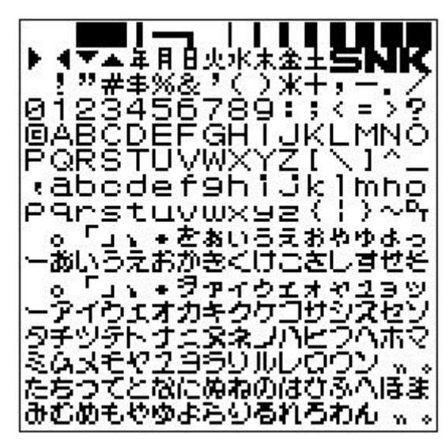

*SYSTEM CALL REFERENCE MANUAL*

**SNK CORPORATON 1998.10.21 Release 1.0**

# *TABLE OF CONTENTS*

| PREFACE                                                                                                                             | 3                                                                                                                |
|-------------------------------------------------------------------------------------------------------------------------------------|------------------------------------------------------------------------------------------------------------------|
| SYSTEM CALL OUTLINE                                                                                                                 | 4                                                                                                                |
| USING SYSTEM CALLS                                                                                                                  | 4                                                                                                                |
| USE WITH SUBROUTINE CALLS                                                                                                           | 4                                                                                                                |
| USE WITH SOFTWARE INTERRUPTS...............................................................................                         | 4                                                                                                                |
| SYSTEM CALL VECTOR TABLE                                                                                                            | 5                                                                                                                |
| EXAMPLE 1.......................................................................................................................... | 5                                                                                                                |
| EXAMPLE 2.......................................................................................................................... | 5                                                                                                                |
| SYSTEM PROGRAM VERSION USE CONDITIONS..............................................................                                 | 6                                                                                                                |
| VECTOR DEFINITIONS...........................................................................................................       | 7                                                                                                                |
| VECT_SHUTDOWN.............................................................................................................          | 7                                                                                                                |
| VECT_CLOCKGEARSET.....................................................................................................              | 7                                                                                                                |
| VECT_INTLVSET                                                                                                                       | 8                                                                                                                |
| VECT_RTCGET                                                                                                                         | 8                                                                                                                |
| VECT_ALARMSET...............................................................................................................        | 9                                                                                                                |
| VECT_ALARMDOWNSET                                                                                                                   | 9                                                                                                                |
| VECT_SYSFONTSET                                                                                                                     | 10                                                                                                               |
| VECT_FLASHERS                                                                                                                       | ..............................................................................................................11 |
| VECT_FLASHPROTECT                                                                                                                   | 12                                                                                                               |
| VECT_GEMODESET                                                                                                                      | 13                                                                                                               |
| REVISION HISTORY                                                                                                                    | 14                                                                                                               |

# *PREFACE*

Materials covered in this manual are based on system program requirements of the NEOGEO POCKET. Please understand that there is the possibility of updates to the materials and thus the user program needs to be corrected accordingly.

This manual assumes development will be in assembly language. If C language is to be used for development, please refer to the manual supplied with the Toshiba Development package.

# *SYSTEM CALL OUTLINE*

These are subroutines prepared as part of the system to allow changes to the settings managed by the system and special operations such as accessing the flash memory.

Each operation has a specific vector number associated with it and the vector numbers are defined in the header file SYSTEM.INC.

### *USING SYSTEM CALLS*

There are two different methods for using the system calls. Please choose according to the need and operation necessary.

### *USE WITH SUBROUTINE CALLS*

First set the vector number in register W (RW3) of register bank 3 (register bank for the system). Next set the necessary parameters specific to the operation. And finally, call the subroutine SYSTEM\_CALL.

Because this method does not use any interrupts unlike the method below, it does not hinder other interrupts. If system calls are to be made while using horizontal blanking interrupt (Hint), or serial communication interrupts are used, this method is recommended.

However, all interrupts are prohibited during system calls related to flash memory management.

To use the SYSTEM\_CALL subroutine, it is necessary to link the system library. Please refer to "SYSTEM LIBRARY REFERENCE MANUAL" on how to link to the library.

### *USE WITH SOFTWARE INTERRUPTS*

First set the vector number in register W (RW3) of register bank 3 (register bank for the system). Next set the necessary parameters specific to the operation. And finally, use software interrupt 1 (SWI 1).

This method prohibits other interrupts (DI). Because of this, it is not affected by most of the other interrupts. If it is preferable not to have interrupts (such as V-int) generated during an operation, so this method is recommended. Specifically, please use the VECT\_SHUTDOWN operation during shutdown and flash memory related operations (VECT\_FLASHWRITE, VECT\_FLASHERS, and VECT\_FLASHALLERS).

Conversely, this method is capable of changing the interrupt generation timing of other interrupts. Using this method during time crucial operations (such as H-int and serial communication) is not recommended.

# *SYSTEM CALL VECTOR TABLE*

| VECT_SHUTDOWN     |               | ;Shutdown (power off)     |                             |
|-------------------|---------------|---------------------------|-----------------------------|
| VECT_CLOCKGEARSET |               | ;Changing CPU clock speed |                             |
| VECT_INTLVSET     |               | ;Interrupt level setting  |                             |
| VECT_RTCGET       |               | ;Real time clock          | × obtain time               |
| VECT_ALARMSET     |               | ;Real time clock          | × alarm setting during game |
| VECT_ALARMDOWNSET |               | ;Real time clock          | × unit start up alarm       |
| VECT_SYSFONTSET   |               | ;System font setting      |                             |
| VECT_FLASHWRITE   | ;Flash memory | ×                         | data write                  |
| VECT_FLASHALLERS  | ;Flash memory | ×                         | erase all blocks            |
| VECT_FLASHERS     | ;Flash memory | ×                         | erase block specified       |
| VECT_FLASHPROTECT | ;Flash memory | ×                         | protect block specified     |
| VECT_GEMODESET    |               | ;color LCD specific       | × set color mode            |

\*Each subroutine requires different variables. Please refer to vector definitions for details.

## *EXAMPLE 1*

· Lowering CPU clock speed

ldb rw3, VECT\_CLOCKGEARSET ; change clock gear ldb rb3,0x04 ; clock speed to the lowest 0x04 ldb rc3,0x00 ; no auto regeneration with control panel input call SYSTEM\_CALL ; call system call subroutine

### *EXAMPLE 2*

· Writing data to flash memory

| ldb | rw3, VECT_FLASHWRITE | ; writing flash memory                  |
|-----|----------------------|-----------------------------------------|
| ldb | ra3,0x00             | ;selecting flash memory card (0x200000) |
| ldw | rbc3,0x02            | ; number of transfer (0x200             |
| ldl | xhl3,0x6600          | ; from address (RAM for example)        |
| ldl | xde3,0x70000         | ; to address (0x270000 in this example) |
| swi | 1                    | ; software interrupt 1                  |

# *SYSTEM PROGRAM VERSION USE CONDITIONS*

Some of the system calls are only valid for use in the color LCD system program. The definitions following this page are noted to specify applicability in monochrome LCD system program or color LCD system program.

Please look in "OS\_Version" of the system work. If the environment is a monochrome LCD system program, please do not use system calls only valid in color LCD environment.

Please refer to SYSTEM WORK REFERENCE MANUAL (rel 0.9 or later) for further information on "OS\_Version".

# *VECTOR DEFINITIONS*

Please use register bank 3 (system register) for all registers specified by the parameters.

Parameter None Return value None

Powers off the NEOGEO POCKET unit.

The power on/off of the NEOGEO POCKET is managed by the system. When a request from the system to power off the unit is received, the game program must initiate shutdown by calling this subroutine. Please refer to the SYSTEM WORK REFERENCE MANUAL for details about shutdown.

Power off request from the system is generated when the following occurs:

- 1. Main battery output level drops considerably
- 2. When the system has been left ON for a long time (no panel switch input) and auto power off system is being used

Parameter RB3………CPU clock speed (0x00 0x04)

RC3………auto clock speed regeneration with panel switch input

(0: No other than 0: Yes)

Return value None Destroys None

Changes the CPU clock speed of NEOGEO POCKET.

The CPU operation clock speed is highest with 0 and as the values increase it slows down.

If auto clock speed regeneration is on, any input from the panel switch will automatically set the clock speed to the highest value.

In order to lower the power consumption by the system, it is recommended to lower the clock speed when high clock speeds are not necessary.

| Parameters       | System Clock |
|------------------|--------------|
| 0x00: 1 x cycle  | 6.144 MHz    |
| 0x01: 2 x cycle  | 3.072 MHz    |
| 0x02: 4 x cycle  | 1.536 MHz    |
| 0x03: 8 x cycle  | 768 kHz      |
| 0x04: 16 x cycle | 384 kHz      |

## *VECT\_INTLVSET* Monochrome O Color O

Parameter RB3………interrupt level (0x00 0x05)

RC3………interrupt number to be set (0x00 0x09)

Return value None Destroys None

Sets the interrupt level. Because some interrupts in the NEOGEO POCKET have system involvement, please use this subroutine to change interrupt levels. Please DO NOT set interrupt levels that may not be set by this subroutine. DO NOT create functions to do so.

The higher the level number, the higher the priority. If the interrupt level is set to 0, the interrupt that was set to 0 is nullified. The highest level is 0x05.

Also, setting the interrupt with this subroutine retains the interrupt request at this time. If the interrupt request is to be destroyed, please use the system library routine INT\_LV\_SET (Please refer to SYSTEM LIBRARY MANUAL for further information).

"Interrupt number to be set" should be the interrupt who's level is to be modified. The following is the list of interrupts and their corresponding interrupt number.

0 : Interrupt request from RTC alarm (Only valid when the game is running \*1) 1 : Interrupt request from the Z80 CPU 2 : Interrupt request from 8 bit timer 0 3 : Interrupt request from 8 bit timer 1 4 : Interrupt request from 8 bit timer 2 5 : Interrupt request from 8 bit timer 3 6 : End of transfer interrupt request from Micro DMA channel 0 7 : End of transfer interrupt request from Micro DMA channel 1 8 : End of transfer interrupt request from Micro DMA channel 2 9 : End of transfer interrupt request from Micro DMA channel 3

\*1 When the power is off, RTC alarm interrupt is set at the system level and thus can not be set at the user level.

| VECT_RTCGET                        |                                                | Monochrome O Color O                    |
|------------------------------------|------------------------------------------------|-----------------------------------------|
| Parameter                          | XHL3……get real time clock data storage address |                                         |
| Return value (XHL3+0)(1Byte)……year | ¬                                              | 0~99(00~90=2000~2090, 91~99=1991~ 1999) |
| (XHL3+1)(1Byte)……month             | ¬                                              | 1~12                                    |
| (XHL3+2)(1Byte)……day               | ¬                                              | 1~31                                    |
| (XHL3+3)(1Byte)……hour              | ¬                                              | 0~23                                    |
| (XHL3+4)(1Byte)……minute            | ¬                                              | 0~59                                    |
| (XHL3+5)(1Byte)……second            | ¬                                              | 0~59                                    |
|                                    | (XHL3+6)(1Byte)……upper 4 bit: leap year        | ¬ 0~3                                   |
|                                    | lower 4 bits: day of the week                  | ¬ 0~6                                   |
| Destroys None                      |                                                |                                         |

## *VECT\_ALARMSET* Monochrome O Color O

Parameter QC3……day¬error value if other than 1~31 or 0xFF RB3………hour¬error value if other than 0~23 or 0xFF RC3………minute¬error value if other than 0~59 or 0xFF Return value RA3………SYS\_SUCCESS: no error SYS\_FAILURE: error Destroys RB3, RC3

Sets the game alarm. Please set values as BCD values.

VECT\_ALARMSET is only valid when the power is ON. The interrupt is initiated on the time and date set, but if the user software which set the alarm is not inserted in the unit (NEOGEO POCKET) or if the power is OFF, the interrupt is ignored (\*2).

When the power is ON, the interrupt operation set with the user vector 0x6FC8 "RTC alarm interrupt operation" is initiated (during normal operation of the unit).

There is only one alarm setting. If multiple settings are set, the last setting is valid.

\*2 Even when the user software which set the alarm is inserted in the unit, if the system program (i.e. internal software, eye catch, etc.) is running the interrupt is ignored. Please DO NOT create a program with high dependency on the alarm.

## *VECT\_ALARMDOWNSET* Monochrome O Color O

Parameter QC3………day¬error value if other than 1~31 or 0xFF RB3………hour¬error value if other than 0~23 or 0xFF RC3………minute¬error value if other than 0~59 or 0xFF Return value RA3………SYS\_SUCCESS: no error SYS\_FAILURE: error Destroys RB3, RC3

Sets the alarm (interrupt) which powers ON the NEOGEO POECKET unit when the power is OFF. Please set values as BCD values.

VECT\_ALARMDOWNSET operates only when the power is OFF. If the power is OFF on the day and time specified, the user software is run. User\_Boot (0x6F84) in the system work has a bit ON to signify the difference between this startup and normal start up. Please refer to SYSTEM WORK REFERENCE MANUAL for details.

The user software which set the alarm must be inserted on the time specified or if the power is ON the interrupt is ignored. If another game software is started up even once, the alarm setting is destroyed (excluding the same software title).

There may be only one alarm. If multiple alarms are set, the last one is the valid one. Please be aware that VECT\_ALARMSET and VECT\_ALARMDOWN set may not be set at the same time.

### About 0xFF Setting of the Alarm

This value in the day, time and minute parameters, allows the alarm to ignore a parameter. For example, setting 0xFF in the day, 0x10 in the hour, and 0x30 in the minute sets the alarm to 10:30 AM on the day the alarm is set (if it is before 10:30 AM) or the next day.

\*If the alarm is ignored once, the setting is invalid from that time and is destroyed.

## *VECT\_SYSFONTSET* Monochrome O Color O

Parameter RA3……upper 4 bits specify palette code for transparency (0~3) lower 4 bits specify palette for font (0~3)

Return value None

Destroys None

Transfers 256 system font characters to the front half of the character RAM (0xA00~0xAFFF). In general, please specify '0x03' for RA3.

### *SYSTEM FONT*

### 0123456789ABCDEF

## *VECT\_FLASHWRITE* Monochrome O Color O

Parameter RA3……..specify flash memory address (0: 0x200000 / 1: 0x800000)

RBC3……transfer byte number (transfers in multiples of 256)

XHL3……data transfer from address XDE3……data transfer to address

Return value RA3……..SYS\_SUCCESS: no error

 Other values: error Destroys RBC3, XHL3, XDE3

Writes data to flash memory.

Data writes are in 0x100 bytes. Setting 0x01 in RBC3 register transfers 0x100 bytes.

## *VECT\_FLASHALLERS* Monochrome O Color O

Parameter RA3……..specify flash memory address (0: 0x200000 / 1: 0x800000)

Return value RA3……..SYS\_SUCCESS: no error

Other values: error

Destroys None

Erases all blocks of flash memory(\*3). However, protected areas are not erased.

## *VECT\_FLASHERS* Monochrome O Color O

Parameter RA3……..specify flash memory address (0: 0x200000 / 1: 0x800000)

RB3…..…block number

Return value RA3……..SYS\_SUCCESS: no error Other values: error

Destroys None

Erases specified block of flash memory. However, protected areas are not erased.

### Caution regarding flash memory block erase system call

System call "VECT\_FLASHERS" cannot operate on blocks 32, 33, 34 (F16\_B32, F16\_B33, F16\_B34). When these areas need to be operated on, please use the system library routine "CLR\_FLASH\_RAM" (Please refer to SYSTEM LIBRARY MANUAL for further information).

\*3 Please refer to FLASH MEMORY REFERENCE MANUAL for flash memory address and block address information.

Parameter RA3……..please set 0x01 RB3…..…start block number for protect RC3…..…flash memory card type (0x00: 4Mbit, 0x01: 8Mbit, 0x02:16Mbit) RD3…..…number of blocks to be protected Return value RA3……..SYS\_SUCCESS: no error Other values: error Destroys None

Protects the requested number of blocks from the start address in the flash memory. As an exception, it is not possible to protect blocks after block 32 (F16\_B32).

Once the blocks are protected, it is impossible to write or erase data in these blocks.

There is no operation which will remove the protection, and care must be taken when this system call is used.

Flash memory card applicable to this operation is the CS1 (the slot in the 0x800000 development tool). If the program is run only with the use of the NEOGEO POCKET, this system call is invalid.

Also, this system call destroys the user work RAM area. The area to be destroyed is approximately 0x400 bytes starting from 0x6000.

Calling this system call while using the debugger will cause the debugger to freeze up.

## *VECT\_GEMODESET* Monochrome X Color O

Parameter RA3……mode setting 0x00: K1GE upper palette compatible mode 0x10: K2GE mode

Destroys None

Sets the color display mode to either the K1GE upper palette compatible mode or the K2GE mode. Mode change is immediate. Please refer to K2GE TECHNICAL REFERENCE MANUAL for more information.

# *REVISION HISTORY*

| rel 0.1 | Initial release 1998/05/18                          |
|---------|-----------------------------------------------------|
| rel 0.2 | “VECT_FLASHWRITE” register use modified 1998/06/01  |
| rel 0.3 | System font modified                                |
| rel 0.4 | System font modified                                |
| rel 0.8 | PREFACE changed                                     |
| rel 0.9 | “VECT_INTLVSET” interrupt request caution not added |
| rel 1.0 | “VECT_GEMODESET” added                              |