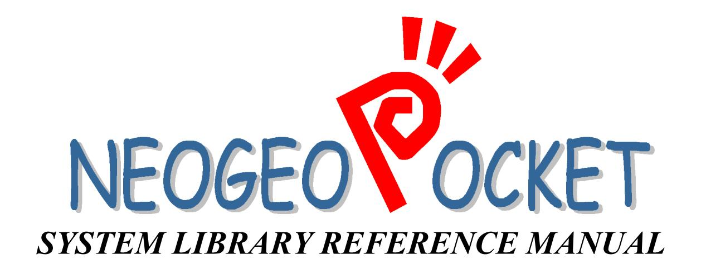

**SNK CORPORATION 1998.10.29 REL 1.0**

# *TABLE OF CONTENTS*

| PREFACE                                                                                                                            | 3 |
|------------------------------------------------------------------------------------------------------------------------------------|---|
| LINKING SYSTEM LIBRARY..................................................................................................           | 4 |
| SYSTEM PROGRAM VERSION USE CONDITIONS..............................................................                                | 5 |
| SUBROUTINE DEFINITIONS..................................................................................................           | 6 |
| SYSTEM_CALL                                                                                                                        | 6 |
| SYS_PATCH......................................................................................................................... | 6 |
| WRITE_FLASH_RAM..........................................................................................................          | 7 |
| CLR_FLASH_RAM                                                                                                                      | 7 |
| INT_LV_SET                                                                                                                         | 7 |
| FLASH_M_READ.................................................................................................................      | 8 |
| REVISION HISTORY                                                                                                                   | 9 |

### *PREFACE*

Contents written in this reference manual is based on NEOGEO POCKET system program. Please be aware that there will be revisions with system program version updates.

The reference manual assumes development will be done using assembly language. If C language is to be used for development, please refer to the manual included in Toshiba's Development Software Package.

## *LINKING SYSTEM LIBRARY*

Program sample involved in linking the system library "**SYSTEM.LIB**" is listed below.

#### LINK COMMAND FILE

Example: SAMPLE.LCF

| Example:   | SAMPLE.LCF     |                    |
|------------|----------------|--------------------|
| system.lib |                | ;library file name |
| io(RW)     | :org=0x0       | len=0x100          |
| work(RW)   | :org=0x4000    | len=0x3000         |
| z80(RW)    | :org=0x7000    | len=0x1000         |
| lcd(RW)    | : org=0x8000   | len=0x4000         |
| user(RX)   | : org=0x200000 | len=0x200000       |
| }          |                | ;library file name |
|            | system.lib     | ;library file name |

Example: SAMPLE.ASM

\$include **"system.inc"**

#### extern large **SYSTEM\_CALL**

;;Example 1 Changing CPU Clock Speed to 4 ldb rw3,VECT\_CLOCKGEARSET ; changing clock speed ldb rb3,0x04 ; clock speed is set to the lowest 0x04 ldb rc3,0xff ; auto clock speed regeneration is OFF calr**SYSTEM\_CALL** ; calling system call

### *SYSTEM PROGRAM VERSION USE CONDITIONS*

There are routines only valid for use with the system program for color LCD. SUBROUTINE DEFINITIONS listed in the following pages is marked for color LCD system use only or use for both (monochrome and color).

Please check the OS\_Version in system work to determine which system program is being run, monochrome or color. Please DO NOT use any subroutines valid for use only with color LCD environment if the system program on the hardware is the monochrome version.

Please refer to the OS\_Version section in SYSTEM WORK REFERENCE MANUAL (rel 0.9 or later) for further information.

## *SUBROUTINE DEFINITIONS*

Parameter Return value dependent on the system call functionality Destroys

This is the system call to allow usage of system calls in a subroutine. (Please refer to the SYSTEM CALL REFERENCE MANUAL for details on system calls.)

Parameter Return value none Destroys

This is the routine used for problems arising from the initial production of the system program. Sudden change or interruption in the main power supply (rapid cyclical removal and insertion of batteries, etc.) may result in the inability of the system to shutdown with the depression on the main power SW. This routine is a measure to correct this problem. Please call this routine at least once at startup.

This is the subroutine to write to the flash memory. The functionality is the same as the system call VECT\_FLASHWRITE.

Parameter Return value This subroutine function is the same as the system call VECT\_FLASHERS. Destroys

This is the subroutine to erase blocks of the flash memory.

The operation is similar to system call VECT\_FLASHERS.

Unfortunately, there is a bug in the production version of the NEOGEO POCKET system program which does not allow the VECT\_FLASHERS to properly erase blocks F16\_B32, F16\_B33, and F16\_B34 in the 16 Mbit flash memory card. For this reason, please use this routine when the listed blocks need to be erased.

Other blocks in the 16Mbit and blocks in the 4Mbit and 8 Mbit flash memory will be erased properly with the use of system call VECT\_FLASHERS. Also the use of the system call operates quicker than this subroutine.

Parameter RB3……interrupt level (0x00 ~ 0x05 or OR value with \_INT\_CLR\_BIT\*) RC3……interrupt number to be set (0x00 ~ 0x09)

Return value Destroys Same as system call VECT\_INTLVSET.

This is the subroutine to set the interrupt level for the interrupts (opened) public to the user.

The operation is similar to the system call VECT\_INTLVSET with the additional capacity to clear or retain the unprocessed interrupt request.

To retain the request, set values 0x00 ~ 0x05 in register RB3. To clear the request, enter the result OR value of the interrupt level (0x00 ~0x05) with \_INT\_CLR\_BIT.

\* \_INT\_CLR\_BIT is EQU defined in SYSTEM.INC.

Parameters RA3……specify flash memory card address (0: 0x200000 / 1: 0x800000) Return value RA3……flash memory card capacity 0x00: not flash memory card 0x04: 4 Mbit 0x08: 8 Mbit 0x10: 16 Mbit

Destroys none

This subroutine determines the memory card capacity of the specified address.

This subroutine should be used during debug. When creating master program, the code calling this subroutine should be invalid.

If the POWER button is depressed while this subroutine is operating, the main power may go off.

### *REVISION HISTORY*

| rel 0.1 | Initial release                                     | 1998/07/15   |
|---------|-----------------------------------------------------|--------------|
| rel 0.2 | ES1B version flash memory related subroutines added | 1998/07/27   |
| rel 0.8 | Preface modified                                    |              |
|         | “SAMPLE.ASM” “sys_call.inc”                         | ”system.inc” |
| rel 0.9 | “WRITE_FLASH_RAM” added                             |              |
| rel 1.0 | “FLASH_M_READ” added                                |              |