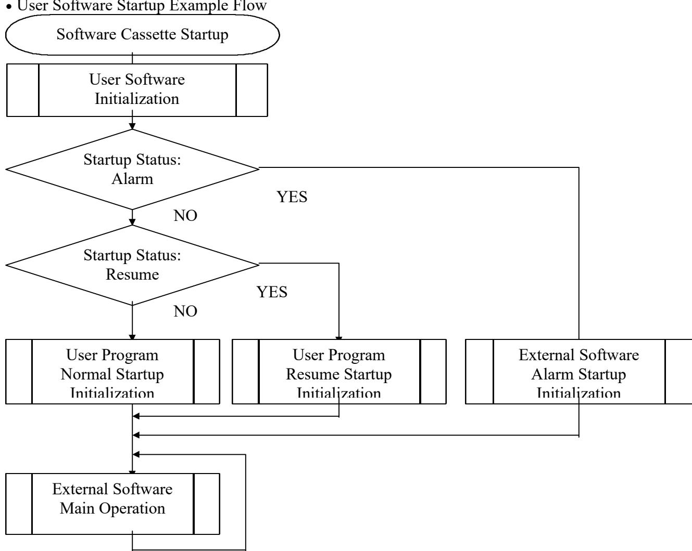
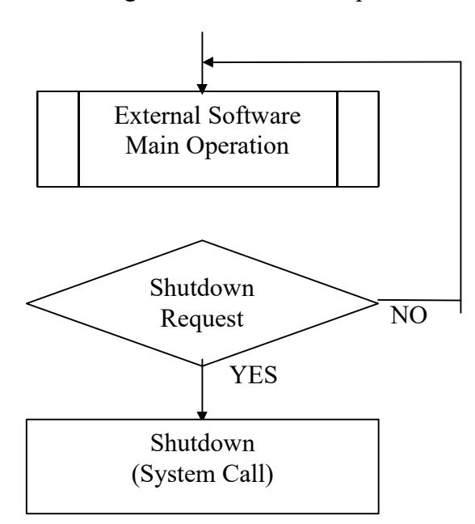

# SYSTEM PROGRAM REFERENCE MANUAL

SNK CORPORATION 1998.11.02 rel 1.0

# *REVISION HISTORY*

| Rel. 0.1 | PROVISIONAL SYSTEM PROGRAM REFERENCE MANUAL ES0 Version          | 1998.05.18 |
|----------|------------------------------------------------------------------|------------|
| Rel. 0.2 | PROVISIONAL SYSTEM PROGRAM REFERENCE MANUAL ES0 Appended Version | 1998.06.01 |
| Rel. 0.3 | PROVISIONAL SYSTEM PROGRAM REFERENCE MANUAL ES1B Version         | 1998.07.27 |
| Rel. 0.5 | SYSTEM PROGRAM REFERENCE MANUAL initial release                  | 1998.09.01 |
| Rel. 0.8 | System Program Management Area corrected                         |            |
| Rel. 1.0 | NEOGEO POCKET System Call Table added                            |            |

# **TABLE OF CONTENTS**

| REVISION HISTORY                                           | 2  |
|------------------------------------------------------------|----|
| NEOGEO POCKET SYSTEM PROGRAM                               | 5  |
| OUTLINE                                                    | 5  |
| NEOGEO POCKET SYSTEM CALL (BIOS CALL)                      | 5  |
| NEOGEO POCKET SYSTEM CALL (BIOS CALL) TABLE                | 5  |
| NEOGEO POCKET FUNCTION TABLE                               | 6  |
| MAIN CPU                                                   | 6  |
| SOUND CONTROL CPU                                          | 6  |
| 2D GRAPHICS                                                | 7  |
| HARDWARE RESOURCE DIRECTLY ACCESSIBLE THROUGH USER PROGRAM | 7  |
| MEMORY MAP                                                 | 8  |
| MAIN CPU MEMORY MAP                                        | 8  |
| NEOGEO POCKET EMULATION UNIT MEMORY MAP                    | 8  |
| USER PROGRAM STARTUP/SHUTDOWN                              | 10 |
| USER PROGRAM STARTUP PROCEDURE                             | 10 |
| USER PROGRAM SHUTDOWN PROCEDURE                            | 10 |
| SYSTEM PROGRAM MANAGEMENT AREA                             | 12 |
| SOFTWARE CASSETTE RECOGNITION HEADER INFORMATION FORMAT    | 12 |
| SYSTEM PROGRAM RESERVE AREA                                | 12 |
| WORK RAM AREA                                              | 12 |
| SYSTEM INFORMATION                                         | 12 |
| USER PROGRAM INTERRUPT OPERATION VECTOR                    | 12 |
| NEOGEO POCKET PROGRAM DEVELOPMENT ENVIRONMENT              | 14 |
| COMPUTER USED                                              | 14 |
| DEVELOPMENT LANGUAGE                                       | 14 |
| DEVELOPMENT HARDWARE                                       | 14 |

 **15**

| EMUSE CONTROLLER SOFTWARE SETTINGS                     | 15 |
|--------------------------------------------------------|----|
| STARTING UP THE DEBUGGER SOFTWARE                      | 15 |
| STEPS AFTER DEBUGER STSARTUP                           | 16 |
| CAUTIONS DEVELOPING USER PROGRAMS                      | 17 |
| COMMAND USE RESTRICTIONS                               | 17 |
| REGISTER USE RESTRICTIONS                              | 17 |
| INTERRUPT MASK REGISTER RESTRICTIONS                   | 17 |
| CLEARING WATCH DOG TIMER                               | 17 |
| RESUME FUNCTION                                        | 17 |
| INITIAL PRODUCTION SYSTEM PROGRAM BUGS                 | 17 |
| ERASURE OF FLASH MEMORY (SOFTWARE CASSETTE)            | 17 |
| BLOCK PROTECT OF FLASH MEMORY (SOFTWARE CASSETTE)      | 18 |
| SETTING INTERRUPT REQUEST LEVEL                        | 18 |
| RESUME/RTC ALARM STARTUP CASSETTE VERIFICATION         | 18 |
| DATA BACKUP DURING THE USE OF PROGRAM DEVELOPMENT TOOL | 18 |
| MONOCHROME/COLOR COMPATIBILITY                         | 18 |
| NEOGEO POCKET SOFTWARE CHECK LIST                      | 19 |

# *NEOGEO POCKET SYSTEM PROGRAM*

### *OUTLINE*

 NEOGEO POCKET system program is a program to control NEOGEO POCKET, which is a portable game console with a 16 bit micro controller.

# *NEOGEO POCKET SYSTEM CALL (BIOS CALL)*

 NEOGEO POCKET system calls are subroutines prepared to allow changes to settings managed by the system program, allow access to flash memory (for NEOGEO POCEKT), allow serial communication and other special tasks.

# *NEOGEO POCKET SYSTEM CALL (BIOS CALL) TABLE*

| VECT_SHUTDOWN     | : Shutdown (Power OFF)                                  |
|-------------------|---------------------------------------------------------|
| VECT_CLOCKGEARSET | : CPU operation clock setting                           |
| VECT_INTLVSET     | : Interrupt level setting                               |
| VECT_RTCGET       | : Real time clock - obtain time                         |
| VECT_ALARMSET     | : Real time clock - alarm setting during game operation |
| VECT_ALARMDOWNSET | : Real time clock - unit start up alarm setting         |
| VECT_SYSFONTSET   | : System font setting                                   |
| VECT_FLASHWRITE   | : Flash memory - data write                             |
| VECT_FLASHALLERS  | : Flash memory - erase all blocks                       |
| VECT_FLASHERS     | : Flash memory - erase specified blocks                 |
| VECT_FLASHPROTECT | : Flash memory - protect specified blocks               |
| VECT_GEMODESET    | : Color LCD color mode setting (color version only)     |

### (Serial Communication)

VECT\_COMINIT : Initialize serial communication BIOS VECT\_COMSENDSTART : Communication start send BIOS VECT\_COMRECIVESTART : Communication start reception BIOS VECT\_COMCREATEDATA : Communication create send data BIOS VECT\_COMGETDATA : Communication obtain reception data BIOS VECT\_COMONRTS : Communication allow RTS signal send BIOS VECT\_COMOFFRTS : Communication prohibit RTS signal send BIOS VECT\_COMSENDSTATUS : Communication obtain send status BIOS VECT\_COMRECIVESTATUS : Communication obtain reception status BIOS VECT\_COMCREATEBUFDATA : Communication obtain create data buffer BIOS VECT\_COMGETBUFDATA : Communication write reception obtaining buffer BIOS

\* Please refer to SYSTEM CALL REFERENCE MANUAL and SERIAL COMMUNCATION REFERENCE MANUAL for further information.

# *NEOGEO POCKET FUNCTION TABLE*

### *MAIN CPU*

CPU TLCS-900/H CPU core (384KHz ~ 6.144MHz) Internal ROM (System) 64KB (8/16 bit, 0 wait) Internal RAM 12KB (8/16 bit, 0 wait) Software cassette I/F 2MB maximum (8 bit 0, wait) (Use of flash memory allows data save. Area not accessible exists.) 8 bit timer 4 channels (1 channel used for Z80 interrupt generation.) (Using 2 channel allows use as a 16 bit timer.) (Use of timer 0 and micro DMA allows raster scroll effect.) Serial I/F \* 1 channel Parallel I/F \* Control buttons, serial I/O control, etc. A/D converter \* 1 channel (Power management.) Real time clock \* Watch dog timer \* CS/WAIT controller \* Interrupt controller \* Clock gear \* External power control \*

The items marked with \* are managed by the NEOGEO POCKET system program.

# *SOUND CONTROL CPU*

CPU Z80 compatible CPU core (3.072MHz) Internal RAM 4KB (8bit, 0 wait, accessible through the main CPU) Sound source 3 square wave, 1 noise modulation, total of4 sounds simultaneously out

### *2D GRAPHICS*

| Character RAM          | 8KB (8/16 bit)                                              |
|------------------------|-------------------------------------------------------------|
| Scroll VRAM            | 4KB (8/16 bit)                                              |
| Color palette RAM      | Color: 312 bytes (16 bit)                                   |
| Display area           | 160 dots x 152 dots                                         |
| Virtual display area   | 256 dots x 256 dots                                         |
| Maximum display levels | Monochrome: 8 levels (clear color + 3 levels per character) |

 Please refer to K1GE REFERENCE MANUAL and/or K2GE REFERENCE MANUAL for further information.

# *HARDWARE RESOURCE DIRECTLY ACCESSIBLE THROUGH USER PROGRAM*

l 8 bit timer 0~3 (When using the Z80 sound driver, 8 bit timer 3 can not be used.) l MicroDMA 0~3 l K1GE (monochrome)/K2GE (color) (Excluding OS control, interrupt control, LED, 2D circuit reset, general input, etc.) l Work RAM (0x4000~0x6BFF) l Watch dog timer control register (0x6F) (Clear code 0x4E only)

# *MEMORY MAP*

# *MAIN CPU MEMORY MAP*

 The main CPU memory map is shown in the figure below. Currently the work area accessible to the user is: 0x4000 ~ 0x6BFF. Also, making a resume request to the system will save 0x4000 ~ 0x5FFF. This will allow RESUME FUNCTION to be executable. Unless there is a specific need, please do not write to the Internal I/0. If incorrect values are written, the system will go down.

| 0x200000                      | ROM1                                    |
|-------------------------------|-----------------------------------------|
| Emulation                     | (2 MB) & (8 bit bus) ROM2               |
| Monitor ROM 0x3FFFFF 0x800000 | (64 KB)                                 |
| Emulation Specific Cassette   | (2 MB) (8 bit bus)                      |
| Monitor RAM 0x9FFFFF 0xFF0000 | (64 KB)                                 |
| Internal ROM 0xFFFFFF         | (64 KB) (16 bit bus) < System Program > |

# *USER PROGRAM STARTUP/SHUTDOWN*

# *USER PROGRAM STARTUP PROCEDURE*

 Please follow the steps below for NEOGEO POCKET compatible user software startup. User software startup begins from the startup address listed in the exterior software header. As startup conditions, there are: Normal Startup (Startup Status Flag: Power SW ON), Resume Startup and RTC Alarm (Startup Status Flag: Alarm). Please check the Startup Status Flag (User\_Boot) and run the appropriate program.

### · User Software Startup Example Flow

There are foreseeable changes in the hardware, system version up, and other factors resulting in additional startups. Please program the software to operate with normal startup routines for other startup statuses.

\*Please refer to SYSTEM WORK REFERENCE MANUAL for further information on startup statuses. *USER PROGRAM SHUTDOWN PROCEDURE*

 If a shutdown request is generated by the system during operation of NEOGEO POCKET compatible software, please use the following steps for shutdown.

Because there are several situations which result in the generation of a shutdown request; Low Voltage Shutdown, Inactivity Shutdown and Power SW shutdown; when it is convenient for the user program, check the shutdown request flag (User\_Shutdown) and shutdown (system call) the system.

### · User Program Shutdown Example Flow

As one of the operations of shutdown, it may be necessary to save data. If this is the case, please return to the main operation to save the data and quickly call the shutdown function afterwards. During a shutdown request from low voltage, the system begins to drain the secondary power supply. If a user makes a selection during saving, please take into account the time limit allowed during selection.

With the change of hardware specification, system version ups, and other reasons, there is the possibility of additional shutdown requests. Please take other shutdown requests into account by shutting the system down with the use of system call.

 When the Power SW is pressed, the user program is forced to shutdown in the current version of the system.

\*Please refer to SYSTEM WORK REFERENCE MANUAL for further information on shutdown operation.

# *SYSTEM PROGRAM MANAGEMENT AREA*

# *SOFTWARE CASSETTE RECOGNITION HEADER INFORMATION FORMAT*

The area from the beginning to 40H of the software cassette is reserved for use as software cassette recognition header information.

| ADDRESS  | LENGTH   | CONTENT                                                      |
|----------|----------|--------------------------------------------------------------|
| 0200000H | 28 Bytes | Software cassette recognition code *                         |
| 020001CH | 4 Bytes  | Software cassette startup address (Specify in little endian) |
| 0200020H | 2 Bytes  | Software cassette ID code (Specify in little endian BCD)     |
| 0200022H | 1 Byte   | Software cassette ID sub-code (version)                      |
| 0200023H | 1 Byte   | Compatible system code (Monochrome = 0x00 / Color = 0x10)    |
| 0200024H | 12 Bytes | Software cassette title name (Specify in ASCII)              |
| 0200030H | 16 Bytes | (Reserved: please write in 0)                                |

\* Software recognition code " COPYRIGHT BY SNK CORPORATION" (SNK use) or " LICENSED BY SNK CORPORATION" (Third party use) \* Software provisional development ID code = 0x0000 \* Placement address…0x200000 = software cassette ROM address…0x000000

# *SYSTEM PROGRAM RESERVE AREA*

 The last 1 block (16KB) of the software cassette is reserve for the system program. Please DO NOT use this area for program code, data or backup area.

# *WORK RAM AREA*

1 KB in the work RAM area 0x6C00 ~ 0x6FFF is used by the system program. The area usable by the user program, including stack area, is 0x4000 ~ 0x6BFF. The area 0x4000 ~ 0x5FFF is saved when the user program request the resume function and the system "eye catch" is not displayed. (This excludes the case when another program has destroyed this area.)

# *SYSTEM INFORMATION*

| Battery_voltage | (0x6f80) | : Main power voltage                |
|-----------------|----------|-------------------------------------|
| Sys_Lever       | (0x6f82) | : Controller button input values    |
| Language        | (0x6f87) | : Language code                     |
| User_Shutdown   | (0x6f85) | : Shutdown request flag             |
| User_Boot       | (0x6f84) | : Startup condition flag            |
| User_Answer     | (0x6f86) | : Response (request) to system flag |
| OS_Version      | (0x6f91) | : System program version            |

\* Please refer to SYSTEM WORK REFERENCE MANUAL for further information.

The table below shows the interrupts available to the user program.

| Address | Contents                                                | Micro DMA |
|---------|---------------------------------------------------------|-----------|
| 06FB8H  | Software Interrupt (SWI 3)                              |           |
| 06FBCH  | Software Interrupt (SWI 4)                              |           |
| 06FC0H  | Software Interrupt (SWI 5)                              |           |
| 06FC4H  | Software Interrupt (SWI 6)                              |           |
| 06FC8H  | RTC Alarm Interrupt (During normal operation)           | 00AH      |
| 06FCCH  | Vertical Blanking Interrupt                             | 00BH      |
| 06FD0H  | Interrupt From Z80                                      | 00CH      |
| 06FD4H  | Timer Interrupt (8 bit timer 0)                         | 010H      |
| 06FD8H  | Timer Interrupt (8 bit timer 1)                         | 011H      |
| 06FDCH  | Timer Interrupt (8 bit timer 2)                         | 012H      |
| 06FE0H  | Timer Interrupt (8 bit timer 3)                         | 013H      |
| 06FE4H  | Serial Transmission Interrupt (In principle not usable) | 018H      |
| 06FE8H  | Serial Reception Interrupt (In principle not usable)    | 019H      |
| 06FECH  | (Reserved)                                              |           |
| 06FF0H  | End Micro DMA Interrupt (Micro DMA 0)                   |           |
| 06FF4H  | End Micro DMA Interrupt (Micro DMA 1)                   |           |
| 06FF8H  | End Micro DMA Interrupt (Micro DMA 2)                   |           |
| 06FFCH  | End Micro DMA Interrupt (Micro DMA 3)                   |           |

\* It is forbidden to prohibit Vertical Blanking Interrupt (Interrupt level 4) because the operation has system involvement.

\* Serial Reception Interrupt and Serial Transmission Interrupt is used during Serial Communication BIOS (system Call). In principle, use of Serial Communication BIOS outside of Expanded Library is prohibited.

# *NEOGEO POCKET PROGRAM DEVELOPMENT ENVIRONMENT*

### *COMPUTER USED*

PC/AT compatible

OS CPU Memory Display Resolution Windows 95 / NT 4.0 486 DX2 (100MHz) or better 95: 16MB or more NT: 32MB or more VGA (640 x 480 x 256 colors) or more

# *DEVELOPMENT LANGUAGE*

Toshiba Micro-controller development language (C compiler × C-Like compiler × Assembler)

# *DEVELOPMENT HARDWARE*

NEOGEO PCKET Emulation Unit (ROM emulator EMUSE built in)

# *STARTING UP THE NEOGEO POCKET PROGRAM DEVELOPMENT TOOL (DEBUGGER)*

# *EMUSE CONTROLLER SOFTWARE SETTINGS*

 There are 3 directories; **EMUDIR**, **EMUTRG**, and **workspace** under the **setup file** directory. After installing the necessary development software, please copy these three directories under C:\EMUSE. Set up files necessary will be overwritten. Please confirm that the environment setting is as below when the EMUSE control software is run.

| CPU type                  | TLCS900H   |
|---------------------------|------------|
| ROM type                  | 27C4000    |
| Data bus width            | HALT WORD  |
| Initial setup file        | K1INIT.ASM |
| Interrupt setup file      | Not used   |
| ROM1 start address        | 200000     |
| ROM2 start address        | 300000     |
| Monitor ROM start address | 3F0000     |
| Monitor RAM start address | 9F0000     |

# *STARTING UP THE DEBUGGER SOFTWARE*

- 1. Install the necessary development software (Development Language, REDU Debugger, EMUSE Control Software, etc.).
- 2. Connect the host computer to the NEOGEO POCKET Emulation Unit using the two cables (COM1, LPT1).
- 3. Connect the NEOGEO POCKET Emulation Unit and the NEOGEO POCKET unit with two cables (K1-DEV, D1GA200FS).
- 4. Insert the Emulation Specific Software Cassette in to the software cassette connection port of the NEOGEO POCKET Emulation Unit. (DO NOT remove the cassette until the debugger has ended.)
- 5. Turn the power ON for the NEOGEO POCKET Emulation Unit.
- 6. Select "EMUSE Control Soft" from the WINDOWS startup menu.
- 7. Click on the "run debugger" button and load the EMUSE monitor.
- 8. From the profile selection, choose "start debugger" to start the debugger software.

\* Please refer to the manual provided by Midoriya Denki Corporation for further information on the debugger.

# *STEPS AFTER DEBUGER STSARTUP*

 After the debugger start up, define \_\_STARTUP label in the user program as an outside symbol. Add the following code below the \_\_STARTUP label. Then load the absolute file from the debugger or specify the \_\_STARTUP label as 0xff1800 and run the program with the GO command (This method is valid for REDU debugger version 2.1 or later).

\_\_STARTUP: NOP JP 0xff1800

 The window size is minimized during user program start up. After initial setup, and after displaying on the LCD is possible, please define the display area.

(H origin + H size 160, V origin + V size 152)

 The software starts up with interrupts prohibited (DI). Please set the interrupt vectors (0x6FB8~) with the addresses where the interrupt operation function exists and the interrupt level. Next set interrupt permission to (EI 0) allow interrupt operations.

 Please be aware that out of the interrupts public to the user, the vertical blanking operation function (0x6FCC) permission is set to "allow" normally.

# *CAUTIONS DEVELOPING USER PROGRAMS*

# *COMMAND USE RESTRICTIONS*

Please DO NOT use the "halt" command because voltage management is done by the system program.

# *REGISTER USE RESTRICTIONS*

Unless necessary (i.e. system calls, library, etc.), please DO NOT use register bank 3. The system program uses register bank 3.

# *INTERRUPT MASK REGISTER RESTRICTIONS*

Other than during interrupt operations, when the user program is in normal operation, setting high values in mask register (IFF2 ~ IFF0) will interfere with the power management by the system program. It is not prohibited to set high values in the interrupt mask register during initialization, but soon afterwards, please set the values to low (EI 0 ~ 2).

# *CLEARING WATCH DOG TIMER*

 A Watch Dog Timer exists to detect the user program if it starts destroying itself. There is a need to clear the Watch Dog Timer Control Register (0x6F) with the clear code (0x4E) periodically.

# *RESUME FUNCTION*

Requesting resume function to the system saves the values in work RAM area 0x4000 ~ 0x5FFF. This area is destroyed when another software from cassette or internal software is run. If resume operation request is to be made with the use of User\_Answer of the System Work, it is necessary to do the following on startup. At startup check the resume startup flag, User\_Boot, and verify the validity of the data. If the data is valid, operations to resume user software should be taken. (Please refer to SYSTEM WORK REFERENCE MANUAL.)

# *INITIAL PRODUCTION SYSTEM PROGRAM BUGS*

Sudden change or interruption in the main power supply (rapid cyclical removal and insertion of batteries, etc.) may result in the inability of the system to shutdown with the depression on the main power SW. As a measure to correct this problem, please call SYS\_PATCH (Please refer to SYSTEM LIBRARY REFERENCE MANUAL for further information.) when starting the user program from the software cassette.

# *ERASURE OF FLASH MEMORY (SOFTWARE CASSETTE)*

 The system call VECT\_FLASHERS will only erase up to the 32nd block. If higher blocks are requested, it will result in erasure of random blocks. If the need exists to erase blocks higher than 32nd , please use the system library call CLR\_FLASH\_RAM. (Please refer to SYSTEM LIBRARY REFERENCE MANUAL for further information.

# *BLOCK PROTECT OF FLASH MEMORY (SOFTWARE CASSETTE)*

 The system call VECT\_FLASHPROTECT will only protect up to the 32nd block. If higher blocks are requested, it will result in protection of random blocks. DO NOT specify blocks higher than 32 for protection. Please be aware, if a block protect is done once, there is no way of removing this protection.

# *SETTING INTERRUPT REQUEST LEVEL*

 Interrupt requests produced during setting of the interrupt request level by the use of the system call VECT\_INTLVSET is held even during when interrupts are prohibited. Thus it is necessary to stop the system including timers and arrest the production of interrupts.

 If it is inappropriate to do the above, the use of system library INT\_LV\_SET during setting of interrupt request levels will allow clearing of the interrupt requests. (Please refer to SYSTEM LIBRARY REFERENCE MANUAL for further information.)

# *RESUME/RTC ALARM STARTUP CASSETTE VERIFICATION*

 Software cassette ID code is used for verifying the version of the resume/RTC alarm startup cassette. The software cassette ID sub-code is not used. If a difference of versions results in incorrect resume startup, it is necessary to compare the saved data for exception handling.

# *DATA BACKUP DURING THE USE OF PROGRAM DEVELOPMENT TOOL*

When the program development tool is to be used for data backup, please write or erase blocks of the emulation unit software cassette from 0x800000, disregarding the monitor RAM area blocks for temporary use. If the software cassette is used prior to release, please make changes to area from 0x200000 onward.

(Please refer to NEOGEO POCKET Emulation Unit Memory Map in this manual.)

# *MONOCHROME/COLOR COMPATIBILITY*

 If the user program is color compatible, please evaluate OS\_Version of the system information to determine if the hardware is monochrome or color and run the software appropriately. If the software is only monochrome compatible, software recognition header information's compatible system code is 0x00, please do not use any of the K2GE expanded functionality even when the hardware is color compatible.

 If the system information is color compatible, and the system code of the software is 0x00, the user program runs in K1GE upper palette compatible mode. If the system code of the software is 0x10, the user program will run in K2GE mode. Please use the system call VECT\_GEMODESET to switch between K1GE upper palette compatible mode or K2GE mode when the software is color compatible. (Please refer to System Program Management Area in this manual, Vector Definitions in SYSTEM CALL REFERENCE MANUAL, and System Work Definitions in SYSTEM WORK REFERENCE MANUAL.)

# *NEOGEO POCKET SOFTWARE CHECK LIST*

The list below is a check list of articles to be followed before master submission.

During user program startup, is the new system library subroutine SYS\_PATCH called?

 (Please refer to Cautions Developing User Programs in this manual, and Subroutine Definitions in SYSTEM LIBRARY REFERENCE MANUAL)

 During user program initialization, excluding interrupt operations, is the value of the interrupt maskable register of normal operation (IIF2 ~ IIF0) less than or equal to 2?

(Please refer to Cautions Developing User Program in this manual.)

 During initialization and other operations which require long periods of time, is the watch dog timer cleared (Maximum cycle of approximately 100 ms)?

(Please refer to Cautions Developing User Program in this manual.)

 When using the resume function, is the User\_Boot resume startup flag and the validity of the saved data checked? (Unless the same game is normally started up, the saved data is easily destroyed.)

 (Please refer to Cautions Developing User Program in this manual and System Work Definitions in SYSTEM WORK REFERENCE MANUAL.)

 When using saved data in the software cassette, is the validity of the data checked with the use of check sum and other methods? (Depressing the power SW during a save produces an error message from the flash memory side and the save is not concluded. It is recommended to retry several times when the error message is produced. Also there is a need for exception handling when the data is not valid.)

 (Please refer to Vector Definitions in SYSTEM CALL REFERENCE MANUAL and Subroutine Definitions in SYSTEM LIBRARY REFERENCE MANUAL.)

 When the user program starts up with an undefined startup flag (User\_Boot) value, does the program start up as usual?

 (Please refer to User Program Startup/Shutdown in this manual and System Work Definitions in SYSTEM WORK REFERENCE MANUAL.)

 When the user program is shut down with an undefined shutdown request flag (User\_Shutdown) is it shutdown (system call)?

 (Please refer to User Program Startup/Shutdown in this manual and System Work Definitions in SYSTEM WORK REFERENCE MANUAL.)

 During user program shutdown with a shutdown request flag (User\_Shutdown) from main power off, is the only method used shutdown with system call? (In the current system program, main power off shutdown is a forced OFF in case of bugs in the software which does not allow normal shutdown. To take further updates of system program into consideration, please only use the system call shutdown when the request arises. The assumption is that when the main power is turned off, and unlike the batteries dying, the user decision is involved.)

 (Please refer to User Program Startup/Shutdown in this manual and System Work Definitions in SYSTEM WORK REFERENCE MANUAL.)

 Is the fifth bit of User\_Answer the system request flag cleared? (The bit is currently reserved, but undetermined values may change the operation timing. Because the value may be manipulated by library functions in the future, please input the value 0 during user program startup. Also for other flags not defined at this time, please input 0 for future considerations.)

(Please refer to System Work Definition in SYSTEM WORK REFERENCE MANUAL.)

 Is the last block of the software cassette (16 KB) being used as a program, data, save area or protected? (Please refer to Flash Memory Use Restriction in FLASH MEMORY REFERENCE MANUAL.)

 Is erase/write pair occurring in the same memory cell on the software cassette often? (One of the characteristics of flash memory is the limited number of erase/write possible. If saving is necessary frequently, it is necessary to save to different memory cells and erasing a block of data to conserve the number of erase/write.)

(Please refer to Flash Memory Write Restriction in FLASH MEMORY REFERENCE MANUAL.)

 Are all system calls used during serial communication used by subroutine call (SYSTEM\_CALL) rather than software interrupt (SWI 1)? (When quick response is necessary, interrupt generated in serial communication, software interrupts may obstruct the interrupt requiring quick response.)

 (Please refer to Using System Call in SYSTEM CALL REFERENCE MANUAL and Cautions with Serial Communication BIOS Use in SERIAL COMMUNICATION REFERENCE MANUAL.)

 Is the user program created with the assumption that data transmission and reception is not synchronized when using serial communication? (There is no method to synchronize vertical blanking periods of the two units connected. The amount of operations each system is handled during operation over flow is different for each of the system.)

 When the user program is running, does the system restart and display illegal initialization screen? (The restart of the system may be due to the following: watchdog circuit reset, undefined command operation, or system managed system RAM may be destroyed by the user program.)