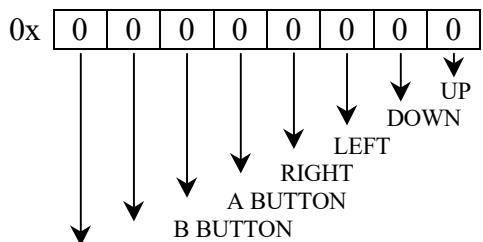
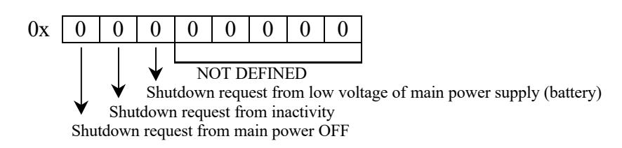
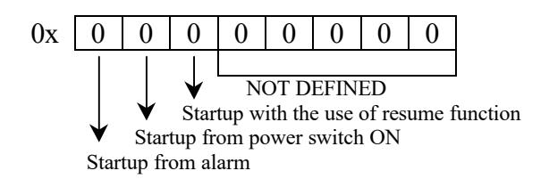
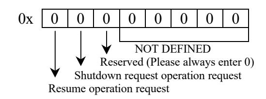

*SYSTEM WORK REFERENCE MANUAL*

SNK CORPORATION 1998.10.26 rel. 1.0

# *TABLE OF CONTENTS*

| PREFACE   | ...........................................................................................................................................3                           |
|-----------|------------------------------------------------------------------------------------------------------------------------------------------------------------------------|
| Language  | .....................................................................................................................................................................4 |
| User_Boot | ....................................................................................................................................................................6  |

# *PREFACE*

Materials covered in this manual are based on the NEOGEO POCKET production version. Please understand that with system program version updates, the reference manual material will change.

# *SYSTEM WORK DEFINITION*

EQU definitions of the system work and bit flag are listed in the header file "SYSTEM.INC."

**Address: 0x6f80 Length: word Attribute: Read Only**

This work contains the voltage of the main battery measured periodically by the system. The value range is 0H~3FFH.

**Address: 0x6f82 Length: byte Attribute: Read Only**

This work contains the "chattering" filtered "Lever" inputs. Each bit has the following information:

OPTION BUTTON (C BUTTON NEOGEO controller when connected) (D BUTTON NEO GEO controller when connected)

**Address: 0x6f87 Length: byte Attribute: Read Only**

It stores the language code chosen. Currently, 0 is for Japanese and 1 is for English.

**Address: 0x6f85 Length: byte Attribute: Read Only**

This is the bit flag work to request the user for shutdown.

Power ON/OFF operation of the NEOGEO POCKET is managed by the system. Please check these shutdown request bits to initiate shutdown quickly if the request arises.

Please use the system call VECT\_SHUTDOWN for shutdown operation.

Currently, the upper 3 bits are used. Since it is possible that lower bits may be used for other designations, please initiate shutdown if any of these bits are 1.

## **Main Power OFF Shutdown Request**

Bit Equation: MP\_SHUTDOWN\_REQ

This request arises when the main power is turned OFF through the use of the power switch. This bit is checked by the system and shutdown is initiated. The system is shutdown before the user can evaluate the bit.

### **Inactivity Shutdown Request**

Bit Equation: TIME\_SHUTDOWN\_REQ

This request arises from prolonged inactivity (i.e. No inputs from the control panel). If the bit is not set in the User\_Answer (defined later) work , the request is not generated. Currently, ten minutes of inactivity warrants shutdown. If the request arises, please prepare for shutdown and use the system call VECT\_SHUTDOWN.

# **Low Voltage Shutdown Request**

Bit Equation: BAT\_SHUTDOWN\_REQ

This request arises when the battery voltage falls and system operation is affected. Please be aware that if this request is continually ignored and the voltage continues to fall, the system will shut itself down.

If the request arises, please prepare for shutdown and use the system call

VECT\_SHUTDOWN.

**Address: 0x6f84 Length: byte Attribute: Read Only**

This is the bit flag work which stores the startup status.

## **Alarm Startup**

Bit Equation: ALARM\_BOOT\_REQ

Designates that startup was initiated by the alarm interrupt.

This bit is set only when the system starts up after the user sets the alarm interrupt by using the system call "VECT\_ALARMDOWNSET."

## **Power ON Startup**

Bit Equation: POWER\_BOOT\_REQ

Designates normal power switch ON startup.

## **Resume Function Startup**

Bit Equation: RESUME\_BOOT\_REQ

An area of the work RAM (0x4000 ~ 0x5FFF) is saved with data before the last shutdown. There are several conditions that need to be met before this startup can occur properly.

× The startup software is the same as the software which requested the resume startup (by setting the proper value in the User\_Answer work) the last time the power was turned OFF. × No other software or internal system software (excluding system daily alarm) was run. If another software was run, the data in the work RAM is destroyed and the RAM data is not preserved. × The battery and the lithium battery have the required voltage, and data in the work RAM may be saved during power OFF.

During resume startup, the system "eye catch" is not displayed and the user software is immediately started up. Please be aware that the possibility of both this bit and the alarm startup bit being ON simultaneously exists. This resume function only saves the RAM data as is. There is a necessity for the user software to verify the validity of the data by check sum and other methods.

**Address: 0x6f86 Length: Byte Attribute: Read / Write**

This is the bit flag work for requests to the system from the user.

## **Resume Operation**

Bit Equation: RESUME\_ANS

Specifies the use or non-use of the resume function. Setting the bit to 1 specifies the use of the resume function.

If resume function is used, an area of the work RAM (0x4000 ~ 0x5FFF) is saved at the time power is turned OFF. If the same game software as the one which set the bit for this function is inserted into the unit, the next time the power is turned on the game program starts without displaying the system "eye catch."

If the resume function is used, please check the resume startup bit of the User\_Boot, verify the validity of the saved data, and run the necessary operations for resuming the game.

## **Shutdown Request Operation**

Bit Equation: TIMER\_SHUTDOWN\_ANS

Specifies whether shutdown requests are generated or not from the system with prolonged inactivity (10 minutes of no input from the control panel). Setting the bit to 1 turns the request generation ON.

**ALWAYS set this bit in the user program as possible.**

**Address: 0x6f91 Length: Byte Attribute: Read Only**

Contains the version information of the NEOGEO POCKET system program.

 Less than 0x10 … NEOGEO POCKET system program monochrome LCD version More than and including 0x10 …NEOGEO POCKET system program color LCD version

Please do not compare the OS\_Version value to be the same as 0x00, but as less than (or more than and including) 0x10.

# *REVISION HISTORY*

| rel 0.1 | Initial release                            | 1998/05/18 |
|---------|--------------------------------------------|------------|
| rel 0.2 | Modified                                   | 1998/07/15 |
| rel 0.3 | Resume function added (ES1C version)       | 1998/07/27 |
| rel 0.8 | Preface modified                           |            |
| rel 0.9 | “OS_Version” added                         | 1998/09/25 |
| rel 1.0 | Monochrome/color use/not usable mark added | 1998/10/26 |